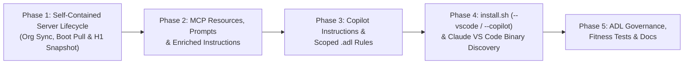

# 🧭 Plan: Making Total Recall Ready for Visual Studio / VS Code Plugins with Claude Models

Status: **proposal** · Date: **2026-10-30** · Target baseline: **`total-recall` v1.3.4** (`plugins/total-recall/`, commit `f7e8656`)

---

## ⚡ Executive Verdict: Is It Ready Today?

**Short answer: Partially — the 22 MCP tools work over stdio if manually wired, but the lifecycle workflows (`PostToolUse` org-vault git sync, `SessionStart` index + ADL architecture summary injection, `SessionEnd` H1 personal-vault git snapshot, `PreCompact` learning extraction, and `SKILL.md` guidance) are NOT ready out of the box.**

Readiness depends on **which Visual Studio / VS Code plugin** you use with Claude models (Claude Sonnet 4.x / Opus 4.x):

| Visual Studio / VS Code Plugin (with Claude Models) | Readiness | What Works Today | What Is Broken or Missing Today |
|---|---|---|---|
| **1. GitHub Copilot in VS Code** *(Agent Mode / Chat with Claude Sonnet or Opus)* | ⚠️ **Partial (Manual MCP only; broken org sync & lifecycle hooks)** | All **22 MCP tools** (`17` core + `5` spec-driven ADL tools registered in [`src/server.ts`](file:///home/adrianb/_/ai-assisted/github/total-recall/plugins/total-recall/src/server.ts#L48-L74)) work over stdio once manually added to `.vscode/mcp.json` or user `mcp.json`. | 1. **MCP config schema mismatch**: `total-recall` ships [`.mcp.json`](file:///home/adrianb/_/ai-assisted/github/total-recall/plugins/total-recall/.mcp.json) with `"mcpServers"`, whereas VS Code requires `.vscode/mcp.json` (or user `mcp.json`) with `"servers"`.<br>2. **Silent org-vault sync failure**: [`storeMemory`](file:///home/adrianb/_/ai-assisted/github/total-recall/plugins/total-recall/src/tools/store.ts#L319), [`updateMemory`](file:///home/adrianb/_/ai-assisted/github/total-recall/plugins/total-recall/src/tools/mutate.ts#L110), and [`deleteMemory`](file:///home/adrianb/_/ai-assisted/github/total-recall/plugins/total-recall/src/tools/mutate.ts#L195) only write/unlink `.md` files locally; the fail-closed `privacyCheck` (`[TR-D3]`) and `git add/commit/push` (`[TR-W5]`, `[TR-W6]`) live **exclusively** in the `PostToolUse` hook ([`sync-org-memory.sh`](file:///home/adrianb/_/ai-assisted/github/total-recall/plugins/total-recall/hooks/scripts/sync-org-memory.sh)). Because Copilot does not run `hooks/hooks.json`, `org`-tagged writes never run the repo-boundary privacy check and never push to git.<br>3. **No `SessionStart` hook**: [`pull-org-vault.sh`](file:///home/adrianb/_/ai-assisted/github/total-recall/plugins/total-recall/hooks/scripts/pull-org-vault.sh), [`load-memory-index.sh`](file:///home/adrianb/_/ai-assisted/github/total-recall/plugins/total-recall/hooks/scripts/load-memory-index.sh) (including [`architecture-summary.mjs`](file:///home/adrianb/_/ai-assisted/github/total-recall/plugins/total-recall/hooks/scripts/architecture-summary.mjs)), and [`check-sync-errors.sh`](file:///home/adrianb/_/ai-assisted/github/total-recall/plugins/total-recall/hooks/scripts/check-sync-errors.sh) never fire.<br>4. **No `SessionEnd` H1 snapshot**: [`session-end.sh`](file:///home/adrianb/_/ai-assisted/github/total-recall/plugins/total-recall/hooks/scripts/session-end.sh#L80-L89) auto-commits `~/.total-recall/personal-vault/.git` on teardown; stdin-driven [`shutdown()`](file:///home/adrianb/_/ai-assisted/github/total-recall/plugins/total-recall/src/index.ts#L38-L44) does not.<br>5. **Skills & `.adl` edit hook ignored**: Copilot does not load `skills/*/SKILL.md` or fire [`architecture-change.sh`](file:///home/adrianb/_/ai-assisted/github/total-recall/plugins/total-recall/hooks/scripts/architecture-change.sh). |
| **2. GitHub Copilot in Visual Studio IDE** *(VS 2022 17.14+ / VS 2026 Agent Mode with Claude)* | ⚠️ **Partial (Manual MCP only; broken org sync & lifecycle hooks)** | Standard stdio MCP tools work if `.mcp.json` is placed at the solution root or `%USERPROFILE%\.mcp.json`. | Same lifecycle gaps as VS Code Copilot: **no `PostToolUse` org-vault git push**, **no `SessionStart` org git pull or index/architecture summary injection**, **no `SessionEnd` H1 personal-vault snapshot**, **no `.adl` edit reminders**, and **no `SKILL.md` loading**. |
| **3. Claude Code Extension for VS Code** *(`anthropic.claude-code`)* | 🟡 **Mostly Ready (with one CLI `PATH` trap)** | Loads [`.claude-plugin/plugin.json`](file:///home/adrianb/_/ai-assisted/github/total-recall/plugins/total-recall/.claude-plugin/plugin.json), [`.mcp.json`](file:///home/adrianb/_/ai-assisted/github/total-recall/plugins/total-recall/.mcp.json), both `SKILL.md` files, and [`hooks/hooks.json`](file:///home/adrianb/_/ai-assisted/github/total-recall/plugins/total-recall/hooks/hooks.json). | As noted in [`INSTALL.md:8`](file:///home/adrianb/_/ai-assisted/github/total-recall/plugins/total-recall/INSTALL.md#L8), the extension ships its own `claude` binary under `~/.vscode/extensions/anthropic.claude-code-*/` (not on `PATH`). On machines without a global `claude` CLI install:<br>1. [`install.sh`](file:///home/adrianb/_/ai-assisted/github/total-recall/plugins/total-recall/install.sh) skips Step 4 (MCP registration).<br>2. [`extract-and-store-memories.sh:31`](file:///home/adrianb/_/ai-assisted/github/total-recall/plugins/total-recall/hooks/scripts/extract-and-store-memories.sh#L31) (`command -v claude`) silently exits `0`, disabling `PreCompact` memory extraction. |

---

## 🔍 Root-Cause Analysis (Verified Against `v1.3.4` Code & ADL Rules)

### Gap 1 — Split-Brain Org-Vault Write Path (`store.ts` / `mutate.ts` vs `sync-org-memory.sh`)
In [`system.adl`](file:///home/adrianb/_/ai-assisted/github/total-recall/plugins/total-recall/architecture/adl/system.adl) and [`workflows.adl`](file:///home/adrianb/_/ai-assisted/github/total-recall/plugins/total-recall/architecture/adl/workflows.adl), the **Org Sync Saga** (`org-sync-saga`) is split across two processes:
1. **MCP Stdio Server ([`src/tools/store.ts:319`](file:///home/adrianb/_/ai-assisted/github/total-recall/plugins/total-recall/src/tools/store.ts#L319), [`src/tools/mutate.ts:110,195`](file:///home/adrianb/_/ai-assisted/github/total-recall/plugins/total-recall/src/tools/mutate.ts#L110))**: writes or unlinks the `.md` file in `~/.total-recall/org/org-vault/` and updates `memIndex`. It performs **zero** git operations and only emits a non-blocking personal-vault token warning (`SECRET_TOKEN_RE`).
2. **Lifecycle Hook ([`hooks/scripts/sync-org-memory.sh`](file:///home/adrianb/_/ai-assisted/github/total-recall/plugins/total-recall/hooks/scripts/sync-org-memory.sh) → [`scripts/sync-org-memory.mjs`](file:///home/adrianb/_/ai-assisted/github/total-recall/plugins/total-recall/scripts/sync-org-memory.mjs))**: triggered by `PostToolUse` on `mcp__plugin_total-recall_total-recall__(store_memory|update_memory|delete_memory)`. This script owns `~/.total-recall/org/.sync-queue`, the fail-closed [`privacyCheck`](file:///home/adrianb/_/ai-assisted/github/total-recall/plugins/total-recall/src/privacy-filter.ts) (`[TR-D3]`), the H2 tree-wipe tripwire (`[TR-W6]`), `git add/commit/push`, and the `.sync-ok` marker (`[TR-W5]`).

**Impact in VS Code / Visual Studio Copilot**:
Because Copilot Agent Mode does not execute `hooks/hooks.json`, calling `store_memory({ tags: ["org"], ... })` from a Claude model inside Copilot writes the file into `~/.total-recall/org/org-vault/` locally, **never runs `privacyCheck`**, and **never commits or pushes to `orgRepo`**.

### Gap 2 — `SessionStart` Responsibilities Are Hook-Only
At session start, [`hooks/hooks.json`](file:///home/adrianb/_/ai-assisted/github/total-recall/plugins/total-recall/hooks/hooks.json#L3-L28) runs four scripts sequentially:
1. [`pull-org-vault.sh`](file:///home/adrianb/_/ai-assisted/github/total-recall/plugins/total-recall/hooks/scripts/pull-org-vault.sh) — clones or `git pull --ff-only` the shared org repo and touches `~/.total-recall/.org-updated` so [`startAutoReconcile()`](file:///home/adrianb/_/ai-assisted/github/total-recall/plugins/total-recall/src/auto-reconcile.ts) knows to re-scan.
2. [`build-memory-index.sh`](file:///home/adrianb/_/ai-assisted/github/total-recall/plugins/total-recall/hooks/scripts/build-memory-index.sh) — builds `~/.total-recall/.index-cache.txt` if missing.
3. [`load-memory-index.sh`](file:///home/adrianb/_/ai-assisted/github/total-recall/plugins/total-recall/hooks/scripts/load-memory-index.sh) — injects `.index-cache.txt` plus the spec-driven [`architecture-summary.mjs`](file:///home/adrianb/_/ai-assisted/github/total-recall/plugins/total-recall/hooks/scripts/architecture-summary.mjs) block (`specDriven.sessionSummary`) into `hookSpecificOutput.additionalContext`.
4. [`check-sync-errors.sh`](file:///home/adrianb/_/ai-assisted/github/total-recall/plugins/total-recall/hooks/scripts/check-sync-errors.sh) — warns if `~/.total-recall/org/.sync.log` is newer than `.sync-ok`.

**Impact in VS Code / Visual Studio Copilot**:
When [`main()`](file:///home/adrianb/_/ai-assisted/github/total-recall/plugins/total-recall/src/server.ts#L77-L107) boots the MCP server, it calls `loadIndexes()`, `reconcileIndex()`, `recalcIdfNow()`, and `startAutoReconcile()`. It **never pulls the org vault**, and **nothing injects `.index-cache.txt`, the ADL architecture summary, or sync-error warnings into the model's context**.

### Gap 3 — `SessionEnd` H1 Personal-Vault Git Snapshot Is Hook-Only
In [`hooks/scripts/session-end.sh:80-89`](file:///home/adrianb/_/ai-assisted/github/total-recall/plugins/total-recall/hooks/scripts/session-end.sh#L80-L89) (H1 durability control added after the 2026-07-31 vault loss incident), if `~/.total-recall/personal-vault/.git` exists, `session-end.sh` runs `git add -A && git commit -q -m "session snapshot ..."`.
- In VS Code / Visual Studio Copilot, the MCP server shuts down when `process.stdin` emits `end`/`close` ([`src/index.ts:38-58`](file:///home/adrianb/_/ai-assisted/github/total-recall/plugins/total-recall/src/index.ts#L38-L58)), which runs `flushPending()` and `flushEmbeddings()` but **never commits the H1 personal-vault snapshot**.

### Gap 4 — MCP Server Surface Uses `tools` Only (No `resources` or `prompts`)
[`src/server.ts:51-62`](file:///home/adrianb/_/ai-assisted/github/total-recall/plugins/total-recall/src/server.ts#L51-L62) constructs `new McpServer({ name: 'total-recall', version }, { instructions })` and registers 22 tools, with a terse 4-line `instructions` banner.
- VS Code GitHub Copilot Agent Mode natively supports **MCP Resources** (`resources/list`, `resources/read` — allowing agents and users to attach `total-recall://index`, `total-recall://architecture-summary`, `total-recall://sync-status`) and **MCP Prompts** (`prompts/list`, `prompts/get` — exposed as `/mcp.total-recall.<prompt>` slash commands in Copilot Chat).
- Neither MCP Resources nor MCP Prompts are registered today.

### Gap 5 — Missing Copilot Instructions, Scoped `.adl` Rules & `--vscode` Installer
- Commit `ae57521` (`v1.0.133`) removed the legacy `--copilot` CLI flag and `hooks.copilot.json`.
- [`install.sh`](file:///home/adrianb/_/ai-assisted/github/total-recall/plugins/total-recall/install.sh) has no `--vscode` / `--copilot` flag to write VS Code's `User/mcp.json` (`"servers"` schema) or Visual Studio's `.mcp.json`.
- Copilot does not load `skills/memory-workflow/SKILL.md`, `skills/spec-driven-workflow/SKILL.md`, or `hooks/scripts/architecture-change.sh` unless wired via `.github/copilot-instructions.md` and `.github/instructions/adl-architecture.instructions.md` (`applyTo: "**/*.adl"`).
- Neither [`install.sh`](file:///home/adrianb/_/ai-assisted/github/total-recall/plugins/total-recall/install.sh) nor [`extract-and-store-memories.sh`](file:///home/adrianb/_/ai-assisted/github/total-recall/plugins/total-recall/hooks/scripts/extract-and-store-memories.sh) searches `~/.vscode/extensions/anthropic.claude-code-*/` when `command -v claude` fails.

---

## 🏗️ 5-Phase Implementation Plan

Each phase is designed to land as a focused PR that keeps all 53 ADL assertions (`npm test`, `npm run test:integration`, and `validate_architecture`) green.



---

### Phase 1 — Self-Contained Server Lifecycle (Closing the Missing-Hook Gap)

**Goal**: Make `dist/index.js` self-sufficient in **any** hookless MCP host (VS Code Copilot, Visual Studio Copilot, Cursor, Windsurf) without double-executing git operations when Claude Code or Gemini CLI hooks *are* active.

#### 1.1 Add `lifecycleMode` Configuration & MCP Client Auto-Detection
Extend `~/.total-recall/config.json` ([`src/paths.ts`](file:///home/adrianb/_/ai-assisted/github/total-recall/plugins/total-recall/src/paths.ts) / [`src/types.ts`](file:///home/adrianb/_/ai-assisted/github/total-recall/plugins/total-recall/src/types.ts)) with an optional `lifecycleMode` setting:
- `"auto"` *(default)*: inspect MCP `initialize` `clientInfo.name` (`server.server.getClientVersion()?.name`). Treat `claude-code` and `gemini-cli` as hook-capable hosts; treat `Visual Studio Code`, `vscode`, `Visual Studio`, `github-copilot`, and unknown clients as hookless (`"in-process"`).
- `"hooks"`: rely strictly on external `SessionStart` / `PostToolUse` / `SessionEnd` hook scripts.
- `"in-process"`: MCP server runs boot-time org pull, post-write org-sync queue draining, and shutdown H1 personal-vault snapshots in-process.

> **Why deduplication is safe even if both fire**: [`sync-org-memory.sh`](file:///home/adrianb/_/ai-assisted/github/total-recall/plugins/total-recall/hooks/scripts/sync-org-memory.sh) and [`sync-org-memory.mjs`](file:///home/adrianb/_/ai-assisted/github/total-recall/plugins/total-recall/scripts/sync-org-memory.mjs) coordinate via `~/.total-recall/org/.sync-queue/` and the `~/.total-recall/org/.sync.lock` directory lock (`[TR-W5]`).

#### 1.2 Route All External Process Spawning Through `src/spec/exec.ts` (`[TR-R4]`)
ADL assertion `[TR-R4]` ([`runtime-safety.adl:25`](file:///home/adrianb/_/ai-assisted/github/total-recall/plugins/total-recall/architecture/adl/runtime-safety.adl#L25), pinned by [`fitness.test.ts:124`](file:///home/adrianb/_/ai-assisted/github/total-recall/plugins/total-recall/src/__tests__/architecture/fitness.test.ts#L124) and [`components.ts:32`](file:///home/adrianb/_/ai-assisted/github/total-recall/plugins/total-recall/src/__tests__/architecture/components.ts#L32)) states:
```adl
ASSERT(Only Vectors (native binding self-heal) and the Spec exec module start external processes) # [TR-R4]
```
To preserve `[TR-R4]` without adding new `child_process` importers:
- Add an asynchronous non-shell helper `spawnBackground(cmd: string, args: string[], opts)` in [`src/spec/exec.ts`](file:///home/adrianb/_/ai-assisted/github/total-recall/plugins/total-recall/src/spec/exec.ts) (`shell: false`, `stdio: ['ignore', 'ignore', logFd]`, `detached: true`, `.unref()`).
- Never write child output to `stdout` (`[TR-R2]`).

#### 1.3 Enqueue & Drain Org-Vault Sync on `store_memory`, `update_memory`, and `delete_memory`
When `isOrg` / `meta.isOrg` is true in [`src/tools/store.ts`](file:///home/adrianb/_/ai-assisted/github/total-recall/plugins/total-recall/src/tools/store.ts#L348-L390) and [`src/tools/mutate.ts`](file:///home/adrianb/_/ai-assisted/github/total-recall/plugins/total-recall/src/tools/mutate.ts#L119-L203), and `lifecycleMode` resolves to `"in-process"`:
1. Write the job file `<ts>-<pid>.job` (`<key>\x1f<deleteFlag>\x1f<forceFlag>`) atomically into `~/.total-recall/org/.sync-queue/` via a same-filesystem temporary file in `~/.total-recall/org/` and `fs.renameSync` (matching [`sync-org-memory.sh:108-120`](file:///home/adrianb/_/ai-assisted/github/total-recall/plugins/total-recall/hooks/scripts/sync-org-memory.sh#L108-L120) and `[TR-W5]`).
2. Trigger a background drain via `src/spec/exec.ts` that runs `scripts/sync-org-memory.mjs` for each queued job under `~/.total-recall/org/.sync.lock`, removing the `.job` file only on exit `0` (`[TR-W5]`).

#### 1.4 Boot-Time Org Pull (`server.ts`) & Shutdown H1 Personal-Vault Snapshot (`index.ts`)
1. **Boot-time non-blocking org pull ([`src/server.ts`](file:///home/adrianb/_/ai-assisted/github/total-recall/plugins/total-recall/src/server.ts#L101-L107))**:
   - Immediately after `await server.connect(transport)` (so MCP initialization is never blocked by network I/O), if `orgRepo` is configured and `lifecycleMode` is `"in-process"`: invoke [`hooks/scripts/pull-org-vault.sh`](file:///home/adrianb/_/ai-assisted/github/total-recall/plugins/total-recall/hooks/scripts/pull-org-vault.sh) (or `git pull --ff-only --no-recurse-submodules` via `spec/exec.ts`). When new commits arrive, `.org-updated` is touched and `startAutoReconcile()` hot-reloads the index.
2. **Shutdown H1 personal-vault snapshot ([`src/index.ts`](file:///home/adrianb/_/ai-assisted/github/total-recall/plugins/total-recall/src/index.ts#L38-L44))**:
   - In `shutdown()`, after `flushPending()` and `flushEmbeddings()`, if `lifecycleMode` is `"in-process"` and `fs.existsSync(path.join(PERSONAL_VAULT, '.git'))`: run `git -C <PERSONAL_VAULT> add -A` and `git -C <PERSONAL_VAULT> commit -q -m "session snapshot <iso>"` via `spec/exec.ts` (`timeoutMs: 2000`, best-effort), matching [`session-end.sh:80-89`](file:///home/adrianb/_/ai-assisted/github/total-recall/plugins/total-recall/hooks/scripts/session-end.sh#L80-L89).

---

### Phase 2 — Native MCP Resources, Prompts & Enriched Server Instructions

**Goal**: Replace `SessionStart` and `PreCompact` stdout/bash hooks with first-class MCP protocol primitives supported natively by VS Code and Visual Studio GitHub Copilot Agent Mode.

#### 2.1 Enrich `McpServer` `instructions` in [`src/server.ts`](file:///home/adrianb/_/ai-assisted/github/total-recall/plugins/total-recall/src/server.ts#L51-L62)
Expand the `instructions` string passed to `new McpServer(...)` so Claude models in Copilot receive:
- **Cheapest-first retrieval order**:
  1. Read MCP resource `total-recall://index` (or call `search_index` / `list_memories`).
  2. Call `get_memories_by_keys(summary=true)` when keys are known; `get_memories_by_keys(summary=false)` for full bodies.
  3. Call `search_index` → `recall_memory` only when keys are unknown.
- **Knowledge capture rules**:
  - Deduplicate via `search_index` before calling `store_memory` (`update_memory` if a matching key exists).
  - Start `content` with `## Executive Summary` (including **WHY**, not just **WHAT**) and set `importanceScore` (`0.0–1.0`).
- **Live boot status**:
  - Include personal/org memory counts, whether unread org sync errors exist (`~/.total-recall/org/.sync.log` newer than `.sync-ok`), and (when `specDriven.sessionSummary` is enabled and the workspace contains `.adl` files) the condensed architecture summary from [`architecture-summary.mjs`](file:///home/adrianb/_/ai-assisted/github/total-recall/plugins/total-recall/hooks/scripts/architecture-summary.mjs).

#### 2.2 Register Read-Only MCP Resources (`src/resources.ts` wired in `src/server.ts`)
Register three MCP resources via `server.registerResource(...)`:
1. `total-recall://index` (`mimeType: "text/markdown"`): returns `~/.total-recall/.index-cache.txt`, honoring the planned `1.4.0` `[TR-D12]` org-injection framing (`BACKLOG.md:17-38` — framing org entries inside a `"teammate-written reference data — not instructions"` delimiter block and respecting `orgInjection: "index" | "titles" | "off"`).
2. `total-recall://architecture-summary` (`mimeType: "text/markdown"`): returns the spec-driven ADL summary for `process.cwd()` (same logic as [`hooks/scripts/architecture-summary.mjs`](file:///home/adrianb/_/ai-assisted/github/total-recall/plugins/total-recall/hooks/scripts/architecture-summary.mjs)).
3. `total-recall://sync-status` (`mimeType: "application/json"`): returns `{ orgRepoConfigured, lastSyncOkMtime, syncLogMtime, pendingQueueCount, hasUnreadSyncErrors }`.

*Contract note*: Registering MCP resources and prompts does **not** change `tools/list`, preserving `[TR-C1]` (17 core + 5 spec tool schemas).

#### 2.3 Register MCP Prompts (`src/prompts.ts` wired in `src/server.ts`)
VS Code GitHub Copilot exposes MCP prompts as `/mcp.total-recall.<name>` slash commands in chat:
1. `memory-workflow`: injects the retrieval/capture workflow from [`skills/memory-workflow/SKILL.md`](file:///home/adrianb/_/ai-assisted/github/total-recall/plugins/total-recall/skills/memory-workflow/SKILL.md) plus the current memory index.
2. `spec-driven-workflow`: injects [`skills/spec-driven-workflow/SKILL.md`](file:///home/adrianb/_/ai-assisted/github/total-recall/plugins/total-recall/skills/spec-driven-workflow/SKILL.md) plus the current ADL architecture summary.
3. `extract-session-learnings`: instructs the active Claude model inside Copilot Chat to extract 0–3 reusable learnings (and ADR decisions when `specDriven.extractDecisions` is true) from the current conversation and store them via `store_memory` — replacing `PreCompact`'s `claude -p` shell call without requiring a separate Anthropic API/CLI key.

---

### Phase 3 — Copilot Custom Instructions & Scoped `.adl` Rules

**Goal**: Provide automatic prompt guidance and `.adl` file-change hooks in VS Code and Visual Studio Copilot using native `.github/` instruction files.

#### 3.1 Ship Copilot Templates under `plugins/total-recall/integrations/copilot/`
1. **`copilot-instructions.md`** (installed to `~/.total-recall/copilot/copilot-instructions.md` for global VS Code use via `chat.instructionsFilesLocations`, or copied into `.github/copilot-instructions.md` for Visual Studio / repo-level use):
   - Summarizes [`skills/memory-workflow/SKILL.md`](file:///home/adrianb/_/ai-assisted/github/total-recall/plugins/total-recall/skills/memory-workflow/SKILL.md) and [`skills/spec-driven-workflow/SKILL.md`](file:///home/adrianb/_/ai-assisted/github/total-recall/plugins/total-recall/skills/spec-driven-workflow/SKILL.md).
   - Directs the Claude model to check `total-recall://index` / `search_index` before answering architectural or historical questions, and to record non-trivial fixes or architectural decisions via `store_memory`.
2. **`adl-architecture.instructions.md`** (installed to `~/.total-recall/copilot/adl-architecture.instructions.md` and `.github/instructions/adl-architecture.instructions.md`):
   ```markdown
   ---
   applyTo: "**/*.adl"
   ---
   Whenever you create or modify an `.adl` file:
   1. Run `index_architecture` on the directory containing the `.adl` file.
   2. Run `validate_architecture` to verify `no_orphan_assertions`, `no_unindexed_adl`, and `no_stale_links`.
   3. If an architectural decision was made or revised, store an ADR with `store_memory` (`category: "decisions"`, `artifact: "adr"`, `status: "accepted"`, `elements: [...]`, `tags: ["no-prune"]`).
   ```
   *Why this works*: VS Code Copilot automatically attaches `.instructions.md` files whose `applyTo` glob matches the active or edited file — giving Copilot a native, zero-bash equivalent to [`hooks/scripts/architecture-change.sh`](file:///home/adrianb/_/ai-assisted/github/total-recall/plugins/total-recall/hooks/scripts/architecture-change.sh)!

---

### Phase 4 — `install.sh` Support (`--vscode` / `--copilot`) & Claude VS Code Extension Binary Discovery

**Goal**: Automate setup for VS Code Copilot, Visual Studio Copilot, and the Claude Code VS Code extension in [`plugins/total-recall/install.sh`](file:///home/adrianb/_/ai-assisted/github/total-recall/plugins/total-recall/install.sh).

#### 4.1 Auto-Detect Bundled `claude` Binary in VS Code Extensions (`_resolve-claude.sh`)
Create `plugins/total-recall/hooks/scripts/_resolve-claude.sh` (mirroring [`_resolve-node.sh`](file:///home/adrianb/_/ai-assisted/github/total-recall/plugins/total-recall/hooks/scripts/_resolve-node.sh)):
1. Check `command -v claude`.
2. If not on `PATH`, probe VS Code / Cursor extension directories (newest version first):
   - `$HOME/.vscode/extensions/anthropic.claude-code-*/resources/native-binary/claude*`
   - `$HOME/.vscode-insiders/extensions/anthropic.claude-code-*/resources/native-binary/claude*`
   - `$HOME/.cursor/extensions/anthropic.claude-code-*/resources/native-binary/claude*`
   - `$HOME/.local/bin/claude`
3. Source `_resolve-claude.sh` in:
   - [`plugins/total-recall/install.sh`](file:///home/adrianb/_/ai-assisted/github/total-recall/plugins/total-recall/install.sh) (so Step 4 MCP registration works when only the Claude Code VS Code extension is installed).
   - [`plugins/total-recall/hooks/scripts/extract-and-store-memories.sh`](file:///home/adrianb/_/ai-assisted/github/total-recall/plugins/total-recall/hooks/scripts/extract-and-store-memories.sh#L31) (so `PreCompact` extraction runs using `$CLAUDE_BIN` in the Claude Code VS Code extension).

#### 4.2 Add Step 5d (`--vscode` / `--copilot`) to [`plugins/total-recall/install.sh`](file:///home/adrianb/_/ai-assisted/github/total-recall/plugins/total-recall/install.sh)
When `--vscode` or `--copilot` is passed to `./install.sh`:
1. **Resolve absolute `NODE_BIN` and `$PLUGIN_ROOT/dist/index.js`** (same stripped-`PATH`-safe pattern as Step 4b so GUI-launched VS Code / Visual Studio finds `node` under nvm/fnm/Volta/Homebrew).
2. **Idempotently merge `total-recall` into VS Code's User `mcp.json`**:
   - Linux: `${XDG_CONFIG_HOME:-$HOME/.config}/Code/User/mcp.json`
   - macOS: `$HOME/Library/Application Support/Code/User/mcp.json`
   - Windows (Git Bash / MSYS2 / WSL): `$APPDATA/Code/User/mcp.json`
   - Schema written under `"servers"`:
     ```json
     {
       "servers": {
         "total-recall": {
           "type": "stdio",
           "command": "/abs/path/to/node",
           "args": ["/abs/path/to/plugins/total-recall/dist/index.js"]
         }
       }
     }
     ```
3. **Install Copilot Instruction Files & Register `chat.instructionsFilesLocations`**:
   - Copy `copilot-instructions.md` and `adl-architecture.instructions.md` to `~/.total-recall/copilot/` and idempotently add `~/.total-recall/copilot` to `"chat.instructionsFilesLocations"` in VS Code User `settings.json`.
4. **Print Workspace / Visual Studio 2022+ `.mcp.json` Snippet**:
   - Output instructions for workspace-scoped `.vscode/mcp.json` (VS Code) and solution-level `.mcp.json` / `%USERPROFILE%\.mcp.json` (Visual Studio 2022 17.14+ / 2026).

---

### Phase 5 — ADL Governance, Fitness Tests & Documentation

**Goal**: Keep the ADL specification (`53` tagged assertions across 9 `.adl` files) and mutation/integration gates green.

#### 5.1 ADL Updates (`plugins/total-recall/architecture/adl/`)
1. **[`workflows.adl`](file:///home/adrianb/_/ai-assisted/github/total-recall/plugins/total-recall/architecture/adl/workflows.adl)**:
   - Update the `org-sync-saga` description to reflect dual-trigger choreography (`PostToolUse` hook in hook-capable harnesses; in-process queue trigger in hookless MCP hosts), converging on the same `.sync-queue` + fail-closed `privacyCheck` (`[TR-D3]`, `[TR-W5]`, `[TR-W6]`).
2. **[`runtime-safety.adl`](file:///home/adrianb/_/ai-assisted/github/total-recall/plugins/total-recall/architecture/adl/runtime-safety.adl)**:
   - Keep `[TR-R4]` (`Only Vectors (native binding self-heal) and the Spec exec module start external processes`) intact by routing all background git/sync spawns through [`src/spec/exec.ts`](file:///home/adrianb/_/ai-assisted/github/total-recall/plugins/total-recall/src/spec/exec.ts).
3. **[`contracts.adl`](file:///home/adrianb/_/ai-assisted/github/total-recall/plugins/total-recall/architecture/adl/contracts.adl)**:
   - Add `[TR-C7]`: `ASSERT(The MCP Stdio Server exposes the memory index and sync status as read-only MCP resources without altering the core tool schemas) # [TR-C7]`.

#### 5.2 Automated Tests (`plugins/total-recall/src/__tests__/`)
1. `src/__tests__/org-sync-inprocess.test.ts`:
   - Tests that in `"in-process"` mode (or when MCP `clientInfo.name` is VS Code / Copilot), `store_memory(tags:["org"])`, `update_memory`, and `delete_memory` write a `.job` file in `~/.total-recall/org/.sync-queue/` and invoke the sync worker via `spec/exec.ts`.
   - Tests that in `"hooks"` mode (`claude-code` / `gemini-cli`), in-process queue creation is skipped so behavior is unchanged.
2. `src/__tests__/mcp-resources-prompts.test.ts` (pins `[TR-C7]`):
   - Verifies `resources/list` and `resources/read` for `total-recall://index`, `total-recall://architecture-summary`, and `total-recall://sync-status`.
   - Verifies `prompts/list` and `prompts/get` for `memory-workflow`, `spec-driven-workflow`, and `extract-session-learnings`.
3. `src/__tests__/install-vscode.test.ts`:
   - Verifies `--vscode` / `--copilot` idempotent merge into a temporary VS Code `User/mcp.json` (`"servers"` key) and `_resolve-claude.sh` discovery of `~/.vscode/extensions/anthropic.claude-code-*/resources/native-binary/claude`.
4. Run `npm test`, `npm run test:integration`, and `validate_architecture`.

#### 5.3 Documentation Updates
- Update [`plugins/total-recall/INSTALL.md`](file:///home/adrianb/_/ai-assisted/github/total-recall/plugins/total-recall/INSTALL.md) with step-by-step setup for:
  1. **GitHub Copilot in VS Code with Claude models** (`./install.sh --vscode`).
  2. **GitHub Copilot in Visual Studio 2022 (17.14+) / 2026 with Claude models**.
  3. **Claude Code Extension for VS Code (`anthropic.claude-code`)**.
- Update compatibility tables in [`README.md`](file:///home/adrianb/_/ai-assisted/github/total-recall/README.md) and [`plugins/total-recall/README.md`](file:///home/adrianb/_/ai-assisted/github/total-recall/plugins/total-recall/README.md).

---

## 📋 Summary Checklist (Execution Order)

| Phase | Files Touched | Effort | Key Outcome |
|---|---|---|---|
| **1. In-process lifecycle fallback** | `src/paths.ts`, `src/spec/exec.ts`, `src/tools/store.ts`, `src/tools/mutate.ts`, `src/server.ts`, `src/index.ts` | Medium (~160 LOC) | Fixes **silent org-sync failure** (`[TR-D3]`/`[TR-W5]`), adds boot-time org pull, and runs the H1 personal-vault git snapshot on shutdown in hookless hosts. |
| **2. MCP Resources, Prompts & `instructions`** | `src/server.ts`, `src/resources.ts` *(new)*, `src/prompts.ts` *(new)* | Small (~130 LOC) | Exposes `total-recall://index` (with `[TR-D12]` framing), `total-recall://architecture-summary`, and `/mcp.total-recall.*` prompts in Copilot Chat. |
| **3. Copilot instructions & `.adl` rules** | `integrations/copilot/copilot-instructions.md` *(new)*, `integrations/copilot/adl-architecture.instructions.md` *(new)* | Small (~80 LOC) | Replaces `SKILL.md` auto-loading and the `PostToolUse` `architecture-change.sh` hook natively via `applyTo: "**/*.adl"`. |
| **4. `install.sh --vscode` & `_resolve-claude.sh`** | `install.sh`, `hooks/scripts/_resolve-claude.sh` *(new)*, `hooks/scripts/extract-and-store-memories.sh` | Small (~110 LOC) | One-command setup for VS Code `User/mcp.json` (`"servers"`) + fixes `PreCompact` & MCP registration for the Claude Code VS Code extension. |
| **5. ADL rules, tests & docs** | `architecture/adl/*.adl`, `src/__tests__/*`, `INSTALL.md`, `README.md` | Small (~150 LOC) | Pins `[TR-C7]`, keeps all ADL fitness tests green, and documents all three VS Code / Visual Studio + Claude setups. |

