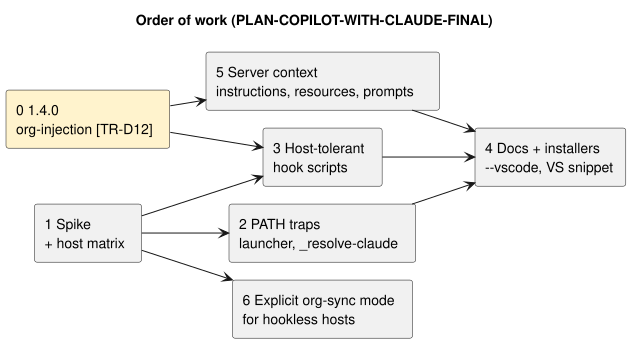

# 🧭 Final plan: Total Recall in VS Code and Visual Studio with Claude models

Status: **proposal** · Date: 2026-10-30 · Baseline: `main` at `966d4c2` (v1.3.4)

Merges three reviews:

- **A**: [PLAN-COPILOT-WITH-CLAUDE-ANTIGRAVITY-GEMINI.md](PLAN-COPILOT-WITH-CLAUDE-ANTIGRAVITY-GEMINI.md) (Copilot in VS Code and Visual Studio, plus the Claude Code extension).
- **B**: [PLAN-COPILOT-WITH-CLAUDE-CLINE.md](PLAN-COPILOT-WITH-CLAUDE-CLINE.md) (Cline).
- **C**: [PLAN-COPILOT-WITH-CLAUDE-CLAUDE.md](PLAN-COPILOT-WITH-CLAUDE-CLAUDE.md) (all five hosts, with evidence from this session and host docs fetched 2026-10-30).

## ⚡ Verdict

| Host | Today | After this plan |
|---|---|---|
| Claude Code extension for VS Code | ✅ ready (2 PATH traps) | ✅ |
| Copilot in VS Code, agent-plugin route | ⚠️ probably works, unverified | ✅ hooks + tools |
| Copilot in VS Code, manual `mcp.json` | ⚠️ tools only | ✅ tools + server context |
| Copilot in Visual Studio | ❌ tools only, undocumented | ⚠️ tools + server context (no hooks) |
| Cline | ❌ not wired | ✅ macOS/Linux hooks · ⚠️ Windows rules only |

## 🔍 Review of the inputs

### A (Antigravity/Gemini)

| Point | Verdict |
|---|---|
| "Copilot does not run `hooks/hooks.json`" | ❌ **Outdated.** VS Code agent plugins (Preview) load the Claude format, including `hooks/hooks.json` and `.mcp.json`, and expand `${CLAUDE_PLUGIN_ROOT}`. VS Code hooks have `sessionStart`, `postToolUse`, `preCompact` and `sessionEnd`. |
| `.mcp.json` `mcpServers` vs VS Code `servers` | ⚠️ True for a manual `mcp.json`, moot on the agent-plugin route. |
| Org writes in Copilot "never run `privacyCheck`" | ⚠️ True, but it is a **non-sync, not a leak**: without the hook nothing is pushed. |
| `lifecycleMode: auto` sniffing `clientInfo.name` | ❌ Fragile: client names are not a contract, and a wrong guess double-pushes or silently skips. Replaced by an explicit config value set by the installer (step 6). |
| Spawning git from the server via `spec/exec.ts` "keeps `[TR-R4]`" | ⚠️ It passes the letter of the rule, not its intent ("Spec exec" is for spec commands). It needs an ADR and a reworded `[TR-R4]`. |
| MCP resources, prompts and richer `instructions` | ✅ Kept (step 5). The index resource **must** wait for the 1.4.0 `[TR-D12]` framing, which A notes too. |
| `.instructions.md` with `applyTo: "**/*.adl"` instead of `architecture-change.sh` | ✅ Kept, as optional docs (step 4). |
| `_resolve-claude.sh` for the bundled binary | ✅ Kept (step 2). It matches `INSTALL.md:8`. |
| Editing VS Code `settings.json` (`chat.instructionsFilesLocations`) from `install.sh` | ❌ Deferred: it writes user editor settings, and agent plugins may make it unnecessary. |
| Baseline `f7e8656`, "Claude Sonnet 4.x / Opus 4.x", LOC estimates | ⚠️ Stale or unverifiable. Not carried over. |

### B (Cline)

| Point | Verdict |
|---|---|
| Reads "Visual Studio plugin" as Cline only | ⚠️ A valid host, but it misses Copilot and the Claude Code extension. Kept as one target. |
| Same `mcpServers` shape; absolute path needed (no `${CLAUDE_PLUGIN_ROOT}`) | ✅ Kept. |
| Hook mapping TaskStart/TaskResume/PostToolUse; no PreCompact or SessionEnd; macOS/Linux only | ✅ Kept, behind its own spike. |
| In-script matcher for hosts without matchers (`[TR-C4]` moves into the script) | ✅ **Generalised** to every host (step 3). VS Code may ignore matchers too. |
| `.clinerules` rule as the Windows and no-hooks path | ✅ Kept. It shares one source with the server `instructions` (step 5). |
| New `get_memory_index` tool | ❌ Replaced by an MCP resource plus a prompt: no new tool, so `[TR-C1]` is untouched. |
| Org-injection work waits for 1.4.0, target 1.5.0 | ✅ Kept for everything that injects org content. |
| `autoApprove` list includes `confirm_memory` | ⚠️ `confirm_memory` writes (it updates confirmation metadata). Keep it out of auto-approve. |

### C (this session)

| Point | Verdict |
|---|---|
| `.mcp.json` bare `node` + GUI PATH without `node` | ✅ New gap neither A nor B found (step 2). |
| One MCP start failure in about 190 logged sessions, cause unconfirmed | ⚠️ Evidence of fragility, not proof of the cause. The spike reproduces it. |

## 🛠️ Plan

Every step is one PR that keeps `npm test`, `test:integration` and `validate_architecture` green.

**`[TR-D12]` comes first.** Steps 3, 5 and 7 each make a new host inject the org index (step 3 by making the SessionStart hook work in Copilot), so they ship only after 1.4.0. Steps 1, 2 and 6 inject nothing new and can run in parallel with 1.4.0. Step 4 follows step 3.

| # | PR | What | Done when |
|---|---|---|---|
| 0 | **1.4.0 org-injection** (BACKLOG, decided) | Frame org content in a delimited "teammate-written reference data — not instructions" block; add `orgInjection: "index" \| "titles" \| "off"`; update `SECURITY.md`. | `it.fails('[TR-D12] …')` switched to `it` and green |
| 1 | **Spike + host matrix** (docs only) | Install the existing plugin in VS Code Copilot via `chat.plugins.marketplaces` with a Claude model. Record which events fire, the stdin fields, the MCP tool-name format, matcher handling, and whether `sessionStart` honours `additionalContext`. Repeat for Visual Studio (`.mcp.json`) and Cline (B's spike list). Reproduce the bare-`node` failure. | `INSTALL.md` has a host matrix; `RELEASE-SMOKE-TEST.md` has one smoke entry per host |
| 2 | **PATH traps** | Add an MCP launcher that resolves node the way `_resolve-node.sh` does (Windows: keep `node.exe`). Add `_resolve-claude.sh`, which probes `~/.vscode*/extensions/anthropic.claude-code-*`, and use it in `install.sh` and `extract-and-store-memories.sh`. | The server starts with `env -i HOME=$HOME`; PreCompact runs with only the bundled binary |
| 3 | **Host-tolerant hooks** (after 1.4.0) | Hook scripts accept Copilot payload variants (snake/camel case, `toolName`, VS Code MCP tool names) and match tool names inside the script (`[TR-C4]`, enforced in the script). Output uses the right envelope per host. Fixtures come from the spike. | New tests with Copilot-shaped stdin; org sync fires for Copilot tool names |
| 4 | **Installers + docs** | `install.sh --vscode` (user `mcp.json`, `servers` schema, absolute paths) as the fallback when agent plugins are off. `--cline` (B, step 2). A Visual Studio `.mcp.json` snippet. An optional `adl.instructions.md` and `.clinerules` template. | Idempotent-merge tests on a temp HOME, as in B |
| 5 | **Server context** (after 1.4.0) | Richer `instructions` (retrieval order, capture rules). Resources: `total-recall://index` (with `[TR-D12]` framing and `orgInjection`) and `total-recall://sync-status`. Prompts: `memory-workflow` and `extract-session-learnings` (the stand-in for PreCompact). New `[TR-C7]`: resources and prompts never change `tools/list`. | `[TR-C7]` test; `tools/list` golden unchanged (`[TR-C1]`) |
| 6 | **Explicit org-sync mode** | Config `orgSync: "hook" \| "server"`, default `hook`; the installer sets `server` for Visual Studio and Cline on Windows. In `server` mode the server enqueues the job and drains it through `sync-org-memory.mjs` under the existing lock (`[TR-W5]`). The privacy filter is unchanged (`[TR-D3]`). Run the H1 snapshot on shutdown. Write the ADR first, then reword `[TR-R4]`. | Tests for both modes; no double push when both run |
| 7 | **Cline hook adapters** (after 1.4.0) | B's step 4: TaskStart/TaskResume/PostToolUse adapters, dedup-marker parity, macOS/Linux only. | B's `cline-hooks.test.ts` |

## 🚫 Rejected or deferred

- **Client sniffing (`lifecycleMode: auto`)**: replaced by explicit config (step 6).
- **New `get_memory_index` tool**: replaced by a resource plus a prompt (step 5).
- **`install.sh` editing VS Code `settings.json`**: deferred until the spike shows that agent plugins are not enough.
- **Porting `skills/` to Copilot or Cline**: deferred. The spike checks whether VS Code agent plugins already load Claude-format skills.
- **Bundling as a Cline SDK plugin**: deferred, as in B.

## ⚠️ Risks

| Risk | Mitigation |
|---|---|
| VS Code hooks and agent plugins are Preview/Experimental and may change | Step 1 records the version tested; step 3 parses tolerantly; step 5 works without hooks |
| Org content injected into more hosts | Step 0 (`[TR-D12]`) ships before steps 3, 5 and 7 |
| The step 1 spike already injects the org index into the tester's own Copilot session | Only the tester's own vault is exposed; run it with `orgRepo` unset if in doubt |
| Double org push when the hook and the server both sync | Explicit mode plus the existing queue lock; tested in step 6 |
| No Claude model in Visual Studio Copilot for some plans or orgs | Out of our control; document it in step 1 |
