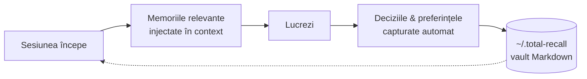
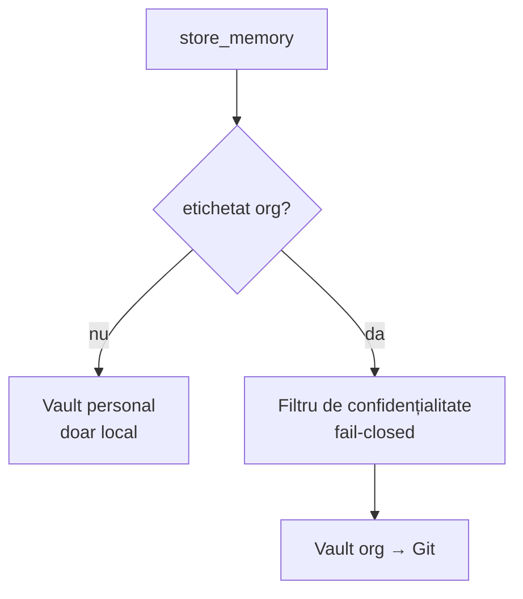

# 🧠 total-recall

**Asistentul tău AI (Claude, Gemini, Antigravity) uită totul la finalul fiecărei sesiuni. Acest plugin rezolvă problema.**

O memorie persistentă și căutabilă pentru Claude Code și Gemini/Antigravity. Memoriile sunt fișiere Markdown simple pe discul tău — pot fi căutate cu grep, versionate cu git, citibile în [Obsidian](https://obsidian.md/). Nimic nu părăsește mașina ta decât dacă îl etichetezi `org`.

[🇬🇧 English](README.md) · 🇷🇴 Română

## ⚡ TL;DR

- **Ce este** — un plugin care dă asistentului AI o memorie persistentă: memoriile se salvează pe computerul tău și supraviețuiesc între sesiuni, deci nu mai reexplici aceleași lucruri. Pentru Claude Code și Gemini/Antigravity: 17 unelte MCP peste un vault de fișiere Markdown din `~/.total-recall`.
- **Ce face pentru tine** — injectează memoriile relevante la începutul fiecărei sesiuni și capturează automat deciziile și preferințele pe măsură ce lucrezi și înainte de fiecare compactare a contextului, ca să nu repeți același context.
- **Cum caută** — hibrid: TF-IDF × curba uitării Ebbinghaus, plus căutare semantică opțională; degradează curat la căutare de text dacă căutarea semantică nu e activată.
- **Confidențialitate** — local-first. Vault-ul personal nu părăsește mașina; doar ce etichetezi `org` trece printr-un filtru fail-closed spre un repo Git comun.
- **Instalare** — `/plugin marketplace add adrian-balaban/total-recall`, `/plugin install total-recall`, apoi `./install.sh` o singură dată. Node.js 18+, Linux · macOS · Windows (Git Bash).
- **Amprentă** — ~1–2 MB, două dependențe de producție (SDK-ul MCP și Zod). Modelul semantic de ~200 MB se descarcă doar dacă activezi căutarea semantică.
- **Status** — v1.1.22, stabilă: 798 teste trec, Test Coverage 93.6% statements, Mutation tests ≈68%. Vezi [Probleme cunoscute](#️-probleme-cunoscute) pentru pragurile de Test Coverage pe care CI le ratează încă.



## ⚙️ Cum funcționează

| | |
|---|---|
| **17 unelte MCP** | stocare, recuperare, căutare hibridă, reranking semantic, export/import în masă |
| **Căutare hibridă** | TF-IDF × curba uitării Ebbinghaus, combinată opțional cu embeddings vectoriale |
| **Hook-uri de ciclu de viață** | context injectat la începutul sesiunii, memorii capturate pe măsură ce lucrezi |
| **Două vault-uri** | cel personal rămâne local; cel etichetat `org` se sincronizează cu un repo Git comun |

- **Caracteristica principală:** la SessionStart se injectează doar indexul memoriilor; memoriile complete se citesc la cerere prin `get_memories_by_keys`.
- **Captură PreCompact:** 0–3 lecții sunt extrase din conversație înainte de compactarea contextului și salvate.
- **Reîncărcare live:** memoriile pe care un coleg le trimite în vault-ul org apar în sesiunea ta fără restart.
- **Arhivare, nu ștergere:** versiunile înlocuite ale unei memorii sunt păstrate.



Diagramele C4 (context → containere → componente → cod), harta modulelor, modelul de date,
secvența de pornire, pipeline-ul de căutare și ciclul de viață al hook-urilor sunt documentate în
**[ARCHITECTURE.md](plugins/total-recall/ARCHITECTURE.md)**.

## 🛠️ Cele 17 unelte

| Grup | Unelte |
|---|---|
| **Salvare** | `store_memory` |
| **Căutare** | `recall_memory`, `search_index` |
| **Citire** | `list_memories`, `get_memories_by_keys`, `get_stats`, `get_timeline`, `get_related_memories` |
| **Modificare** | `update_memory`, `delete_memory`, `confirm_memory`, `rebuild_index`, `prune_memories` |
| **Reordonare** | `rerank_memories` |
| **Operații în masă** | `export_memories`, `import_memories`, `delete_memories` |

## 💡 Ce se salvează automat

Observații de lucru (ce a mers, ce nu) · context de proiect neevident (motivații, constrângeri,
decizii non-triviale) · un prompt de sfârșit de sesiune „ceva demn de reținut?".

Nu se salvează: fragmente de cod, căi de fișiere, istoric git — toate derivabile din spațiul de lucru.

## 🥇 Folosește-l ca unic sistem de memorie

Claude Code vine cu propria memorie bazată pe fișiere (un director `memory/` cu un index
`MEMORY.md`), iar unele configurații adaugă un istoric `.remember/`. Dacă vrei ca Total Recall
să fie singura sursă de adevăr, spune-o în `~/.claude/CLAUDE.md` **global**:

```markdown
## Memory
Use total-recall exclusively for all memories, in every project.
- Store via `store_memory` / `update_memory`; recall via `recall_memory` / `search_index`.
- NEVER use the harness file-based memory (`memory/`, `MEMORY.md`) or `.remember/`.
- If total-recall is unavailable, tell me and skip persisting — do not silently fall back.
```

**De ce funcționează:** prioritatea instrucțiunilor este `CLAUDE.md`-ul tău > skill-uri >
valorile implicite ale harness-ului, deci instrucțiunea ta bate hook-urile și prompturile
implicite care încurajează memoria încorporată.

**Ordinea de recuperare, de la cel mai ieftin:** indexul injectat (deja în context) →
`get_memories_by_keys` → `search_index` → `recall_memory`.

Skill-ul `total-recall:memory-workflow` (ordinea de recuperare, deduplicare, `importanceScore`,
etichetare org) este material de referință opțional, nu o dependență.

## 🚀 Instalare

Dintr-o sesiune Claude Code:

```
/plugin marketplace add adrian-balaban/total-recall
/plugin install total-recall
```

apoi rulează `./install.sh` o singură dată, din directorul plugin-ului instalat, pentru a crea
vault-urile și a înregistra serverul MCP.

Linux · macOS · Windows (Git Bash) · Node.js 18+. Gemini/Antigravity, clone locale și profilul
minimal (fără vectori): **[INSTALL.md](plugins/total-recall/INSTALL.md)**

**Marketplace-ul este singurul canal de distribuție** — fără zip, fără pachet npm. Se
instalează branch-ul `release`, al cărui bundle este construit de GitHub Actions după ce poarta CI devine verde; `dist/` este ignorat pe `main`, deci niciun artefact construit manual nu poate fi livrat.

### 🔗 Amprentă

Două dependențe de producție — SDK-ul MCP și Zod. Trei opționale alimentează
căutarea semantică (`@huggingface/transformers`, `better-sqlite3`, `sqlite-vec`)
și sunt aduse doar dacă o activezi.

| | |
|---|---|
| **Plugin** | ~1–2 MB |
| **Model opțional pentru căutare semantică „multi-language"** | ~200 MB, descărcat la prima utilizare |

## 📦 Ce se livrează vs. ce e doar pentru contributori

<details>
<summary>Fișiere de runtime, doar pentru vault-ul org, doar pentru contributori</summary>

- **Runtime (întotdeauna):** manifestele (`plugin.json`, `.mcp.json`, `package.json`), `dist/index.js`, `dist/frontmatter.mjs`, `hooks/hooks.json` și scripturile de index de la SessionStart.
- **Runtime doar pentru utilizatorii vault-ului org:** `sync-org-memory.*`, `pull-org-vault.sh`, `check-sync-errors.sh`, `dist/privacy-filter.mjs`, `atomic-write.mjs`.
- **Doar pentru contributori:** `src/`, teste, configurații vitest/stryker, `tsconfig.json`, `CLAUDE.md`, `ARCHITECTURE.md`.

Ieșirea generată (`node_modules/`, `coverage/`, `reports/`, `.remember/`) este ignorată de git și poate fi ștearsă fără grijă. `dist/` este construit de CI, nu este comis.

</details>

## 🧭 Principii de design

- **Local-first** — memoriile sunt pe mașina ta, nu în cloud.
- **Lizibil** — fiecare memorie este un fișier Markdown pe care îl poți edita în orice editor.
- **Versionabil** — vault-ul de echipă este susținut de git; vault-ul personal rămâne local.
- **Fără infrastructură** — niciun server sau bază de date externă. Fișierele Markdown sunt
  sursa adevărului.
- **Tolerant la erori** — degradează la căutare de text dacă căutarea semantică nu este disponibilă.

## 📊 Status

| | |
|---|---|
| **Versiune** | 1.1.22 — stabilă |
| **Teste** | 778 unitare + 20 de integrare, toate trec · 47 fișiere · ~13k linii de cod de test |
| **Test Coverage** | 93.6% statements · 88.2% branches · 95.3% lines |
| **Mutation tests** | ≈68% (Stryker, 16 module de bază) · variază ~±1 pt de la o rulare la alta · poarta eșuează sub 65% |
| **CI** | [`mutation.yml`](.github/workflows/mutation.yml) — audit + typecheck + build + suitele complete unitare și de integrare + Stryker la fiecare push/PR pe `main`. Singurul pipeline de build; nimic nu este verificat local |
| **Release-uri** | [`release.yml`](.github/workflows/release.yml) — construiește `dist/` și publică branch-ul `release` de pe care instalează marketplace-ul; taguri + note când versiunea se schimbă |
| **Audit** | 0 critice în dependențele de producție |

Mutation testing verifică dacă testele sunt într-adevăr bune: Stryker schimbă deliberat lucruri mici în cod (`>` devine `<`, `true` devine `false`), iar o suită de teste care nu pică atunci nu este suficient de strictă.

Reproducere: `npm test` · `npm run test:coverage` · `npm run test:integration` · `npm run mutation`
(din `plugins/total-recall/`)

### ⚠️ Probleme cunoscute

- **Test Coverage ratează trei din patru praguri** setate în `vitest.config.ts`: statements
  93.6% (necesar 95), functions 93.5% (necesar 95), branches 88.2% (necesar 90). Lines trece la
  95.3%. `npm run test:coverage` iese deci cu cod non-zero. Cele mai mari lacune sunt
  `vectorStore.ts` (72.5%) și `embeddings.ts` (88.6%).
- **Trei module au teste care ating codul, dar nu îi verifică logica.** Scorul de mutație pe
  modul divergă puternic de acoperire: `embeddings.ts` 49.4%, `vectorStore.ts` 54.0% și
  `persistence.ts` 56.2%. Cazul instructiv e `persistence.ts` — 86.1% acoperire la doar 56.2%
  mutație, cu 112 mutanți supraviețuitori: testele execută codul, dar nu ar observa dacă
  s-ar strica. Acoperirea singură ar fi ratat asta; de aceea poarta se uită la mutație.
- **Scorul de Mutation tests nu este reproductibil de la o rulare la alta.** Două rulări CI fără nicio
  modificare la vreun fișier sursă mutat au raportat 65.39% și 66.39% — aproximativ ±1 punct
  de variație, cel mai probabil din mutanți care expiră (timeout) sub încărcare variabilă a runner-ului. Nu
  citi o singură cifră zecimală ca fiind precisă. Marja peste pragul de 65% a fost
  extinsă la aproximativ 3 puncte în v1.1.22 (cinci module aduse de la
  0–75% la 93–100%, +34 mutanți uciși), astfel încât variația obișnuită nu mai riscă o
  poartă CI roșie — ceea ce contează pentru că o poartă roșie reține în tăcere branch-ul `release`
  în loc să livreze ceva stricat.

## 📡 Thoughtworks Technology Radar Vol. 34

Mai multe tehnici din [Thoughtworks Technology Radar Vol. 34 (2026)](tr_technology_radar_vol_34_en_1.pdf)
sunt deja implementate aici, ca decizii de design luate independent:

| Tehnică | Inel | Cum o face Total Recall |
|---|---|---|
| Progressive context disclosure + Context engineering | Trial + Adopt | SessionStart injectează doar indexul memoriilor; conținutul complet se citește la cerere |
| Mutation testing | Trial | Poartă Stryker în CI (vezi [Status](#-status)) |
| Claude Code plugin marketplace | Trial | distribuție bazată pe git, fără drift de versiune; singurul canal din v1.1.19, alimentat de un branch construit în CI |
| Structured output from LLMs | Adopt | hook-ul de captură cere modelului linii JSON, nu text liber |
| MCP by default | Hold | operațiile de sistem (git, indexare) rămân în scripturi simple, nu în unelte MCP |

**Trei direcții viitoare**, fiecare în [BACKLOG.md](BACKLOG.md) cu declanșator:
un graf de context peste memorii (lanțul `supersededAt` stochează deja muchii temporale);
extracție ancorată în sursă pentru hook-ul de captură; un set de evaluare pentru `recall_memory`.

Sinteza completă Adopt/Trial e în memoria org
`org/knowledge/thoughtworks-technology-radar-vol-34-2026-adopt-trial-synthesis`.

---

📖 **[Documentație completă](plugins/total-recall/README.md)** ·
🏗️ **[Arhitectură](plugins/total-recall/ARCHITECTURE.md)** ·
📦 **[Ghid de instalare](plugins/total-recall/INSTALL.md)** ·
🎤 **[Prezentare: Claude vs Ollama & Total Recall](https://github.com/adrian-balaban/presentation-claude-vs-ollama-and-total-recall-plugin-21-07-2026)** (Română, Iul 2026)
