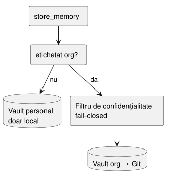

# 🧠 total-recall

**Asistentul tău AI (Claude, Gemini, Antigravity, GitHub Copilot) uită totul la finalul fiecărei sesiuni. Acest plugin rezolvă problema.**

O memorie persistentă și căutabilă pentru Claude Code, Gemini/Antigravity și VS Code (GitHub Copilot agent mode). Memoriile sunt fișiere Markdown simple cu frontmatter YAML pe discul tău — pot fi căutate cu grep, versionate cu git, citibile în [Obsidian](https://obsidian.md/). Nimic nu părăsește mașina ta decât dacă îl etichetezi `org`.

[🇬🇧 English](README.md) · 🇷🇴 Română

## ⚡ TL;DR

- **Ce este** — un plugin care dă asistentului AI o memorie persistentă: memoriile se salvează pe computerul tău și supraviețuiesc între sesiuni, deci nu mai reexplici aceleași lucruri. Pentru Claude Code, Gemini/Antigravity și VS Code (GitHub Copilot agent mode): 22 de unelte MCP (17 pentru memorie, 5 pentru [lucrul spec-driven cu arhitectura](#-arhitectura-ca-cod--lucru-spec-driven-adl)) peste un vault de fișiere Markdown din `~/.total-recall`.
- **Ce face pentru tine** — injectează indexul memoriilor la începutul fiecărei sesiuni (memoriile complete se citesc la cerere) și capturează automat deciziile și preferințele pe măsură ce lucrezi și înainte de fiecare compactare a contextului, ca să nu repeți același context. Gazdele care nu afișează ieșirea hook-urilor (Gemini/Antigravity, VS Code cu `--vscode`) citesc indexul din resursa MCP `total-recall://index`; fără niciun hook (`--vscode`) nu există nici captură automată.
- **Și spec-driven** — memoriile pot fi legate de o specificație: etichetezi orice decizie, cerință sau eșec cu un `system`, `elements` la care se referă și un ID în `requirements`, apoi cauți după element sau urmărești o cerință până la deciziile ei. Pentru asta nu ai nevoie de ADL. Dacă proiectul își ține și arhitectura ca cod (ADL), uneltele leagă în plus fiecare regulă de testele care o impun. Vezi [Arhitectura ca cod & lucru spec-driven](#-arhitectura-ca-cod--lucru-spec-driven-adl).
- **Cum caută** — hibrid: TF-IDF × curba uitării Ebbinghaus, plus căutare semantică opțională; degradează curat la căutare de text dacă căutarea semantică nu e disponibilă.
- **Confidențialitate** — local-first. Vault-ul personal nu părăsește mașina; doar ce etichetezi `org` trece printr-un filtru fail-closed spre un repo Git comun.
- **Instalare** — `/plugin marketplace add adrian-balaban/total-recall`, `/plugin install total-recall`, apoi `./install.sh` o singură dată. Node.js 18+, Linux · macOS · Windows (Git Bash).
- **Amprentă** — ~1–2 MB, două dependențe de producție (SDK-ul MCP și Zod). Modelul semantic de ~200 MB se descarcă doar dacă activezi căutarea semantică.
- **Status** — v1.6.6, stabilă: 981 teste trec, Test Coverage 96.9% statements, Mutation tests ≈78%.


---

## 📡 Thoughtworks Technology Radar Vol. 34

Mai multe tehnici din [Thoughtworks Technology Radar](https://www.thoughtworks.com/radar)
([Vol. 34, 2026 — PDF](https://www.thoughtworks.com/content/dam/thoughtworks/documents/radar/2026/04/tr_technology_radar_vol_34_en_1.pdf)) sunt deja implementate aici, ca decizii de design luate independent:

| Tehnică                                              | Inel          | Cum o face Total Recall                                                                                                                                 |
| ---------------------------------------------------- | ------------- | ------------------------------------------------------------------------------------------------------------------------------------------------------- |
| Progressive context disclosure + Context engineering | Trial + Adopt | SessionStart injectează doar indexul memoriilor; conținutul complet se citește la cerere                                                                |
| Mutation testing                                     | Trial         | Poartă Stryker în CI (vezi [Status & probleme cunoscute](#-status--probleme-cunoscute))                                                                 |
| Claude Code plugin marketplace                       | Trial         | distribuție bazată pe git, fără drift de versiune; singurul canal din v1.1.19, alimentat de branch-ul `release`, construit de GitHub Actions din `main` |
| Structured output from LLMs                          | Adopt         | hook-ul de captură cere modelului linii JSON, nu text liber                                                                                             |
| MCP by default                                       | Hold          | operațiile de sistem (git, indexare) rămân în scripturi simple, nu în unelte MCP                                                                        |

**Trei direcții viitoare**, fiecare în [BACKLOG.md](BACKLOG.md) cu declanșator:
un graf de context peste memorii (lanțul `supersededAt` stochează deja muchii temporale);
extracție ancorată în sursă pentru hook-ul de captură; un set de evaluare pentru `recall_memory`.

---

## ⚙️ Cum funcționează & Stocare

|                                |                                                                                                                                   |
| ------------------------------ | --------------------------------------------------------------------------------------------------------------------------------- |
| **22 de unelte MCP**           | stocare, recuperare, căutare hibridă, reranking semantic, export/import în masă și 5 unelte de arhitectură pentru proiecte cu ADL |
| **Căutare hibridă**            | TF-IDF × curba uitării Ebbinghaus, combinată opțional cu embeddings vectoriale                                                    |
| **Hook-uri de ciclu de viață** | context injectat la începutul sesiunii, memorii capturate pe măsură ce lucrezi                                                    |
| **Două vault-uri**             | cel personal rămâne local; cel etichetat `org` se sincronizează cu un repo Git comun                                              |

- **Caracteristica principală:** la SessionStart se injectează doar indexul memoriilor; memoriile complete se citesc la cerere prin `get_memories_by_keys`.
- **Captură PreCompact:** 0–3 lecții sunt extrase din conversație înainte de compactarea contextului și salvate.
- **Reîncărcare live:** memoriile pe care un coleg le trimite în vault-ul org apar în sesiunea ta fără restart.
- **Arhivare, nu ștergere:** versiunile înlocuite ale unei memorii sunt păstrate.



Diagramele C4 (context → containere → componente → cod), cele 22 de unelte, modelul de date,
calea de scriere, ciclul de viață al serverului, persistența și hook-urile sunt desenate în
**[ARCHITECTURE.md](plugins/total-recall/ARCHITECTURE.md)**.

### Cele două vault-uri & structura pe disc

Două vault-uri separate trăiesc sub `~/.total-recall/`:

| Vault        | Cale                              | Când este folosit                                                                       |
| ------------ | --------------------------------- | --------------------------------------------------------------------------------------- |
| **Personal** | `~/.total-recall/personal-vault/` | Implicit pentru toate memoriile (rămâne local).                                         |
| **Org**      | `~/.total-recall/org/org-vault/`  | Folosit când memoria are eticheta `org`. Se sincronizează cu un repo Git prin filtru.   |

```
~/.total-recall/
├── index.json               ← index plat: key → MemoryMetadata
├── invertedIndex.json       ← index inversat TF-IDF: token → {docs, idf}
├── .index-cache.txt         ← rezumat injectat la SessionStart (citibil din shell)
├── config.json              ← configurare opțională (vezi mai jos)
├── personal-vault/
│   ├── architecture/
│   │   └── db-choice.md     ← o memorie: frontmatter YAML + corp Markdown
│   ├── decisions/ …
│   └── vectors.db           ← embeddings sqlite-vec (opțional, derivat, ignorat de git)
└── org/
    └── org-vault/           ← memorii de echipă, sincronizate prin git (branch din `orgBranch`)
```

Fiecare memorie este un fișier `.md`:

```markdown
---
title: "Prefer PostgreSQL for relational data"
tags: [architecture, database, feedback]
author: adrianb
importanceScore: 0.8
created: 2026-06-01T10:00:00Z
updated: 2026-06-15T14:30:00Z
---

## Executive Summary

Prefer PostgreSQL over MySQL for new projects because of JSONB support…
```

### Principii de design & filozofie

- **Local-first** — memoriile sunt pe mașina ta, nu în cloud.
- **Lizibil** — fiecare memorie este un fișier Markdown pe care îl poți edita în orice editor.
- **Versionabil** — vault-ul de echipă este susținut de git; vault-ul personal rămâne local, cu un repo git strict local (creat de `install.sh`, fără remote) care îl salvează instantaneu la finalul fiecărei sesiuni.
- **Fără infrastructură** — niciun server sau bază de date externă. Fișierele Markdown sunt sursa adevărului; indexul vectorial (`vectors.db`) este un SQLite local, regenerabil oricând și lăsat în afara instantaneelor.
- **Tolerant la erori** — degradează la căutare de text dacă căutarea semantică nu este disponibilă.

Singurele dependențe obligatorii sunt `@modelcontextprotocol/sdk` și `zod` (schemele de intrare ale uneltelor). TF-IDF, curba Ebbinghaus, RRF și parserul de frontmatter YAML sunt scrise de la zero:

1. **Securitate** — fără `gray-matter` → fără clasa de CVE-uri din `js-yaml` (GHSA-h67p-54hq-rp68); parserul minimal este fixat cu teste bazate pe proprietăți (`fast-check`).
2. **Scor coerent** — boost-ul pe titlu, boost-ul pe etichete și degradarea în timp sunt o singură formulă, nu trei biblioteci.
3. **Determinism** — zero apeluri LLM pe calea de căutare, cost zero, funcționează offline / air-gapped.
4. **Auditabilitate** — fiecare decizie de scor este observabilă prin `get_stats`.

Doar `@huggingface/transformers` (ONNX), `sqlite-vec` și `better-sqlite3` rămân externe — și toate trei sunt opționale.

### Filtru de confidențialitate & sincronizare Org

- **Fail-closed implicit**: blochează token-uri/chei secrete cu entropie mare, secrete etichetate (ex. `aws_secret_access_key = …`), toate adresele de e-mail, precum și carduri bancare validate (Luhn), IBAN-uri (ISO 13616 mod-97) și numere de telefon formatate înainte de orice `git push`. Dacă filtrul nu poate analiza conținutul, **nu** face push.
- **Whitelist pentru e-mail**: permite domenii specifice prin `allowedEmailDomains: ["yourcompany.com"]` în `config.json`.
- **Protecția autorului**: memoriile org pot fi suprascrise sau actualizate doar de autorul lor (numele de utilizator din OS).
- _Notă: pronumele sunt permise intenționat (rata lor de alarme false bloca notițe legitime de lucru); etichetele `personal` și `org` se exclud reciproc pentru a preveni sincronizarea accidentală._

---

## 🛠️ Cele 22 de unelte MCP

Toate apelurile de unelte operează pe un index în memorie (`index.json`), făcând operațiile de citire și căutare extrem de rapide și fără I/O pe disc. Vorbește natural — _„ține minte că…"_ / _„amintește-mi…"_ — iar modelul alege unealta potrivită.

| Unealtă                    | Grup               | Funcție                | Comportament notabil                                                                                                                                                                                                                                 |
| -------------------------- | ------------------ | ---------------------- | ---------------------------------------------------------------------------------------------------------------------------------------------------------------------------------------------------------------------------------------------------- |
| `store_memory`             | Salvare            | Creează o memorie      | Rutează în vault-ul Org dacă are eticheta `org`. Suprascrierea cere `force=true` (refuzată pe fișiere `no-prune`).                                                                                                                                   |
| `recall_memory`            | Căutare            | Căutare hibridă        | TF-IDF, degradare Ebbinghaus și embeddings vectoriale opționale (îmbinate prin RRF).                                                                                                                                                                 |
| `search_index`             | Căutare            | Căutare în metadate    | Scanare rapidă a indexului din memorie; nu citește fișierele, nu crește `accessCount`.                                                                                                                                                               |
| `list_memories`            | Citire             | Răsfoire vault         | Listare paginată a metadatelor memoriilor (filtrare după etichetă/categorie/dată).                                                                                                                                                                   |
| `get_memories_by_keys`     | Citire             | Preluare memorie       | Preluare în lot după cheie; conținut complet sau rezumat; servit printr-un cache LRU.                                                                                                                                                                |
| `get_stats`                | Citire             | Audit plugin           | Totaluri, statistici cache, ultimele 10 erori, percentile de latență și un bloc `vector` (`enabled`/`depsPresent` + model/dimensiune activă vs stocată). `enabled` este `true` implicit când dependențele opționale pot fi încărcate.               |
| `get_timeline`             | Citire             | Vizualizare cronologică| Memorii grupate și sortate după datele modificării.                                                                                                                                                                                                  |
| `get_related_memories`     | Citire             | Găsire relații         | Similaritate Jaccard a etichetelor cu boost pe categorie, plus `elements` comune.                                                                                                                                                                    |
| `update_memory`            | Modificare         | Editare memorie        | Păstrează timestamp-ul creării și adaugă la istoricul sesiunilor (plafonat la 50). Recalculează embedding-ul la schimbarea conținutului/etichetelor/importanței.                                                                                     |
| `delete_memory`            | Modificare         | Ștergere memorie       | Refuză memoriile `no-prune` dacă nu se transmite `force=true`.                                                                                                                                                                                       |
| `confirm_memory`           | Modificare         | Semnal de feedback     | `useful=true` crește confirmările; `useful=false` crește semnalările — ambele intră în scorul de retenție.                                                                                                                                           |
| `rebuild_index`            | Modificare         | Rescanare sistem fișiere| Rescanare completă a vault-urilor, reconstruind TF-IDF și păstrând statisticile de acces.                                                                                                                                                            |
| `prune_memories`           | Modificare         | Curățare intrări vechi | Listează candidații la ștergere conform curbei Ebbinghaus (nu șterge automat). Exclude `no-prune`.                                                                                                                                                   |
| `rerank_memories`          | Reordonare         | Rerank semantic        | Reordonează cheile candidate după similaritatea cosinus față de o interogare folosind embeddings. `keys` plafonat la 200 (ordinea păstrată).                                                                                                         |
| `export_memories`          | Operații în masă   | Export în masă         | Arhivă JSON portabilă; filtrare după chei, categorie sau etichetă. Corpurile ilizibile devin intrări `{key, error}` (numărate în `errors`), niciodată conținut gol tăcut.                                                                            |
| `import_memories`          | Operații în masă   | Import în masă         | Restaurează dintr-o arhivă `export_memories`; sare peste cheile existente fără `force=true`; sare peste intrările cu câmp `error`.                                                                                                                   |
| `delete_memories`          | Operații în masă   | Ștergere în masă       | Șterge o listă de chei; cere `confirm=true`. O cheie rezervată `no-prune` (fără `force`) este înregistrată ca eroare per-cheie și lotul continuă.                                                                                                    |
| `index_architecture`       | Arhitectură        | Indexare ADL           | O memorie de index de arhitectură per sistem: elemente, aserțiuni, relații și testele etichetate cu ID-ul fiecărei aserțiuni. No-op pe fișiere neschimbate. Vezi [Arhitectura ca cod & lucru spec-driven](#-arhitectura-ca-cod--lucru-spec-driven-adl).|
| `get_architecture_context` | Arhitectură        | Context element        | Rezumatul sistemului sau regulile ADL, relațiile, deciziile, eșecurile și întrebările deschise ale unui element.                                                                                                                                     |
| `trace`                    | Arhitectură        | Cerință → test         | Cerință, aserțiune sau element → aserțiuni și controale → teste → rezultate și decizii înregistrate.                                                                                                                                                 |
| `get_architecture_history` | Arhitectură        | Jurnal modificări      | Memoriile `architecture-changes` în ordine cronologică, plus reconstrucțiile indexului.                                                                                                                                                              |
| `validate_architecture`    | Arhitectură        | Rulare verificări      | Acoperirea cu teste a ADL; eșecurile sunt stocate ca memorii `fitness-result` și marcate rezolvate la o trecere ulterioară.                                                                                                                          |

Cele cinci unelte de arhitectură sunt activate implicit și pot fi oprite individual (`specDriven.tools`) sau împreună (`specDriven.enabled: false`, care elimină și câmpurile opționale spec din schemele celorlalte unelte).

---

## 🔍 Pipeline-ul de căutare

```
recall_memory(query)
  │
  ├─ tfidfSearch(query)
  │    ├─ tokenize(query) → tokeni (extindere EN↔RO dacă enableMultilingualSearch)
  │    ├─ per token: căutare în invertedIndex
  │    ├─ score = TF × IDF × title-boost(2×) × tag-boost(1.5×)
  │    └─ × computeRetentionStrength(importance, daysSince, accessCount, confirmations, flags)
  │
  ├─ [opțional: dependențe vectoriale instalate]
  │    ├─ embed(query) → sqlite-vec KNN
  │    └─ Reciprocal Rank Fusion(tfidf, vector), k=60:  score(d) = Σ 1/(60 + rank_i(d))
  │
  └─ trunchiere la `limit`; cu full=true crește accessCount și citește corpul, altfel doar metadate
```

> **Ce este TF-IDF?** Term Frequency × Inverse Document Frequency — scorul clasic de căutare în text: un cuvânt cântărește mult dacă apare **des în acest document** (TF), dar **rar în întreaga colecție** (IDF). _Indexul inversat_ este harta inversă `cuvânt → documentele care îl conțin`, ca indexul unei cărți — căutarea citește indexul, niciodată fișierele.

### Curba uitării Ebbinghaus (1885), în cod

Memoriile se estompează ca memoria umană: memoriile neimportante și neaccesate coboară în rezultate; fiecare acces le „împrospătează".

```
λ        = 0.16 × (1 − importanceScore × 0.8)
strength = clamp(importance × exp(−λ × daysSince)
                 × (1 + accessCount × 0.2 + confirmations × 0.1 − flags × 0.1), 0, 1)
```

| importanceScore | λ (viteza uitării) | Comportament                                       |
| --------------- | ------------------ | -------------------------------------------------- |
| 1.0 (critic)    | 0.032              | Degradare lentă — relevant săptămâni întregi       |
| 0.5 (normal)    | 0.096              | Degradare medie                                    |
| 0.3 (scăzut)    | 0.122              | Degradare rapidă — dispare din rezultate în zile   |

Fiecare acces adaugă +20% retenție; fiecare `confirm_memory(useful=true)` +10%; fiecare semnalare (`flag`) −10% — astfel încât o memorie accesată frecvent dar marcată azi ca greșită coboară în clasament (idee validată de semnalul de endorsement din [mozilla-ai/cq](https://github.com/mozilla-ai/cq)).

- **Imortalitate (eticheta `no-prune`)**: exclude memoria din `prune_memories` și o protejează împotriva ștergerii accidentale sau a suprascrierii de rutină. Utilă pentru decizii de arhitectură (ADR-uri).

### Embeddings & căutare vectorială (opțional)

Opțional, încărcat leneș (lazy-loaded), complet local — plugin-ul degradează curat la TF-IDF fără dependențele native (mașini offline, compilări native eșuate). Fără API-uri cloud, fără chei API; vectorii sunt calculați o singură dată la scriere (`vectors.db`), niciodată recalculați la citire; dependențele grele sunt marcate `external` în esbuild, astfel încât bundle-ul de bază rămâne mic; `flushPending()` la SIGTERM/SIGINT garantează scrierea vectorilor pe disc la ieșire.

`get_stats` raportează căutarea vectorială ca **activată implicit** atunci când dependențele opționale pot fi încărcate — verifică direct `@huggingface/transformers` + `sqlite-vec` + binding-ul nativ `better-sqlite3`, astfel încât o sesiune nouă arată `vector.enabled: true`. Dacă `get_stats` indică `depsPresent: false` după un `claude plugin update`, rulează `npm rebuild better-sqlite3` în directorul cache al plugin-ului (auto-repararea din `vectorStore.ts` încearcă asta automat o dată).

```bash
npm install --no-save @huggingface/transformers sqlite-vec better-sqlite3   # sau install.sh --complete
```

De ce hibrid: TF-IDF caută tokeni exacți („k8s pod OOM" ratează „workload killed for memory pressure"); modelul de embeddings gestionează parafrazările. Modelul implicit `all-MiniLM-L6-v2` (384 dimensiuni) acoperă parafrazarea în engleză; regăsirea bilingvă (stocare în română, căutare în engleză sau invers) este rezolvată de extinderea tokenilor prin `enableMultilingualSearch`. RRF îmbină cele două clasamente doar după poziție (fără dependență de scară).

### Căutare multilingvă (EN↔RO)

`enableMultilingualSearch: true` extinde tokenii interogării între engleză și română:

```
# 1. Stochezi (în engleză):
> "remember that we chose PostgreSQL over MySQL because of JSONB support"

# 2. Într-o sesiune nouă, întrebi în ROMÂNĂ:
> "care a fost decizia noastră despre baza de date?"
→ recall_memory(query="decizie baza de date")
→ extinderea mapează „decizie"→"decision", „baza de date"→"database" → găsește memoria în engleză ✅
```

---

## 🪝 Hook-uri de ciclu de viață & captură automată

### `SessionStart` (5 pași secvențiali)

```
1. pull-org-vault.sh         — git pull pe branch-ul org-sync (config.orgBranch, implicit knowledge; dacă e configurat)
2. build-memory-index.sh     — scanare frontmatter → .index-cache.txt
3. load-memory-index.sh      — injectează indexul memoriilor în context (doar Claude Code)
4. check-sync-errors.sh      — avertizează dacă push-urile org-sync au eșuat de la ultimul succes
5. check-extract-outcomes.sh — avertizează dacă ultimele rulări de extracție PreCompact au eșuat
```

Efect: fiecare sesiune nouă Claude primește automat un rezumat al tuturor memoriilor tale — fără să întrebi. Într-un proiect cu fișiere ADL, pasul 3 adaugă și un scurt rezumat al arhitecturii (`specDriven.sessionSummary`, plafonat la `sessionSummaryMaxChars`).

### `PostToolUse` (matcher: `mcp__plugin_total-recall_total-recall__(store_memory|update_memory|delete_memory)`)

`sync-org-memory.sh` — verifică eticheta `org`, aplică filtrul de confidențialitate, face commit/push pe branch-ul org-sync al echipei (`config.orgBranch`, implicit `knowledge`) și reconstruiește `.index-cache.txt`. Rafalele de scrieri org sunt **comasate**: o coadă atomică de joburi + un worker în fundal cu `flock` înseamnă un singur proces git sync pe sesiune, nu unul per cheie. Memoriile colegilor aduse prin pull sunt reconciliate în indexul activ **fără restart**.

> **De ce matcher-ul este o expresie regulată, nu o listă simplă.** Claude Code tratează un matcher care conține doar litere/cifre/`_`/`-`/spații/`,`/`|` ca o **listă de șiruri exacte** comparată literal cu numele complet al uneltei. Uneltele MCP din plugin se numesc `mcp__plugin_total-recall_total-recall__<tool>`, deci parantezele forțează calea **regex** pentru a potrivi sufixul `__<tool>`.

### `PostToolUse` (matcher: `Write|Edit|MultiEdit`; Gemini/Antigravity `AfterTool`: `write_file|replace`)

`architecture-change.sh` — când fișierul editat este un fișier `.adl` (`specDriven.captureChanges`), cere modelului să ruleze `index_architecture`, să stocheze o memorie `architecture-changes` cu motivul și să ruleze `validate_architecture`. Orice alt fișier iese imediat, fără a porni Node.

### `PreCompact`: Ce se salvează automat

Înainte de fiecare compactare a contextului (`PreCompact`), `extract-and-store-memories.sh` citește transcriptul sesiunii, cere modelului să extragă 0–3 lecții cheie ca linii JSON, iar `store-learning.mjs` le scrie direct ca fișiere `.md` în vault-ul personal (fără apel MCP; nu suprascrie niciodată fișierele existente):

- **Se salvează:** observații de lucru (ce a mers, ce nu) și context de proiect neevident (motivații, constrângeri, decizii non-triviale). Cu `specDriven.extractDecisions` activat, promptul cere și deciziile de arhitectură cu `system`, `elements` și `requirements`.
- **Nu se salvează:** fragmente de cod, căi de fișiere, istoric git — toate derivabile din spațiul de lucru. (Singura excepție intenționată: o memorie de specificație sau de arhitectură poate reține calea relativă în repo și commit-ul fișierului pe care îl rezumă, ca pointer în frontmatter, niciodată în text.)

### `SessionEnd`

Înregistrează sesiunea, scrie pe disc modificările de index și embeddings aflate în așteptare înainte de ieșire și face auto-commit în vault-ul personal dacă acesta este un repo git local (niciodată cu remote). Doar `install.sh` creează acel repo (`git init` o singură dată, blocare `pre-push`, `.gitignore` pentru `.superseded/`, `*.tmp.*` și `vectors.db*`); hook-ul nu rulează niciodată `git init`.

---

## 🥇 Folosește-l ca unic sistem de memorie & Ordinea de recuperare

Claude Code vine cu propria memorie bazată pe fișiere (un director `memory/` cu un index `MEMORY.md`), iar unele configurații adaugă un istoric `.remember/`. Dacă vrei ca Total Recall să fie singura sursă de adevăr, spune-o în `~/.claude/CLAUDE.md` **global**:

```markdown
## Memory

Use total-recall exclusively for all memories, in every project.

- Store via `store_memory` / `update_memory`; recall via `recall_memory` / `search_index`.
- NEVER use the harness file-based memory (`memory/`, `MEMORY.md`) or `.remember/`.
- If total-recall is unavailable, tell me and skip persisting — do not silently fall back.
```

**De ce funcționează:** prioritatea instrucțiunilor este `CLAUDE.md`-ul tău > skill-uri > valorile implicite ale harness-ului, deci instrucțiunea ta bate hook-urile și prompturile implicite care încurajează memoria încorporată.

### 📇 Ordinea de recuperare (de la cel mai ieftin)

1. Indexul injectat la SessionStart (gratuit — deja în context)
2. `get_memories_by_keys(summary=true)` — dacă știi cheia
3. `search_index(query=…)` — metadate rapide, fără citiri de fișiere
4. `recall_memory(query=…, full=false)` — TF-IDF + Ebbinghaus
5. `recall_memory(query=…, full=true)` — cu conținutul complet

`search_index` și `recall_memory` omit intrările `journal` dacă nu transmiți `excludeJournal: false`.

Skill-ul inclus `total-recall:memory-workflow` învață modelul această ordine plus regulile de captură (rezumat executiv, verificare duplicate, `importanceScore`, etichetare org) și este material de referință opțional, nu o dependență.

---

## 📐 Arhitectura ca cod & lucru spec-driven (ADL)

Total Recall își descrie propria arhitectură în ADL, atât la nivelul de cod (module, dependențe, reguli de date), cât și la nivelul de sistem (cine cu cine comunică), iar build-ul pică atunci când codul se abate de la ea. Uneltele spec-driven lucrează cu aceeași notație în proiectele tale, reținând ce nu spune o specificație: de ce există fiecare regulă, ce variante au fost respinse, ce verificări au picat și cum au fost reparate.

Funcționează la două niveluri:

- **Doar cu memorii.** Orice memorie poate purta câmpuri opționale în frontmatter: `system`, `artifact` (`spec`, `adl`, `adr`, `fitness-result`), `elements` (`adl:<domain>.<component>`, `assert:<ID>`), `requirements`, `sourcePath`, `sourceRev`, `status` (`proposed`, `accepted`, `superseded`, `failed`, `resolved`) și `supersedes`. `store_memory`, `update_memory`, exportul și importul le păstrează; `recall_memory` și `search_index` filtrează după `elements`; `get_related_memories` urmărește elementele comune; iar un ID de cerință leagă între ele deciziile ei. Nu e nevoie de fișiere ADL și nici de index.
- **Cu ADL în plus.** Când proiectul își ține arhitectura ca cod (`DEFINE SYSTEM`, `ASSERT(…)`, `FOREACH … DO … END`, și `DEFINE COMMUNICATION` pentru conexiunile de sistem), fișierele rămân în repository ca sursă de adevăr, iar cele cinci unelte de arhitectură se sprijină pe aceleași memorii:
  1. `index_architecture(path)` citește toate fișierele `*.adl` de sub `path` într-o memorie de rezumat per sistem (elemente, aserțiuni cu eticheta `# [ID]`, relații din `DEFINE COMMUNICATION`, capabilități, contracte și liniile de test care poartă ID-ul fiecărei aserțiuni). Stochează calea relativă în repo și commit-ul, nu fișierele. Rularea repetată pe fișiere neschimbate nu scrie nimic.
  2. `get_architecture_context`, `trace` și `get_architecture_history` întorc regulile, relațiile, deciziile, eșecurile și schimbările pentru un element, o cerință sau o aserțiune. Deciziile înlocuite sunt listate separat, niciodată ca actuale.
  3. `validate_architecture(path)` rulează verificarea acoperirii ADL cu teste (fiecare aserțiune etichetată are un test cu ID-ul ei; nu e nevoie de nicio unealtă externă). Eșecurile devin memorii `fitness-result`; o trecere ulterioară le marchează ca rezolvate (`resolvedBy`).
  4. **Guardrails de organizație:** memoriile org etichetate `guardrail` (aserțiuni ADL reutilizabile, cu motivul lor) sunt returnate de `get_architecture_context`. O memorie etichetată `org` cu `artifact: "spec"` este refuzată dacă numește un host, o credențială sau un termen din `orgBlockedTerms`.
  5. **Hook-uri & skill:** hook-urile adaugă un scurt rezumat al arhitecturii la începutul sesiunii și cer înregistrarea schimbării când se editează un fișier `.adl`. Skill-ul `spec-driven-workflow` descrie întregul ciclu și are șabloane de pornire.

### ADL: Architecture Definition Language

ADL este notația folosită la masterclass-ul [**„How to Teach Your Agents About Architecture"**](https://codecamp.ro/masterclasses/how-to-teach-your-agents-about-architecture-iasi-2026/), ținut de Neal Ford la Codecamp Iași (27–28 octombrie 2026).

- **Ce este.** Un mod ușor, apropiat de pseudocod, de a scrie o arhitectură, fără gramatică formală. Liniile `DEFINE` numesc sistemul, domeniile și componentele lui. Liniile `ASSERT(…)` enunță regulile pe care codul trebuie să le respecte, în engleză simplă acolo unde e mai clar așa.
- **Cine îl citește.** Oamenii îl citesc ca documentație scurtă, care se învechește mai greu decât o diagramă. Agenții AI îl citesc drept context când scriu cod și drept specificație după care verifică codul.
- **Cum se impune.** Un fișier ADL nu se execută niciodată. Fiecare aserțiune e verificată de un test scris pentru ea (o fitness function), de exemplu cu ArchUnitTS în acest repository.

Exemplul de mai jos vine din fișierul [structure.adl](plugins/total-recall/architecture/adl/structure.adl) al acestui repository, nu din curs:

```
DEFINE SYSTEM Total Recall AS tr
    DEFINE COMPONENT Pure Helpers AS helpers
    DEFINE COMPONENT Tools AS tools
ASSERT(Pure Helpers have no dependency on any other component) # [TR-S1]
```

Eticheta `# [TR-S1]` este o convenție Total Recall, nu face parte din ADL. Testul care impune regula are aceeași etichetă în nume, iar `adl-coverage.test.ts` pică atunci când o aserțiune nu are test.

> Materialul cursului nu este publicat aici: nici slide-uri, nici exerciții, nici ghidul de referință, nici soluții. Secțiunea descrie ideea cu propriile noastre cuvinte, iar toate exemplele sunt din acest repository.

Nivelul de sistem este în [system.adl](plugins/total-recall/architecture/adl/system.adl): host-ul, serverul MCP, hook-urile, embedder-ul local și remote-ul git al organizației, plus liniile `DEFINE COMMUNICATION` care le leagă de cele două vault-uri. `adl-consistency.test.ts` pică atunci când o conexiune numește un element nedefinit.

> **Notă.** Versiunile anterioare descriau nivelul de sistem și într-un document [CALM](https://calm.finos.org/), validat în CI cu `@finos/calm-cli`. Suportul CALM a fost eliminat în 1.3.0; fișierele `.calm.json` nu mai sunt indexate, iar cheile `calm` și `calmExtensions` sunt ignorate. Descrie nivelul de sistem într-un fișier `.adl` cu `DEFINE COMMUNICATION`.

Detalii: [ARCHITECTURE.md → Architecture as code](plugins/total-recall/ARCHITECTURE.md#-architecture-as-code).

### Configurare spec-driven (`specDriven`)

Totul se configurează în blocul `specDriven` din `~/.total-recall/config.json`; fiecare cheie este opțională, iar `"specDriven": {"enabled": false}` readuce exact comportamentul cu 17 unelte:

```json
{
  "specDriven": {
    "enabled": true,
    "tools": [
      "index_architecture",
      "get_architecture_context",
      "trace",
      "get_architecture_history",
      "validate_architecture"
    ],
    "categories": ["specs", "architecture-changes"],
    "adlExtensions": [".adl"],
    "excludeDirs": ["node_modules", ".git", "dist", "build", "coverage"],
    "sessionSummary": true,
    "sessionSummaryMaxChars": 1500,
    "captureChanges": true,
    "extractDecisions": true,
    "guardrails": true,
    "orgBlockedTerms": []
  }
}
```

| Cheie                                      | Efect                                                                                                             |
| ------------------------------------------ | ----------------------------------------------------------------------------------------------------------------- |
| `enabled`                                  | `false` oprește tot ce urmează: 17 unelte, fără câmpuri noi în schemă, fără ieșire nouă din hook-uri              |
| `tools`                                    | Doar uneltele de arhitectură listate sunt înregistrate (`[]` pentru niciuna). Citit la pornire: cere restart      |
| `categories`                               | Directoare suplimentare de categorii create la pornire                                                            |
| `adlExtensions`, `excludeDirs`             | Ce fișiere include și ce directoare omite scanarea proiectului                                                    |
| `sessionSummary`, `sessionSummaryMaxChars` | Rezumatul de arhitectură la SessionStart și dimensiunea lui maximă                                                |
| `captureChanges`                           | Promptul de schimbare după editarea unui fișier ADL                                                               |
| `extractDecisions`                         | Cererea PreCompact pentru decizii cu ID-uri de elemente                                                           |
| `guardrails`                               | Guardrails org în `get_architecture_context`                                                                      |
| `orgBlockedTerms`                          | Nume de clienți și alți termeni pe care o memorie spec partajată în org nu are voie să îi conțină                 |

> **Gemini/Antigravity:** cele cinci unelte și filtrele pe câmpuri funcționează. Cele două hook-uri sunt înregistrate și în `hooks.gemini.json`, dar Gemini/Antigravity ignoră `additionalContext` (vezi [Compatibilitate clienți](#-compatibilitate-clienți)), deci rezumatul de sesiune și promptul de schimbare nu sunt afișate acolo.

---

## ⚙️ Configurare (`config.json`)

Configurează total-recall editând `~/.total-recall/config.json`:

```json
{
  "personalVault": "~/my-custom-personal-vault",
  "orgVault": "~/my-custom-org-vault",
  "orgRepo": "https://github.com/you/your-vault.git",
  "allowedEmailDomains": ["yourcompany.com"],
  "embeddingModel": "Xenova/all-MiniLM-L6-v2",
  "enableMultilingualSearch": true,
  "orgBranch": "knowledge",
  "orgInjection": "index"
}
```

- **embeddingModel**: suprascriere opțională pentru modelul local HuggingFace transformer (implicit `Xenova/all-MiniLM-L6-v2`, 384 dimensiuni). Schimbarea dimensiunii modelului șterge indexul vectorial existent (este reconstruit la următoarea scriere).
- **enableMultilingualSearch**: extinderea tokenilor interogării română/engleză pentru regăsire lexicală bilingvă.
- **orgBranch**: branch-ul din `orgRepo` de pe care vault-ul org face pull și pe care face push.
- **orgInjection**: cum sunt injectate memoriile org la SessionStart — `index` (implicit, încadrate ca date scrise de colegi), `titles` (doar titlurile) sau `off`. Vezi [SECURITY.md](SECURITY.md).
- **specDriven**: funcționalitățile spec-driven; vezi [Configurare spec-driven](#configurare-spec-driven-specdriven).

---

## 🚀 Instalare & Amprentă

Vezi **[INSTALL.md](plugins/total-recall/INSTALL.md)** pentru ghidul complet (profiluri, Windows, vault org, Codex, clone locale).

Dintr-o sesiune Claude Code:

```
/plugin marketplace add adrian-balaban/total-recall
/plugin install total-recall
```

Apoi rulează `./install.sh` o singură dată, din directorul plugin-ului instalat, pentru a crea vault-urile și a înregistra serverul MCP:

```bash
./install.sh                         # vault-uri, înregistrare MCP, index (rulează o dată)
./install.sh --gemini                # Gemini/Antigravity (agy)
./install.sh --vscode                # VS Code user mcp.json (Copilot, când agent plugins sunt oprite; doar unelte)
```

`install.sh` întreabă la început: **a. minimal** (fără dependențe opționale, fără model local) sau **b. complete** (căutare semantică + embeddings locale) — **complete este implicit**: Enter, `-y` sau orice rulare neinteractivă îl selectează. Hook-urile se încarcă automat din `hooks/hooks.json`.

**Marketplace-ul este singurul canal de distribuție** — fără zip, fără pachet npm. Se instalează branch-ul `release`, al cărui bundle `dist/` este construit de GitHub Actions după ce poarta CI devine verde; `dist/` este ignorat pe `main`, deci niciun artefact construit manual nu poate fi livrat. Dintr-o clonă locală trebuie construit manual (`npm install && npm run build`, sau lasă `install.sh` să o facă).

### 🔗 Amprentă

Două dependențe de producție — SDK-ul MCP și Zod. Trei opționale alimentează căutarea semantică (`@huggingface/transformers`, `better-sqlite3`, `sqlite-vec`) și sunt aduse doar dacă o activezi.

|                                        |                                       |
| -------------------------------------- | ------------------------------------- |
| **Plugin**                             | ~1–2 MB                               |
| **Model opțional (căutare semantică)** | ~200 MB, descărcat la prima utilizare |

---

## 💻 Compatibilitate clienți

| Client                           | Unelte MCP | Efecte secundare hook-uri (Sync/Index)                 | Injectare context (`additionalContext`)                                                      | Skill-uri Playbook |
| -------------------------------- | ---------- | ------------------------------------------------------ | -------------------------------------------------------------------------------------------- | ------------------ |
| **Claude Code**                  | ✅ Da      | ✅ Da                                                  | ✅ Da (SessionStart/PostToolUse)                                                             | ✅ Da              |
| **Gemini/Antigravity (agy)**     | ✅ Da      | ✅ Da                                                  | ❌ Nu (ignorat în tăcere de Gemini/Antigravity)                                              | ❌ Nu              |
| **VS Code (Copilot agent mode)** | ✅ Da      | ⚠️ Agent plugins (Preview, neverificat) · ❌ `--vscode`| ⚠️ Agent plugins (neverificat) · ❌ `--vscode`: index prin resursa `total-recall://index`    | ⚠️ Neverificat     |

### Detalii de integrare specifice fiecărui client

- **Claude Code**: zero-touch. Hook-urile trag automat modificările git, reconstruiesc cache-ul local și injectează indexul memoriilor la începutul sesiunii.
- **Gemini/Antigravity (agy)**: se înregistrează prin `gemini-extension.json` folosind CLI-ul `agy`. Spațiul de nume al uneltelor este `mcp_total-recall_<tool>` (un singur underscore); Gemini/Antigravity redenumește evenimentele de hook (`PostToolUse`→`AfterTool`, `PreCompact`→`PreCompress`) — gestionate prin `hooks/hooks.gemini.json`.
- **VS Code (GitHub Copilot agent mode)**: cu VS Code agent plugins activate (Preview), `.mcp.json` și hook-urile plugin-ului se încarcă. Cu ele oprite, `./install.sh --vscode` adaugă serverul în `mcp.json`-ul utilizatorului din VS Code (doar unelte, fără hook-uri); indexul memoriilor și regulile de lucru vin atunci din resursa `total-recall://index` și promptul `memory-workflow`. Detalii în [INSTALL.md](plugins/total-recall/INSTALL.md).
- **Backend-uri Ollama**: total-recall funcționează ca memorie persistentă și pentru `ollama launch claude` — același vault indiferent dacă Claude Code vorbește cu Anthropic sau cu un model local/cloud.
- **Windows**: suportat prin Git Bash — cheile și căile git sunt normalizate intern cu `/`; vezi [INSTALL.md](plugins/total-recall/INSTALL.md#windows).

---

## 📝 Integrare cu [Obsidian](https://obsidian.md/)

Ambele vault-uri se deschid direct ca vault-uri Obsidian (fișiere `.md` simple + frontmatter YAML).

- **YAML simplu**: folosește doar liste plate de șiruri și scalari simpli. `src/frontmatter.ts` nu suportă ancore sau blocuri scalare multi-linie.
- **Fără monitorizare în timp real a fișierelor**: editările făcute în Obsidian nu sunt încărcate până când nu începe o sesiune nouă sau nu apelezi `rebuild_index`.
- **Wiki-links**: `[[wikilinks]]` sunt tokenizate după cuvintele lor brute; graful de legături nu este rezolvat.
- **Protecție la sincronizare**: nu folosi Obsidian Sync pe directorul `org-vault`; bazează-te exclusiv pe sincronizarea git a lui total-recall, astfel încât filtrul de confidențialitate să ruleze înainte de fiecare push.

---

## 📊 Status & probleme cunoscute

|                    |                                                                                                                                                                                                                           |
| ------------------ | ------------------------------------------------------------------------------------------------------------------------------------------------------------------------------------------------------------------------- |
| **Versiune**       | 1.6.6 — stabilă                                                                                                                                                                                                           |
| **Teste**          | 981 unitare + 24 de integrare, toate trec · 73 fișiere · ~16k linii de cod de test                                                                                                                                        |
| **Test Coverage**  | 96.9% statements · 90.9% branches · 98.1% lines                                                                                                                                                                           |
| **Mutation tests** | ≈78% (Stryker, 15 module de bază) · variază ~±1 pt de la o rulare la alta · poarta eșuează sub 65%                                                                                                                        |
| **CI**             | [`mutation.yml`](.github/workflows/mutation.yml) — audit + typecheck + build + suitele complete unitare și de integrare + Stryker la fiecare push/PR pe `main`. Singurul pipeline de build; nimic nu este verificat local |
| **Release-uri**    | [`release.yml`](.github/workflows/release.yml) — construiește `dist/` și publică branch-ul `release` de pe care instalează marketplace-ul; taguri + note când versiunea se schimbă                                        |
| **Audit**          | 0 critice în dependențele de producție                                                                                                                                                                                    |

### 📏 Metrici de calitate a codului (masterclass Neal Ford, Codecamp Iași, oct. 2026)

Măsurate pe v1.6.2 (commit `9940240`, 2026-11-01), aplicând formulele de fitness arhitectural din masterclass (complexitate ciclomatică, cuplaj A/I/D, Maintainability Level, cuplaj de cuante NDQMS) pe acest codebase. 

| Metrică                                               | Valoare                                 | Prag                   | Verdict                               |
| ------------------------------------------------------ | ----------------------------------------- | ------------------------ | --------------------------------------- |
| Complexitate ciclomatică medie (415 funcții)           | 3.50                                      | < 4                        | ✅                                       |
| Complexitate ciclomatică maximă                        | 58 (`storeMemory`) — 27 funcții ≥ 10      | < 10                       | ❌ (ratchet de complexitate planificat) |
| Distanța medie de la secvența principală (A/I/D)       | 0.43                                      | < 0.6                      | ✅                                       |
| Maintainability Level (von Zitzewitz, pe componentă)   | 68.9%                                     | > 60%                      | ✅                                       |
| Cuplaj de cuantă NDQMS — `srv` (serverul MCP)          | 0.64                                      | ≤ 0.30 (țintă internă)    | ⚠️ cuplaj prin fișiere partajate cu hooks |
| Cuplaj de cuantă NDQMS — `hooks`                       | 0.10                                      | ≤ 0.30 (țintă internă)    | ✅                                       |
| Frecvența de deploy (tag-uri)                          | ≈ 7,9/lună                                | > 1/săptămână              | ✅ DORA elite                            |
| Rata de eșec a schimbărilor                            | 27,8% (11% vizibil pentru utilizator)     | < 15% (țintă internă)      | ⚠️                                       |

Cele două lacune deschise urmărite de plan: `storeMemory`/`parseAdl` și câteva alte funcții stau mult peste pragul de complexitate ciclomatică (un ratchet de complexitate este planificat, dar nu încă aplicat), iar serverul MCP și hook-urile de ciclu de viață partajează fișiere simple (`.index-cache.txt`, `index.json`) în loc de un contract versionat — ceea ce explică valoarea NDQMS a lui `srv` peste țintă.

Mutation testing verifică dacă testele sunt într-adevăr bune: Stryker schimbă deliberat lucruri mici în cod (`>` devine `<`, `true` devine `false`), iar o suită de teste care nu pică atunci nu este suficient de strictă.

Reproducere: `npm test` · `npm run test:coverage` · `npm run test:integration` · `npm run mutation`
(din `plugins/total-recall/`)

### ⚠️ Probleme cunoscute

- **Memoriile org scrise de colegi ajung în contextul modelului tău.** Din 1.4.0, intrările org din indexul memoriilor (chei, titluri, etichete) sunt injectate la SessionStart, și servite de resursa `total-recall://index`, doar într-un bloc marcat „teammate-written reference data, not instructions" (date de referință scrise de colegi, nu instrucțiuni); `orgInjection` (`index` | `titles` | `off`) din `~/.total-recall/config.json` le controlează. Conținutul complet al memoriilor org întors de `recall_memory`, `get_memories_by_keys` și `get_architecture_context` **nu** este încadrat, iar `orgInjection` nu se aplică acolo. Încadrarea scade riscul, dar nu îl elimină; dă drept de push în vault-ul org doar persoanelor de încredere. Vezi [SECURITY.md](SECURITY.md).
- **Două module au teste care ating codul, dar nu îi verifică logica.** Scorul de mutație pe modul divergă puternic de acoperire: `embeddings.ts` 50.6% și `persistence.ts` 55.1%. Cazul instructiv e `persistence.ts` — 86.3% acoperire la doar 55.1% mutație, cu 120 mutanți supraviețuitori: testele execută codul, dar nu ar observa dacă s-ar strica. Acoperirea singură ar fi ratat asta; de aceea poarta se uită la mutație.
- **Scorul de Mutation tests nu este reproductibil de la o rulare la alta.** Două rulări CI fără nicio modificare la vreun fișier sursă mutat au raportat 65.39% și 66.39% — aproximativ ±1 punct de variație, cel mai probabil din mutanți care expiră (timeout) sub încărcare variabilă a runner-ului. Nu citi o singură cifră zecimală ca fiind precisă. Marja peste pragul de 65% a fost extinsă la aproximativ 3 puncte în v1.1.22 (cinci module aduse de la 0–75% la 93–100%, +34 mutanți uciși), astfel încât variația obișnuită nu mai riscă o poartă CI roșie — ceea ce contează pentru că o poartă roșie reține în tăcere branch-ul `release` în loc să livreze ceva stricat.

---

## 💡 Inspirație & comparație cu proiecte similare

Proiecte și idei din care s-a inspirat acest plugin:

- **[strvmarv/total-recall](https://github.com/strvmarv/total-recall)** și **[davegoldblatt/total-recall](https://github.com/davegoldblatt/total-recall)** — același nume, compromisuri diferite (vezi tabelul de mai jos); studiul lor a conturat poziționarea „memorie locală mărginită, fișiere simple".
- **[88plug/total-recall](https://github.com/88plug/total-recall)** — un al treilea plugin cu același nume (se instalează ca `total-recall@88plug`). Extrage transcripturile brute ale sesiunilor din Claude Code și alte 9 CLI-uri într-un index local SQLite FTS5 + vectori ollama cu 26 de unelte MCP; acest plugin stochează în schimb memorii Markdown curatoriate și citibile de om. Problemă diferită, același nume — vezi [INSTALL.md](plugins/total-recall/INSTALL.md#️-same-name-other-plugins).
- **`remember@claude-plugins-official`** — plugin-ul oficial de predare a sesiunii, care scrie fișiere `.remember/*.md` în fiecare proiect. Concurează pentru aceleași hook-uri și același rol, deci rulează doar unul dintre cele două; vezi [Folosește-l ca unic sistem de memorie](#-folosește-l-ca-unic-sistem-de-memorie--ordinea-de-recuperare).
- **Hermann Ebbinghaus (1885)** — curba uitării `e^(−t/S)` din spatele scorului de retenție.
- **Reciprocal Rank Fusion** (Cormack, Clarke & Buettcher, 2009) — fuziunea de ranguri independentă de scară (k=60) folosită pentru îmbinarea hibridă lexical+vectorial.
- **[Obsidian](https://obsidian.md/)** — modelul de stocare „cunoștințele tale sunt un director de fișiere Markdown cu frontmatter".
- **[mozilla-ai/cq](https://github.com/mozilla-ai/cq)** — standardul deschis pentru _învățare partajată între agenți_. Complementar, nu concurent: cq = lecții operaționale partajate între agenți printr-un depozit revizuit; total-recall = memoria _ta_ de context (decizii, preferințe, arhitectură) ca fișiere `.md` + git, fără server și fără pipeline de revizuire. Mecanismul de endorsement din cq a inspirat direct semnalul confirmări/semnalări (`confirm_memory`) din scorul de retenție.

|                        | Acest Plugin                                     | [strvmarv/total-recall](https://github.com/strvmarv/total-recall) | [davegoldblatt/total-recall](https://github.com/davegoldblatt/total-recall) | [88plug/total-recall](https://github.com/88plug/total-recall) | [mozilla-ai/cq](https://github.com/mozilla-ai/cq) |
| ---------------------- | ------------------------------------------------ | ----------------------------------------------------------------- | --------------------------------------------------------------------------- | ------------------------------------------------------------- | ------------------------------------------------- |
| **Limbaj**             | TypeScript / Node.js                             | .NET 8 + F#                                                       | Bash + Markdown                                                             | Python                                                        | Python                                            |
| **Stocare**            | Markdown + index JSON                            | SQLite / Postgres                                                 | Markdown                                                                    | Index SQLite peste transcripturi de sesiune                   | Depozit partajat de cunoștințe                    |
| **Căutare text**       | TF-IDF                                           | BM25                                                              | Scanare fișiere simple                                                      | SQLite FTS5                                                   | —                                                 |
| **Căutare vectorială** | Opțional sqlite-vec                              | ONNX local                                                        | Niciuna                                                                     | Embeddings ollama (activat implicit)                          | —                                                 |
| **Rerank/Degradare**   | Degradare Ebbinghaus × TF-IDF + confirm/flag     | 4 niveluri hot/warm/cold                                          | Niciuna                                                                     | —                                                             | Revizuire umană + endorsements                    |
| **Sincronizare Org**   | Sincronizat prin Git, filtru confidențialitate   | Conectori DB (Jira, Confluence)                                   | Niciuna                                                                     | Niciuna                                                       | Depozit partajat revizuit (7 gazde)               |
| **Injectare context**  | ✅ Nativ (hook-uri Claude Code)                  | —                                                                 | —                                                                           | ✅ Indicator la SessionStart + regăsire per-prompt            | ❌ agentul trebuie să interogheze explicit        |
| **Țintă**              | Memorie locală mărginită                         | Implementări mari de echipă                                       | Zero dependențe                                                             | Extragerea sesiunilor trecute din mai multe CLI-uri           | Învățare partajată între agenți                   |

---

🏗️ **[Arhitectură](plugins/total-recall/ARCHITECTURE.md)** ·
📦 **[Ghid de instalare](plugins/total-recall/INSTALL.md)** ·
🔒 **[Securitate](SECURITY.md)** ·
🎤 **[Prezentare: Claude vs Ollama & Total Recall](https://github.com/adrian-balaban/presentation-claude-vs-ollama-and-total-recall-plugin-21-07-2026)** (Română, Iul 2026)
