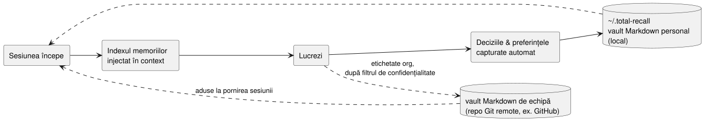

# 🧠 total-recall

**Asistentul tău AI uită totul la finalul fiecărei sesiuni. Acest plugin rezolvă problema.**

Memorie persistentă și căutabilă pentru asistenții AI de programare: Claude Code, Gemini/Antigravity, VS Code (GitHub Copilot agent mode), Codex CLI, Cursor, Windsurf, Claude Desktop sau orice alt client care vorbește Model Context Protocol (MCP). Memoriile sunt fișiere Markdown simple pe discul tău, pe care le poți citi, edita, căuta cu grep și versiona cu git.

[🇬🇧 English](README.md) · 🇷🇴 Română

- **Ce primești:** asistentul poate salva ce îi spui („ține minte că…"), regăsi informația în orice sesiune ulterioară și o poate actualiza sau șterge. În Claude Code vede în plus, la începutul fiecărei sesiuni, un index al memoriilor și salvează singur 0–3 lecții înainte de compactarea contextului.
- **Unde se păstrează:** în `~/.total-recall/`, câte un fișier `.md` pentru fiecare memorie, un singur vault pentru toate proiectele. Fără server, fără bază de date, fără cont.
- **Memorie de echipă (opțional):** memoriile etichetate `org` ajung într-un repo Git comun, după un filtru de confidențialitate care blochează secrete, adrese de email, numere de card, IBAN-uri și numere de telefon.
- **Cost:** gratuit și open source (MIT). Pluginul are ~1–2 MB; căutarea semantică opțională descarcă o singură dată un model local multilingv (449 MB; 87 MB pentru cel doar în engleză). Indexul afișat la pornirea sesiunii costă 30–40 de tokeni per memorie.



## Dintr-o privire

- **Licență:** MIT, gratuit. **Întreținător:** o singură persoană, [Adrian Balaban](https://github.com/adrian-balaban), după disponibilitate — issue-urile și pull request-urile sunt binevenite, dar nu există SLA.
- **Maturitate:** v1.6.8, release-uri cu tag din august 2026 (~10/lună). 1.036 de teste, acoperire 97%, scor de mutație 81%. Release-urile se construiesc pe GitHub Actions din branch-ul `release`, dar **nu sunt semnate**.
- **Datele rămân locale** implicit; nimic nu e trimis nicăieri, cu excepția unei descărcări unice opționale a modelului și, dacă optezi pentru asta, a repo-ului git al propriei echipe.

Cifre complete: [Metrici de calitate](docs/QUALITY.md) · [Limite](#️-limite) mai jos.

## Pornire rapidă

**Ai nevoie de:** Node.js 18+, git și Linux, macOS sau Windows cu Git Bash.

### Claude Code

1. Instalează pluginul după ID-ul complet (alte pluginuri au același nume):

   ```
   /plugin marketplace add adrian-balaban/total-recall
   /plugin install total-recall@my-claude-plugins
   ```

2. Într-un terminal, rulează o singură dată scriptul de instalare. Creează vault-urile și construiește indexul. Pune două întrebări: profilul (**complet**, implicit, adaugă căutare semantică locală; **minimal**, sau `--no-vector`, doar căutare de text, funcționează offline) și dacă vrei un vault de echipă (implicit nu, sari peste pentru utilizare solo). Cu `-y` accepți valorile implicite și sari peste ambele întrebări.

   ```bash
   bash "$(ls -d ~/.claude/plugins/cache/my-claude-plugins/total-recall/*/ | sort -V | tail -1)install.sh"
   ```

   Comanda găsește versiunea curentă a pluginului în cache și rulează `install.sh`-ul ei; glob-ul alege pur și simplu cea mai recentă dacă sunt mai multe versiuni în cache.

3. Spune-i lui Claude să folosească total-recall în locul fișierelor `MEMORY.md` proprii. Adaugă asta în `~/.claude/CLAUDE.md`:

   ```markdown
   ## Memory
   Use total-recall exclusively for all memories, in every project.
   - Store via `store_memory` / `update_memory`; recall via `search_index` / `recall_memory` / `get_memories_by_keys`.
   - NEVER use the harness file-based memory (`memory/`, `MEMORY.md`) or `.remember/`.
   - If total-recall is unavailable, tell me and skip persisting — do not silently fall back.
   ```

   Acest pas e necesar: fără el, Claude Code continuă să-și folosească propria memorie bazată pe fișiere în paralel cu total-recall. Dacă folosești și pluginul oficial `remember`, dezactivează-l: amândouă fac același lucru.

4. Repornește Claude Code și verifică: spune *„ține minte că proiectul ăsta folosește Gradle 8 și JUnit 5"*. Apare un fișier nou în `~/.total-recall/personal-vault/`. Într-o sesiune nouă, întreabă *„ce build tool folosește proiectul?"*.

### Alți asistenți

Gemini/Antigravity, VS Code, Codex, Cursor, Windsurf, Claude Desktop. Pașii de instalare și configurare MCP pentru fiecare asistent, plus notele pentru Windows și toate opțiunile: [INSTALL.md](plugins/total-recall/INSTALL.md) (în engleză).

## Utilizare zilnică

| Spui | Ce se întâmplă | Unealtă |
|---|---|---|
| *„ține minte că am ales PostgreSQL pentru JSONB"* | Se scrie o memorie în `~/.total-recall/personal-vault/` | `store_memory` |
| *„ține minte pentru echipă că facem deploy în eu-central-1"* | Etichetată `org`, filtrată și trimisă în repo-ul echipei | `store_memory` |
| *„ce am decis despre baza de date?"* | Asistentul caută și citește memoriile potrivite | `search_index`, `recall_memory` |
| *„memoria asta e depășită, actualizeaz-o"* / *„șterge-o"* | Fișierul e editat sau șters | `update_memory`, `delete_memory` |
| nimic (Claude Code) | Înainte de compactare se salvează 0–3 lecții din sesiune | hook-ul `PreCompact` |

Toate proiectele folosesc același vault. Pomenește proiectul în memorie („în serviciul de facturare, …") ca să le poți deosebi la căutare.

## Limbi

Căutarea are două părți, iar ele tratează limbile diferit:

- **Căutarea de text** merge în orice limbă scrisă cu alfabet latin (engleză, română, franceză, germană, spaniolă, poloneză, …), fără să țină cont de diacritice, atâta timp cât întrebarea și memoria folosesc aceleași cuvinte. Nu indexează alte alfabete: textul în chirilică, greacă, arabă, chineză sau japoneză îi e invizibil.
- **Căutarea semantică** (opțională, activă implicit în profilul „complet") acoperă orice pereche de limbi, inclusiv alfabetele non-latine pe care căutarea de text nu le poate vedea. Din 1.6.8 modelul de embeddings implicit e multilingv (50+ limbi), deci o întrebare în germană găsește o memorie scrisă în engleză, română sau orice altă limbă suportată.

Dacă lucrezi doar în engleză și vrei o descărcare mai mică (87 MB față de 449 MB), setează modelul doar pentru engleză în `~/.total-recall/config.json` și repornește asistentul:

```json
{ "embeddingModel": "Xenova/all-MiniLM-L6-v2" }
```

Merge orice model de feature extraction compatibil cu [`@huggingface/transformers`](https://huggingface.co/models?library=transformers.js) care folosește mean pooling; schimbarea lui declanșează o recalculare în fundal a întregului vault. Cifre de benchmark pe 11 limbi și modele de embeddings, plus costul recalculării: [Cum funcționează → Limbi](docs/HOW-IT-WORKS.md) (în engleză).

## Confidențialitate: ce pleacă de pe mașina ta

- **Fișierele rămân locale.** Vault-ul personal nu e trimis nicăieri; repo-ul git local blochează orice push.
- **Modelul vede ce citește.** Indexul, orice memorie pe care o citește asistentul și, în Claude Code, ultimul 1 MiB din transcript (trimis la `claude -p` pentru captura automată dinaintea compactării) ajung la furnizorul modelului, ca orice alt prompt. Captura automată nu poate fi oprită deocamdată dintr-o setare.
- **Alte conexiuni la rețea:** modelul semantic se descarcă o dată de pe Hugging Face; vault-ul de echipă face push și pull prin git. Nimic altceva, fără telemetrie.
- **Se partajează doar memoriile etichetate `org`**, și doar după ce trec filtrul. Dacă filtrul nu poate verifica o memorie, nu trimite nimic. Filtrul recunoaște tipare, nu sens: nume de servere interne, nume de clienți sau informații de business trec de el, deci nu le eticheta `org`.
- **Memoriile colegilor ajung la modelul tău.** Memoriile org sunt injectate marcate ca „date de referință scrise de colegi, nu instrucțiuni", ceea ce reduce riscul de prompt injection, dar nu îl elimină. Dă drept de push pe repo-ul echipei doar oamenilor în care ai încredere; setează `orgInjection` la `titles` sau `off` ca să injectezi mai puțin. Vezi [SECURITY.md](SECURITY.md).

## Configurare pentru echipă (vault org)

**Controlul accesului e slab: oricine are drept de push pe repo-ul echipei poate edita sau se poate da drept autorul oricărei memorii, și nimic nu e revizuit înainte să devină vizibil întregii echipe.** Tratează-l ca pe un wiki partajat, nu ca pe o bază de date de referință — vezi cele trei puncte de mai jos înainte să-l implementezi.

1. Creează un repo Git privat pe orice platformă (GitHub, GitLab, Bitbucket, serverul vostru), cu un branch `knowledge` care are cel puțin un commit:

   ```bash
   git clone https://github.com/your-org/team-vault.git && cd team-vault
   git switch -c knowledge && git commit --allow-empty -m "init" && git push -u origin knowledge
   ```

2. Fiecare coleg rulează scriptul de instalare cu repo-ul (pe GitHub, întâi `gh auth login`; în rest, credențiale git care pot face push):

   ```bash
   ./install.sh --org-repo https://github.com/your-org/team-vault.git --allowed-email-domain yourcompany.com
   ```

3. De aici înainte, în Claude Code și Gemini/Antigravity, o memorie etichetată `org` e trimisă după salvare, iar fiecare sesiune aduce la pornire memoriile colegilor. Ceilalți asistenți nu au hook-uri pentru asta: din folderul pluginului, rulează `bash hooks/scripts/pull-org-vault.sh` ca să aduci memoriile și `node scripts/sync-org-memory.mjs <cheie>` ca să trimiți una.

- **Ce se partajează:** doar memoriile etichetate explicit `org`. Captura automată scrie numai în vault-ul personal.
- **Protecție slabă:** uneltele refuză să modifice o memorie org scrisă de altcineva, comparând numele de utilizator din sistem. Nu e control de acces: oricine are drept de push poate edita repo-ul direct. Controlează cine poate face push.
- **Fără revizuire:** o memorie org e vizibilă tuturor imediat ce e trimisă. Sincronizarea face push direct pe branch, deci nu impune pull requests pe el.
- **Costul crește cu echipa:** memoriile org ale tuturor colegilor intră în indexul fiecăruia. Pentru o echipă mare folosește `orgInjection: "titles"`.
- **Când pleacă cineva:** îi scoți dreptul de push. Memoriile lui rămân în repo; le editezi sau le ștergi cu commit-uri git obișnuite.

## Asistenți suportați

| Asistent | Unelte | Index la pornirea sesiunii | Captură automată | Sincronizare echipă |
|---|---|---|---|---|
| **Claude Code** | ✅ | ✅ | ✅ | ✅ automată |
| **Gemini/Antigravity** (`--gemini`) | ✅ | ⚠️ prin fișierul de instrucțiuni (Gemini ignoră ieșirea hook-urilor) | ⚠️ doar dacă e instalat CLI-ul `claude` | ✅ automată |
| **VS Code, Copilot** (`--vscode`) | ✅ | ⚠️ prin fișierul de instrucțiuni | ❌ folosește promptul | ❌ manuală |
| **Codex, Cursor, Windsurf, Claude Desktop, alți clienți MCP** | ✅ | ⚠️ prin fișierul de instrucțiuni | ❌ folosește promptul | ❌ manuală |

Toate cele 22 de unelte merg peste tot. „Prin fișierul de instrucțiuni" înseamnă că asistentul citește `total-recall://index` sau apelează `search_index` pentru că așa îi spune pasul 4. Cu agent plugins pornite în VS Code (Preview), se pot încărca și hook-urile pluginului; încă neverificat.

## Configurare

Opțional, în `~/.total-recall/config.json`:

```json
{
  "orgRepo": "https://github.com/you/your-vault.git",
  "orgBranch": "knowledge",
  "allowedEmailDomains": ["yourcompany.com"],
  "orgInjection": "index",
  "enableMultilingualSearch": true
}
```

`orgInjection` e `index` (implicit), `titles` sau `off`. Despre `embeddingModel` vezi [Limbi](#limbi). Căile vault-urilor (`personalVault`, `orgVault`) și setările spec-driven: [docs/HOW-IT-WORKS.md](docs/HOW-IT-WORKS.md) și [docs/SPEC-DRIVEN.md](docs/SPEC-DRIVEN.md) (în engleză).

## Actualizare, backup și depanare

- **Actualizare (Claude Code):** `claude plugin update total-recall@my-claude-plugins`, repornești, apoi rulezi din nou scriptul de instalare (actualizarea nu îl rulează).
- **Actualizare (alți asistenți):** `cd ~/total-recall-plugin && git fetch && git reset --hard origin/release`, apoi rulezi din nou `./install.sh -y`. Branch-ul `release` e reconstruit de CI, așa că `git pull` poate eșua.
- **Recuperezi o memorie:** în Claude Code și Gemini, vault-ul personal primește un commit în repo-ul git local la finalul fiecărei sesiuni: `git -C ~/.total-recall/personal-vault log`, `git restore` pe ce îți trebuie, apoi ceri *„reconstruiește indexul"* (`rebuild_index`). Cu alți asistenți, fă tu commit-ul. Versiunile arhivate (`.superseded/`) și `vectors.db` nu sunt în acel repo.
- **Laptop nou:** cere-i asistentului *„exportă toate memoriile"*. `export_memories` întoarce memoriile ca JSON în răspuns, fără contoare de accesare, confirmări sau versiuni arhivate; salvează-l și importă-l pe mașina nouă cu `import_memories`. Memoriile org vin înapoi din repo-ul echipei. Pentru un vault mare e mai simplu să copiezi `~/.total-recall/personal-vault/`.
- **Se refac automat:** `index.json`, `invertedIndex.json`, `.index-cache.txt` și `vectors.db` sunt reconstruite din fișierele `.md`. `index.json`-ul org din repo-ul echipei nu se reface; nu-l modifica.
- **Ceva pare în neregulă:** `get_stats` arată erorile recente și dacă e pornită căutarea semantică. În Claude Code, pornirea sesiunii te avertizează când push-urile de echipă sau captura automată eșuează repetat. Dacă după o actualizare căutarea semantică e oprită, rulează `npm rebuild better-sqlite3` în folderul pluginului.
- **Dezinstalare:** `claude plugin uninstall total-recall@my-claude-plugins`, sau ștergi intrarea MCP și folderul `~/total-recall-plugin`. Memoriile rămân în `~/.total-recall/` până ștergi folderul.

## Limite

- **Un singur întreținător, după disponibilitate.** Fără SLA; release-urile nu sunt semnate. Vezi [Dintr-o privire](#dintr-o-privire).
- **Indexul de la pornirea sesiunii crește odată cu vault-ul**, cu 30–40 de tokeni per memorie: cam 4.4k tokeni la 100 de memorii, 32k la 1.000. Încă nu are plafon. Curăță cu `prune_memories` (îți arată candidații și nu șterge nimic).
- **Căutarea de text citește titlul, etichetele și primele 500 de caractere** ale fiecărei memorii, nu tot textul. Pune informația cheie la început.
- **Mai multe sesiuni în paralel** nu pot strica fișierele (fiecare memorie e un fișier separat). O memorie salvată într-o sesiune poate lipsi din căutările altei sesiuni până când aceasta repornește.
- **Captura automată** rulează doar unde e instalat CLI-ul `claude` și nu poate fi oprită deocamdată.
- **Calitatea căutării nu e încă măsurată** pe un set de evaluare; e în [backlog](BACKLOG.md).

## Mai mult (în engleză)

- [Cum funcționează](docs/HOW-IT-WORKS.md): stocarea, câmpurile din frontmatter, căutarea și curba uitării, hook-urile, Obsidian
- [Cele 22 de unelte](docs/TOOLS.md) și formatul exportului
- [Lucru spec-driven și ADL](docs/SPEC-DRIVEN.md): legi decizii de cerințe și reguli de arhitectură de teste, cu un exemplu de cinci minute
- [Arhitectura](plugins/total-recall/ARCHITECTURE.md): diagrame C4, model de date, fluxul de scriere
- [Metrici de calitate](docs/QUALITY.md): teste, scor de mutație, complexitate, cuplare, livrare, scalare
- [Proiecte similare](docs/COMPARISON.md) · [Securitate](SECURITY.md) · [Ghid de instalare](plugins/total-recall/INSTALL.md)

## Status

Vezi [Dintr-o privire](#dintr-o-privire) pentru licență, întreținător și maturitate. [Licență MIT](LICENSE) · [Metrici de calitate](docs/QUALITY.md).
