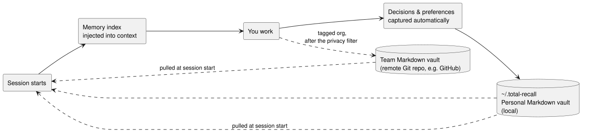

# 🧠 total-recall

[](https://github.com/adrian-balaban/total-recall/actions/workflows/mutation.yml) [](LICENSE)

**Your AI assistant forgets everything at the end of each session. This plugin fixes that.**

Persistent, searchable memory for AI coding assistants: Claude Code, Gemini/Antigravity, VS Code (GitHub Copilot agent mode), Codex CLI, Cursor, Windsurf, Claude Desktop, or any other client that speaks the Model Context Protocol (MCP). Memories are plain Markdown files on your disk that you can read, edit, grep and version with git.

🇬🇧 English · [🇷🇴 Română](README-ro.md)

- **What you get:** your assistant can save what you tell it ("remember that…"), find it again in any later session, and update or forget it. In Claude Code it also sees an index of its memories at the start of every session and saves 0–3 lessons on its own before the context is compacted.
- **Where it lives:** `~/.total-recall/`, one `.md` file per memory, one vault for all your projects. No server to run, no account. Memories you tag `org` can go to a shared Git repo (optional), after a privacy filter that blocks secrets, emails outside your allowed domains, card numbers, IBANs and phone numbers. Three other plugins are also called `total-recall`: [how this one differs](docs/COMPARISON.md).
- **Cost:** free and open source (MIT). The plugin is ~1–2 MB; the default profile downloads a local multilingual model once (449 MB; 87 MB for the English-only one; `--no-vector` skips it). The index shown at session start costs 30–40 tokens per memory.

## At a glance

- **License:** MIT, free. **Maintainer:** one person, [Adrian Balaban](https://github.com/adrian-balaban), best-effort — issues and PRs welcome, but there's no SLA.
- **Maturity:** v1.6.8, tagged releases since August 2026 (~10/month). 1,036 tests, 97% coverage, 81% mutation score. Releases build on GitHub Actions from the `release` branch but are **not signed**.
- **Files stay local** by default. The model provider sees what the assistant reads, and Claude Code sends the last 1 MiB of the transcript to `claude -p` for automatic capture. The only other outbound traffic is a one-time model download and, if you opt in, your own team's git repo.
- **Team vault risk:** anyone with push access to the team repo can edit any memory, and nothing is reviewed before it goes live ([details](#team-setup-org-vault)).
- **The index has no size cap:** 30–40 tokens per memory, about 4.4k at 100 memories, 32k at 1,000 and 162k at 5,000.

Full numbers: [Quality metrics](docs/QUALITY.md) · [Limits](#limits) below.



## Quick start

A first memory that survives a restart takes a few minutes. **You need:** Node.js 18+, git, and Linux, macOS or Windows with Git Bash (plus a Windows `node.exe` on PATH; Node installed only inside WSL does not count).

### Claude Code

1. Install the plugin by its full ID (other plugins share the name):

   ```
   /plugin marketplace add adrian-balaban/total-recall
   /plugin install total-recall@my-claude-plugins
   ```

2. In a terminal, run the setup script once. It creates the vaults and builds the index. It asks two questions: the profile (**complete**, the default, adds local semantic search; **minimal**, or `--no-vector`, is text search only and works offline) and whether to set up a team vault (default no, skip it for solo use). Add `-y` to accept the defaults and skip both questions. The command below finds wherever the plugin cache put the current version (the glob just picks the latest if more than one is cached) and runs its `install.sh`:

   ```bash
   bash "$(ls -d ~/.claude/plugins/cache/my-claude-plugins/total-recall/*/ | sort -V | tail -1)install.sh"
   ```

3. Tell Claude to use total-recall instead of its built-in `MEMORY.md` files. Add this to `~/.claude/CLAUDE.md`:

   ```markdown
   ## Memory
   Use total-recall exclusively for all memories, in every project.
   - Store via `store_memory` / `update_memory`; recall via `search_index` / `recall_memory` / `get_memories_by_keys`.
   - NEVER use the harness file-based memory (`memory/`, `MEMORY.md`) or `.remember/`.
   - If total-recall is unavailable, tell me and skip persisting — do not silently fall back.
   ```

   This step is required: without it, Claude Code keeps using its own file-based memory alongside total-recall; remove the block to undo. If you also run the official `remember` plugin, disable it: both do the same job.

4. Restart Claude Code and check it works: say *"remember that this project uses Gradle 8 and JUnit 5"*. A new file appears under `~/.total-recall/personal-vault/`. In a new session, ask *"what build tool does this project use?"*. Then ask the assistant to call `get_stats`: it lists totals and recent errors, and whether semantic search is on.

### Other assistants

Gemini/Antigravity, VS Code, Codex, Cursor, Windsurf, Claude Desktop. Per-assistant steps, Windows notes and every flag: [INSTALL.md](plugins/total-recall/INSTALL.md).

<details>
<summary>Any MCP client: the short version</summary>

```bash
git clone --depth 1 -b release https://github.com/adrian-balaban/total-recall.git ~/total-recall-plugin
cd ~/total-recall-plugin/plugins/total-recall && ./install.sh -y
```

Then register the server in your client's MCP configuration (command `bash`, argument the absolute path of `scripts/start-server.sh`), for example in the `mcpServers` format:

```json
{
  "mcpServers": {
    "total-recall": {
      "command": "bash",
      "args": ["/home/you/total-recall-plugin/plugins/total-recall/scripts/start-server.sh"]
    }
  }
}
```

For Codex, the same command and argument go in `~/.codex/config.toml`. Add the `## Memory` instructions from step 3 above to the assistant's instruction file. Without hooks, the assistant reads the `total-recall://index` resource and the `memory-workflow` prompt instead of an injected index. To check it works, ask the assistant to call `get_stats`.

</details>

## Daily use

| You say | What happens | Tool |
|---|---|---|
| *"remember that we chose PostgreSQL because of JSONB"* | A memory is written to `~/.total-recall/personal-vault/` | `store_memory` |
| *"remember for the team that we deploy to eu-central-1"* | Tagged `org`, filtered and pushed to the team repo | `store_memory` |
| *"what did we decide about the database?"* | The assistant searches and reads the matching memories | `search_index`, `recall_memory` |
| *"that memory is outdated, update it"* / *"delete it"* | The file is edited or deleted | `update_memory`, `delete_memory` |
| nothing (Claude Code) | 0–3 lessons from the session are saved before compaction | `PreCompact` hook |

All projects share one vault. Name the project in the memory ("in the billing service, …") to keep projects apart in search results.

## Your data

Each memory is one Markdown file with a small YAML header:

```markdown
---
title: "Prefer PostgreSQL for relational data"
tags: [architecture, database]
importanceScore: 0.8
updated: 2026-06-15T14:30:00Z
---
## Executive Summary
Prefer PostgreSQL over MySQL for new projects because of JSONB support…
```

| Kind | Files | If lost |
|---|---|---|
| **Source** | the `.md` files in `~/.total-recall/personal-vault/` | gone, unless you restore them from the vault's local git repo |
| **Derived** | `index.json`, `invertedIndex.json`, `.index-cache.txt`, `vectors.db` | rebuilt automatically from the `.md` files (access counts reset). The org `index.json` in the team repo is not rebuilt: leave it alone |

Export is plain JSON (`export_memories`, returned in the assistant's answer), so `jq` or DuckDB work on it once you save it. To move to a new machine, import it with `import_memories` (org memories come back from the team repo; for a large vault, copying the vault folder is simpler). For an off-machine backup, copy `personal-vault/`: its local git repo sits on the same disk: [The 22 tools → Export format](docs/TOOLS.md#export-format).

## Languages

Text search works in any language written in the Latin alphabet, with most accents ignored, as long as the question and the memory use the same words; it cannot see other scripts. Optional semantic search (on by default in the "complete" profile) covers every language pair, including Cyrillic, Greek, Arabic, Chinese and Japanese: since 1.6.8 the default model is multilingual (50+ languages).

If you only work in English and want the smaller download (87 MB vs. 449 MB), set the English-only model in `~/.total-recall/config.json` and restart the assistant:

```json
{ "embeddingModel": "Xenova/all-MiniLM-L6-v2" }
```

More: [How it works → Languages](docs/HOW-IT-WORKS.md).

## Supported assistants

| Assistant | Tools | Index at session start | Automatic capture | Team sync | Tested |
|---|---|---|---|---|---|
| **Claude Code** | ✅ | ✅ | ✅ | ✅ automatic | ✅ |
| **Gemini/Antigravity** (`--gemini`) | ✅ | ⚠️ through the instruction file (Gemini drops hook output) | ⚠️ only if the `claude` CLI is installed | ✅ automatic | ✅ |
| **VS Code, Copilot** (`--vscode`) | ✅ | ⚠️ through the instruction file | ❌ use the prompt | ❌ manual | ❌ |
| **Codex, Cursor, Windsurf, Claude Desktop, other MCP clients** | ✅ | ⚠️ through the instruction file | ❌ use the prompt | ❌ manual | ❌ |

All 22 tools work everywhere. "Through the instruction file" means the assistant reads `total-recall://index` or calls `search_index` because step 3 tells it to. **Tested** means the install was run end to end.

## How it's built

A stdio MCP server (TypeScript) plus lifecycle hooks, over flat Markdown files; every index is derived and rebuildable. C4 diagrams and invariants: [Architecture](plugins/total-recall/ARCHITECTURE.md). Optional for architects: tie memories to requirements and architecture rules to tests (ADL), with a five-minute walkthrough in [Spec-driven work](docs/SPEC-DRIVEN.md).

## Privacy: what leaves your machine

- **The files stay local.** The personal vault is never pushed anywhere; its local git repo blocks pushes.
- **The model sees what it reads:** the index, recalled memories and, in Claude Code, the last 1 MiB of the transcript (sent to `claude -p` for automatic capture, which cannot be switched off yet).
- **Other network calls:** the semantic model downloads from Hugging Face once; the team vault uses git. No telemetry.
- **Only `org`-tagged memories are shared**, and only after the privacy filter passes. The filter fails closed: if it cannot check a memory, nothing is pushed. It catches patterns, not meaning: internal host names, client names and business facts get through, so don't tag those `org`.
- **Teammates' memories reach your model**, marked as reference data, not instructions. That lowers the prompt-injection risk but does not remove it: give push access only to people you trust, or set `orgInjection` to `titles` or `off`. See [SECURITY.md](SECURITY.md).
- **Stopping is painless.** Your memories stay as `.md` files you can keep, and `export_memories` gives you JSON.

## Team setup (org vault)

**Access control is weak: anyone with push access to the team repo can edit or impersonate any memory, and nothing is reviewed before it goes live for the whole team.** Treat it like a shared wiki. Rules and rollout checklist: [INSTALL.md → Org vault](plugins/total-recall/INSTALL.md#-org-vault-team-memory).

1. Create a private Git repo on any host (GitHub, GitLab, Bitbucket, your own) with a branch named `knowledge` that has at least one commit:

   ```bash
   git clone https://github.com/your-org/team-vault.git && cd team-vault
   git switch -c knowledge && git commit --allow-empty -m "init" && git push -u origin knowledge
   ```

2. Each teammate runs the setup script with the repo (for GitHub, `gh auth login` first; for other hosts, git credentials that work without a prompt, such as a credential helper or an SSH key). `--allowed-email-domain` lets your work email domain through the privacy filter:

   ```bash
   ./install.sh --org-repo https://github.com/your-org/team-vault.git --allowed-email-domain yourcompany.com
   ```

3. From then on, in Claude Code and Gemini/Antigravity, a memory tagged `org` is pushed after it is stored, and each session pulls teammates' memories at start. Other assistants have no hooks for this: see [INSTALL.md → Org vault](plugins/total-recall/INSTALL.md#-org-vault-team-memory).

4. Check it: on one machine say *"remember for the team that …"*; on another, start a new session and ask about it. If it does not arrive, ask for `get_stats` (recent errors); in Claude Code the session start also warns when team pushes keep failing.

Start solo and add the team later: `install.sh` is safe to re-run. Settings (`orgBranch`, `allowedEmailDomains`, `orgInjection`, vault paths): [How it works → Configuration](docs/HOW-IT-WORKS.md#configuration).

## Upgrade, backup and troubleshooting

- **Upgrade (Claude Code):** `claude plugin update total-recall@my-claude-plugins`, restart, then run the setup script again (an update does not run it).
- **Other assistants:** upgrade and uninstall steps are in [INSTALL.md → Install without Claude Code](plugins/total-recall/INSTALL.md#-install-without-claude-code).
- **Restore a memory:** in Claude Code and Gemini the personal vault is committed to its local git repo at the end of each session: `git -C ~/.total-recall/personal-vault log`, `git restore` what you need, then ask for *"rebuild the index"* (`rebuild_index`). With other assistants, commit the vault yourself. Archived versions (`.superseded/`) and `vectors.db` are not in that repo.
- **Something looks off:** `get_stats` shows recent errors and whether semantic search is on. In Claude Code, the session start warns when team pushes or automatic capture keep failing. If semantic search is off after an update, run `npm rebuild better-sqlite3` in the plugin folder.
- **Uninstall (Claude Code):** `claude plugin uninstall total-recall@my-claude-plugins`. Your memories stay in `~/.total-recall/` until you delete it.

## Limits

- **The index at session start has no cap** (cost in [At a glance](#at-a-glance)). Clean up with `prune_memories`: it lists candidates and deletes nothing.
- **Text search reads the title, the tags and the first 500 characters** of each memory, not the whole body. Put the key fact first.
- **Several sessions at once** cannot damage memory files, but a memory stored in one can be missing from another's search until it restarts ([details](docs/HOW-IT-WORKS.md)).
- **Automatic capture** runs only where the `claude` CLI is installed, and cannot be switched off yet.
- **Retrieval quality is not yet measured** against an evaluation set; it is on the [backlog](BACKLOG.md).

## More

- [How it works](docs/HOW-IT-WORKS.md): storage, frontmatter fields, configuration, search and the forgetting curve, hooks, Obsidian
- [The 22 tools](docs/TOOLS.md) and the export format
- [Spec-driven work and ADL](docs/SPEC-DRIVEN.md): link decisions to requirements and architecture rules to tests, with a five-minute walkthrough
- [Architecture](plugins/total-recall/ARCHITECTURE.md): C4 diagrams, data model, write path
- [Quality metrics](docs/QUALITY.md): tests, mutation score, complexity, coupling, delivery, scale
- [Similar projects](docs/COMPARISON.md) · [Security](SECURITY.md) · [Install guide](plugins/total-recall/INSTALL.md)

## Status

See [At a glance](#at-a-glance) for license, maintainer and maturity. [MIT licence](LICENSE) · [Quality metrics](docs/QUALITY.md).
