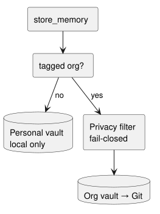

# 🧠 total-recall

**Your AI assistant forgets everything at the end of each session. This plugin fixes that.**

A persistent, searchable memory for Claude Code, Gemini/Antigravity and VS Code (GitHub Copilot agent mode). Memories are plain Markdown files with YAML frontmatter on your disk — greppable, git-versionable, [Obsidian](https://obsidian.md/)-readable. Nothing leaves your machine unless you tag it `org`.

🇬🇧 English · [🇷🇴 Română](README-ro.md)

## ⚡ TL;DR

- **What it is** — a persistent memory plugin for Claude Code, Gemini/Antigravity and VS Code (GitHub Copilot agent mode): memories are saved on your computer and survive across sessions, so you don't re-explain the same things every time. 22 MCP tools (17 for memory, 5 for [spec-driven architecture work](#-architecture-as-code--spec-driven-work-adl)) over a vault of Markdown files in `~/.total-recall`.
- **What it does for you** — injects the memory index at the start of every session (full memories are read on demand) and captures decisions and preferences automatically as you work and before each context compaction. Hosts that don't show hook output (Gemini/Antigravity, VS Code with `--vscode`) read the index from the `total-recall://index` MCP resource instead; with no hooks at all (`--vscode`) there is no automatic capture.
- **Spec-driven too** — memories can be tied to a spec: tag any decision, requirement or failure with a `system`, the `elements` it concerns and a `requirements` ID, and recall by element or follow a requirement to its decisions. No ADL needed for that. If the project also keeps its architecture as code (ADL), the tools additionally link each rule to the tests that enforce it. See [Architecture as code & Spec-driven work](#-architecture-as-code--spec-driven-work-adl).
- **How it searches** — hybrid: TF-IDF × Ebbinghaus forgetting curve, plus optional semantic search; falls back cleanly to text search when semantic search is unavailable.
- **Privacy** — local-first. The personal vault never leaves your machine; only what you tag `org` goes, through a fail-closed privacy filter, to a shared Git repo.
- **Install** — `/plugin marketplace add adrian-balaban/total-recall`, `/plugin install total-recall`, then `./install.sh` once. Node.js 18+, Linux · macOS · Windows (Git Bash).
- **Footprint** — ~1–2 MB, two production dependencies (the MCP SDK and Zod). The ~200 MB semantic model downloads only if you enable semantic search.
- **Status** — v1.6.6, stable: 981 tests pass, 96.9% statement coverage, ≈78% mutation score.


---

## 📡 Thoughtworks Technology Radar Vol. 34

Several techniques from the [Thoughtworks Technology Radar](https://www.thoughtworks.com/radar)
([Vol. 34, 2026 — PDF](https://www.thoughtworks.com/content/dam/thoughtworks/documents/radar/2026/04/tr_technology_radar_vol_34_en_1.pdf)) are already implemented here, as design decisions taken independently:

| Technique                                            | Ring          | How Total Recall does it                                                                                                     |
| ---------------------------------------------------- | ------------- | ---------------------------------------------------------------------------------------------------------------------------- |
| Progressive context disclosure + Context engineering | Trial + Adopt | SessionStart injects only the memory index; full content is read on demand                                                   |
| Mutation testing                                     | Trial         | Stryker gate in CI (see [Status & Known issues](#-status--known-issues))                                                     |
| Claude Code plugin marketplace                       | Trial         | git-based distribution, no version drift; the only channel, fed by a `release` branch that GitHub Actions builds from `main` |
| Structured output from LLMs                          | Adopt         | the capture hook asks the model for JSON lines, not free text                                                                |
| MCP by default                                       | Hold          | system operations (git, indexing) stay in plain scripts, not MCP tools                                                       |

**Three future directions**, each tracked in [BACKLOG.md](BACKLOG.md) with a trigger:
a context graph over memories (the `supersededAt` chain already stores temporal edges);
source-grounded extraction for the capture hook; an evaluation set for `recall_memory`.

---

## ⚙️ How it works & Storage

|                     |                                                                                                              |
| ------------------- | ------------------------------------------------------------------------------------------------------------ |
| **22 MCP tools**    | store, recall, hybrid search, semantic rerank, bulk export/import, and 5 architecture tools for ADL projects |
| **Hybrid search**   | TF-IDF × Ebbinghaus forgetting curve, optionally fused with vector embeddings                                |
| **Lifecycle hooks** | context injected at session start, memories captured as you work                                             |
| **Two vaults**      | personal stays local; `org`-tagged syncs to a shared Git repo                                                |

- **Headline feature:** at SessionStart only the memory index is injected; full memories are fetched on demand through `get_memories_by_keys`.
- **PreCompact capture:** 0–3 lessons are extracted from the conversation before context compaction and saved.
- **Live reload:** memories a teammate pushes to the org vault appear in your session without a restart.
- **Archive, not delete:** superseded versions of a memory are kept, not overwritten.



C4 diagrams (context → containers → components → code), the 22 tools, data model,
write path, server lifecycle, persistence and hook lifecycle are drawn in
**[ARCHITECTURE.md](plugins/total-recall/ARCHITECTURE.md)**.

### Two vaults & on-disk layout

Two separate vaults live under `~/.total-recall/`:

| Vault        | Path                              | When Used                                                                 |
| ------------ | --------------------------------- | ------------------------------------------------------------------------- |
| **Personal** | `~/.total-recall/personal-vault/` | Default for all memories (stays local).                                   |
| **Org**      | `~/.total-recall/org/org-vault/`  | Used when tagged `org`. Syncs to a remote Git repo with a privacy filter. |

```
~/.total-recall/
├── index.json               ← flat index: key → MemoryMetadata
├── invertedIndex.json       ← TF-IDF inverted index: token → {docs, idf}
├── .index-cache.txt         ← summary injected at SessionStart (shell-readable)
├── config.json              ← optional configuration (see below)
├── personal-vault/
│   ├── architecture/
│   │   └── db-choice.md     ← one memory: YAML frontmatter + Markdown body
│   ├── decisions/ …
│   └── vectors.db           ← sqlite-vec embeddings (optional, derived, git-ignored)
└── org/
    └── org-vault/           ← team memories, git-synced (branch from `orgBranch`)
```

Each memory is a `.md` file:

```markdown
---
title: "Prefer PostgreSQL for relational data"
tags: [architecture, database, feedback]
author: adrianb
importanceScore: 0.8
created: 2026-06-01T10:00:00Z
updated: 2026-06-15T14:30:00Z
---

## Executive Summary

Prefer PostgreSQL over MySQL for new projects because of JSONB support…
```

### Design principles & philosophy

- **Local-first** — memories live on your machine, not in the cloud.
- **Readable** — every memory is a Markdown file you can edit in any editor.
- **Versionable** — the team vault is git-backed; the personal vault stays local, with a local-only git repo (created by `install.sh`, never a remote) that snapshots it at the end of each session.
- **No infrastructure** — no external server or database. The Markdown files are the source of truth; the vector index (`vectors.db`) is a local SQLite, regenerable anytime and kept out of the snapshots.
- **Fault-tolerant** — degrades to text search if the vector path is unavailable.

The only mandatory dependencies are `@modelcontextprotocol/sdk` and `zod` (tool input schemas). TF-IDF, Ebbinghaus decay, RRF, and the YAML-frontmatter parser are all written from scratch:

1. **Security** — no `gray-matter` → no `js-yaml` CVE class (GHSA-h67p-54hq-rp68); the minimal parser is pinned by property-based tests (`fast-check`).
2. **Coherent scoring** — title-boost, tag-boost, and decay are one formula, not three libraries.
3. **Determinism** — zero LLM calls in the search path, zero cost, works offline/air-gapped.
4. **Auditability** — every scoring decision is observable via `get_stats`.

Only `@huggingface/transformers` (ONNX), `sqlite-vec` and `better-sqlite3` remain external — and all three are optional.

### Privacy Filter & Org Sync

- **Fail-closed by default**: blocks high-entropy secret tokens/keys, labeled secrets (e.g. a pasted `aws_secret_access_key = …`), all email addresses, and validated credit cards (Luhn), IBANs (ISO 13616 mod-97), and formatted phone numbers before any git push. If the filter cannot analyze the content, it does **not** push.
- **Email whitelist**: allow specific domains via `allowedEmailDomains: ["yourcompany.com"]` in `config.json`.
- **Author protection**: org memories can only be overwritten/updated by their author (OS username).
- _Note: pronouns are deliberately allowed (their false-positive rate blocked legitimate work notes); the `personal` and `org` tags are mutually exclusive to prevent accidental sync._

---

## 🛠️ The 22 MCP Tools

All tool calls operate against an in-memory index (`index.json`), making read/search operations fast and free of disk I/O. Speak naturally — _"remember that…"_ / _"remind me…"_ — and the model picks the right tool.

| Tool                       | Group        | Function            | Notable Behavior                                                                                                                                                                                                                                                    |
| -------------------------- | ------------ | ------------------- | ------------------------------------------------------------------------------------------------------------------------------------------------------------------------------------------------------------------------------------------------------------------- |
| `store_memory`             | Store        | Create a memory     | Routes to Org vault if tagged `org`. Overwrite needs `force=true` (refused on `no-prune` files).                                                                                                                                                                    |
| `recall_memory`            | Search       | Hybrid search       | TF-IDF, Ebbinghaus decay, and optional vector embeddings (fused via RRF).                                                                                                                                                                                           |
| `search_index`             | Search       | Metadata search     | Fast query scan of the in-memory index; does not read files, no `accessCount` bump.                                                                                                                                                                                 |
| `list_memories`            | Read         | Browse vault        | Paginated listing of memory metadata (filter by tag/category/date).                                                                                                                                                                                                 |
| `get_memories_by_keys`     | Read         | Fetch memory        | Batch fetch by key; full content or summary; served through an LRU cache.                                                                                                                                                                                           |
| `get_stats`                | Read         | Audit plugin        | Totals, cache stats, recent error log (last 10), latency percentiles, and a `vector` block (`enabled`/`depsPresent` + live vs stored model/dim). `enabled` defaults to true when the optional deps are loadable, so vector search reads as on from a fresh session. |
| `get_timeline`             | Read         | Chronological view  | Memories grouped and sorted by modification dates.                                                                                                                                                                                                                  |
| `get_related_memories`     | Read         | Find relations      | Jaccard similarity of tags with a category boost, plus shared `elements`.                                                                                                                                                                                           |
| `update_memory`            | Modify       | Edit a memory       | Preserves created timestamp and appends to session history (capped at 50). Re-embeds on content/tags/importance change.                                                                                                                                             |
| `delete_memory`            | Modify       | Delete a memory     | Refuses `no-prune` memories unless `force=true` is passed.                                                                                                                                                                                                          |
| `confirm_memory`           | Modify       | Feedback signal     | `useful=true` increments confirmations; `useful=false` increments flags — both feed retention scoring.                                                                                                                                                              |
| `rebuild_index`            | Modify       | Rescan filesystem   | Full re-scan of vaults, rebuilding TF-IDF while preserving access stats.                                                                                                                                                                                            |
| `prune_memories`           | Modify       | Clean stale entries | Lists Ebbinghaus decay candidates (does not auto-delete). Excludes `no-prune`.                                                                                                                                                                                      |
| `rerank_memories`          | Re-rank      | Semantic rerank     | Reorders candidate keys by cosine similarity to a query using embeddings. `keys` capped at 200 (extras dropped, order preserved).                                                                                                                                   |
| `export_memories`          | Bulk         | Bulk export         | Portable JSON archive; filter by keys, category, or tag. Unreadable bodies become `{key, error}` entries (counted in `errors`), never silent empty content. Closes the "new laptop" scenario.                                                                       |
| `import_memories`          | Bulk         | Bulk import         | Restores from an `export_memories` archive; skips existing keys unless `force=true`; skips entries carrying an `error` field so a failed export read can't clobber a live memory.                                                                                   |
| `delete_memories`          | Bulk         | Bulk delete         | Deletes a list of keys; `confirm=true` required (no default). A reserved `no-prune` key (without `force`) is recorded as a per-key error and the batch continues — not a batch reject. Closes the `prune_memories` loop.                                            |
| `index_architecture`       | Architecture | Index ADL           | One architecture-index memory per system: elements, assertions, relationships, and the tests tagged with each assertion ID. No-op on unchanged files. See [Architecture as code & Spec-driven work](#-architecture-as-code--spec-driven-work-adl).                 |
| `get_architecture_context` | Architecture | Element context     | The system summary, or one element's ADL rules, relationships, decisions, failures and open questions.                                                                                                                                                              |
| `trace`                    | Architecture | Requirement → test  | Requirement, assertion or element → assertions and controls → tests → recorded results and decisions.                                                                                                                                                               |
| `get_architecture_history` | Architecture | Change log          | `architecture-changes` memories in time order, plus the index rebuilds.                                                                                                                                                                                             |
| `validate_architecture`    | Architecture | Run checks          | ADL test coverage; failures stored as `fitness-result` memories, resolved on a later pass.                                                                                                                                                                          |

The five architecture tools are on by default and can be switched off one by one (`specDriven.tools`) or together (`specDriven.enabled: false`, which also removes the optional spec fields from the other tools' schemas).

---

## 🔍 Search Pipeline

```
recall_memory(query)
  │
  ├─ tfidfSearch(query)
  │    ├─ tokenize(query) → tokens (EN↔RO expansion if enableMultilingualSearch)
  │    ├─ per token: lookup in invertedIndex
  │    ├─ score = TF × IDF × title-boost(2×) × tag-boost(1.5×)
  │    └─ × computeRetentionStrength(importance, daysSince, accessCount, confirmations, flags)
  │
  ├─ [optional: vector deps installed]
  │    ├─ embed(query) → sqlite-vec KNN
  │    └─ Reciprocal Rank Fusion(tfidf, vector), k=60:  score(d) = Σ 1/(60 + rank_i(d))
  │
  └─ slice to `limit`; with full=true bump accessCount and read the body, else metadata only
```

> **What is TF-IDF?** Term Frequency × Inverse Document Frequency — the classic text-search score: a word counts a lot if it appears **often in this document** (TF) but **rarely across the collection** (IDF). The _inverted index_ is the reverse map `word → documents containing it`, like a book index — search reads the index, never the files.

### The Ebbinghaus forgetting curve (1885), in code

Memories fade like human memory: unimportant, unaccessed memories decay out of results; every access "refreshes" them.

```
λ        = 0.16 × (1 − importanceScore × 0.8)
strength = clamp(importance × exp(−λ × daysSince)
                 × (1 + accessCount × 0.2 + confirmations × 0.1 − flags × 0.1), 0, 1)
```

| importanceScore | λ (forgetting speed) | Behavior                                |
| --------------- | -------------------- | --------------------------------------- |
| 1.0 (critical)  | 0.032                | Slow decay — relevant for weeks         |
| 0.5 (normal)    | 0.096                | Medium decay                            |
| 0.3 (low)       | 0.122                | Fast decay — fades from results in days |

Each access adds +20% retention; each `confirm_memory(useful=true)` +10%; each flag −10% — so a frequently accessed memory that was flagged wrong today drops, refining retention beyond raw access counts (an idea validated by [mozilla-ai/cq](https://github.com/mozilla-ai/cq)'s endorsement signal).

- **Immortality (`no-prune` tag)**: excludes the memory from `prune_memories` and protects it from accidental deletion or routine overwrite. Useful for architecture decisions (ADRs).

### Embeddings & vector search (optional)

Optional, lazy-loaded, fully local — the plugin degrades cleanly to TF-IDF without the native deps (offline machines, failed native builds). No cloud APIs, no API keys; vectors are computed once at write time (`vectors.db`), never re-embedded on read; heavy deps are esbuild-`external` so the base bundle stays tiny; `flushPending()` on SIGTERM/SIGINT guarantees vectors hit disk on exit.

`get_stats` reports vector search as **enabled by default** when the optional deps are loadable — it probes `@huggingface/transformers` + `sqlite-vec` + the `better-sqlite3` native binding directly (not the lazy-loaded pipeline, which hasn't fired on a fresh session), so a brand-new session reads `vector.enabled: true` instead of looking disabled-while-idle. The one real "disabled" state is a missing `better-sqlite3` binding — the post-`claude plugin update` footgun, where the new version dir ships the dep source-only because `install.sh` doesn't re-run. If `get_stats` shows `depsPresent: false`, run `npm rebuild better-sqlite3` in the plugin cache dir (the in-process self-heal in `vectorStore.ts` tries this once automatically).

```bash
npm install --no-save @huggingface/transformers sqlite-vec better-sqlite3   # or install.sh --complete
```

Why hybrid: TF-IDF is exact-token ("k8s pod OOM" misses "workload killed for memory pressure"); the embedding model handles paraphrase. The default `all-MiniLM-L6-v2` (384-dim, via the in-process HuggingFace pipeline) covers English paraphrase; cross-language retrieval (store in Romanian, retrieve in English) is handled by the `enableMultilingualSearch` query-token expansion, not the embedder. RRF fuses the two rankings by position only (scale-free), since lexical scores and cosine similarities aren't directly comparable.

### Multilingual search (EN↔RO)

`enableMultilingualSearch: true` expands query tokens between English and Romanian:

```
# 1. Store (in English):
> "remember that we chose PostgreSQL over MySQL because of JSONB support"

# 2. In a new session, ask in ROMANIAN:
> "care a fost decizia noastră despre baza de date?"
→ recall_memory(query="decizie baza de date")
→ expansion maps „decizie"→"decision", „baza de date"→"database" → finds the English memory ✅
```

---

## 🪝 Lifecycle Hooks & Automatic Capture

### `SessionStart` (5 sequential steps)

```
1. pull-org-vault.sh         — git pull on the org-sync branch (config.orgBranch, default knowledge; if configured)
2. build-memory-index.sh     — frontmatter scan → .index-cache.txt
3. load-memory-index.sh      — inject the memory index into context (Claude Code only)
4. check-sync-errors.sh      — warn if org-sync pushes failed since last success
5. check-extract-outcomes.sh — warn if most recent PreCompact extraction runs failed
```

Effect: every new Claude session automatically receives a summary of all your memories — without asking. In a project with ADL files, step 3 also adds a short architecture summary (`specDriven.sessionSummary`, capped at `sessionSummaryMaxChars`).

### `PostToolUse` (matcher: `mcp__plugin_total-recall_total-recall__(store_memory|update_memory|delete_memory)`)

`sync-org-memory.sh` — checks the `org` tag, applies the privacy filter, commits/pushes to the team's org-sync branch (`config.orgBranch`, default `knowledge`), and rebuilds `.index-cache.txt`. Bursts of org writes are **coalesced**: an atomic job queue + `flock`ed background worker means one git sync process per session, not one per key. Pulled teammate memories are reconciled into the live index **without a restart** (marker-file poller).

> **Why the matcher is a regex, not a bare tool list.** Claude Code treats a matcher containing only letters/digits/`_`/`-`/spaces/`,`/`|` as an **exact string list** compared verbatim against the full tool name. Plugin MCP tools are named `mcp__plugin_total-recall_total-recall__<tool>`, so a bare `store_memory|update_memory|delete_memory` never matched and the org-sync hook silently never fired. The parens force the **regex** path so it matches the `__<tool>` suffix.

### `PostToolUse` (matcher: `Write|Edit|MultiEdit`; Gemini/Antigravity `AfterTool`: `write_file|replace`)

`architecture-change.sh` — when the edited file is an `.adl` file (`specDriven.captureChanges`), asks the model to run `index_architecture`, store an `architecture-changes` memory with the reason, and run `validate_architecture`. Any other file returns at once, without starting Node for the default extensions.

### `PreCompact`: What gets saved automatically

Before each context compaction (`PreCompact`), `extract-and-store-memories.sh` reads the session transcript, asks the model to extract 0–3 learnings as JSON lines, and `store-learning.mjs` writes them directly as `.md` files to the personal vault (no MCP round-trip; never overwrites existing files):

- **Saved:** work observations (what worked, what didn't) and non-obvious project context (motivations, constraints, non-trivial decisions). With `specDriven.extractDecisions` on, the prompt also asks for architecture decisions with their `system`, `elements` and `requirements`; those fields go through the same sanitiser as `store_memory`.
- **Not saved:** code snippets, file paths, git history — all derivable from the workspace. (The one deliberate exception: a spec or architecture memory may record the repo-relative path and commit of the file it summarises, as a pointer in its frontmatter, never in the text.)

### `SessionEnd`

Logs the session, flushes pending index and embedding writes before exit, and auto-commits the personal vault if it is a local git repo (never a remote). Only `install.sh` creates that repo (one-time `git init`, a `pre-push` block, a `.gitignore` for `.superseded/`, `*.tmp.*` and `vectors.db*`); the hook never runs `git init`, so a vault without `.git` is skipped silently. `claude plugin update` does not re-run `install.sh`: re-run it to create the repo.

---

## 🥇 Using it as your only memory system & Retrieval order

Claude Code ships its own file-based memory (a `memory/` directory with a `MEMORY.md` index), and some setups add a `.remember/` history. If you want Total Recall to be the single source of truth, say so in your **global** `~/.claude/CLAUDE.md`:

```markdown
## Memory

Use total-recall exclusively for all memories, in every project.

- Store via `store_memory` / `update_memory`; recall via `recall_memory` / `search_index`.
- NEVER use the harness file-based memory (`memory/`, `MEMORY.md`) or `.remember/`.
- If total-recall is unavailable, tell me and skip persisting — do not silently fall back.
```

**Why it works:** instruction priority is your `CLAUDE.md` > skills > harness defaults, so your instruction beats the hook and default prompts that encourage the built-in memory.

### 📇 Retrieval order (cheapest first)

1. Injected index at SessionStart (free — already in context)
2. `get_memories_by_keys(summary=true)` — if you know the key
3. `search_index(query=…)` — fast metadata, no file reads
4. `recall_memory(query=…, full=false)` — TF-IDF + Ebbinghaus
5. `recall_memory(query=…, full=true)` — with full content

`search_index` and `recall_memory` skip `journal` entries unless you pass `excludeJournal: false`.

The bundled `total-recall:memory-workflow` skill teaches the model this order plus capture rules (executive summary, dedup check, `importanceScore`, org tagging) and is optional reference material, not a dependency.

---

## 📐 Architecture as code & Spec-driven work (ADL)

Total Recall describes its own architecture in ADL, for the code level (modules, dependencies, data rules) and the system level (who talks to whom), and the build fails when the code drifts from it. The spec-driven tools work with the same notation in your own projects, remembering what a spec does not say: why each rule exists, what was rejected, which checks failed and how they were fixed.

This works at two levels:

- **With memories only.** Any memory can carry optional frontmatter fields: `system`, `artifact` (`spec`, `adl`, `adr`, `fitness-result`), `elements` (`adl:<domain>.<component>`, `assert:<ID>`), `requirements`, `sourcePath`, `sourceRev`, `status` (`proposed`, `accepted`, `superseded`, `failed`, `resolved`) and `supersedes`. `store_memory`, `update_memory`, export and import carry them; `recall_memory` and `search_index` filter on `elements`; `get_related_memories` follows shared elements; and a requirement ID ties its decisions together. This needs no ADL file and no index.
- **With ADL as well.** When a project keeps its architecture as code (`DEFINE SYSTEM`, `ASSERT(…)`, `FOREACH … DO … END`, and `DEFINE COMMUNICATION` for system connections), the files stay in your repository as the source of truth and the five architecture tools build on the same memories:
  1. `index_architecture(path)` reads every `*.adl` file under `path` into one summary memory per system (elements, assertions with their `# [ID]` tag, relationships from `DEFINE COMMUNICATION`, capabilities, contracts, and the test lines carrying each assertion ID). Stores the repo-relative path and commit, not the files. Re-running on unchanged files writes nothing.
  2. `get_architecture_context`, `trace` and `get_architecture_history` return the rules, relationships, decisions, failures and changes for an element, requirement or assertion. Superseded decisions are listed separately, never as current.
  3. `validate_architecture(path)` runs the ADL test-coverage check (every tagged assertion has a test carrying its ID; no external tool needed). Failures become `fitness-result` memories; a later pass marks them resolved (`resolvedBy`).
  4. **Org guardrails:** org memories tagged `guardrail` (reusable ADL assertions with the reason) are returned by `get_architecture_context`. An org-tagged memory with `artifact: "spec"` is refused when it names a host, credential, or term from `orgBlockedTerms`.
  5. **Hooks & skill:** hooks add a short architecture summary at session start and a prompt to record the change when an `.adl` file is edited. The `spec-driven-workflow` skill describes the full loop (spec → requirement IDs → ADL → tagged fitness functions → code → validation → captured decisions) and ships starter templates.

### ADL: Architecture Definition Language

ADL is the notation used in the masterclass [**"How to Teach Your Agents About Architecture"**](https://codecamp.ro/masterclasses/how-to-teach-your-agents-about-architecture-iasi-2026/), which Neal Ford taught at Codecamp Iași, Romania (27–28 October 2026).

- **What it is.** A light, pseudocode-like way to write an architecture down, with no formal grammar. `DEFINE` lines name the system, its domains and its components. `ASSERT(…)` lines state the rules the code must keep, in plain English where that is clearer.
- **Who reads it.** People read it as short documentation that is harder to let go stale than a diagram. AI agents read it as context when they write code, and as a specification to check the code against.
- **How it is enforced.** An ADL file is never executed. Each assertion is checked by a test written for it (a fitness function), for example with ArchUnitTS in this repository.

This example comes from this repository's own [structure.adl](plugins/total-recall/architecture/adl/structure.adl), not from the course:

```
DEFINE SYSTEM Total Recall AS tr
    DEFINE COMPONENT Pure Helpers AS helpers
    DEFINE COMPONENT Tools AS tools
ASSERT(Pure Helpers have no dependency on any other component) # [TR-S1]
```

The `# [TR-S1]` tag is a Total Recall convention, not part of ADL. The test that enforces the rule has the same tag in its name, and `adl-coverage.test.ts` fails when an assertion has no test.

> The course material is not published here: no slides, exercises, reference guide or solutions. This section describes the idea in our own words, and every example is from this repository.

The system level lives in [system.adl](plugins/total-recall/architecture/adl/system.adl): the host, the MCP server, the hooks, the local embedder and the org git remote, and the `DEFINE COMMUNICATION` lines that connect them to the two vaults. `adl-consistency.test.ts` fails when a connection names an element nobody defined.

> **Note.** Earlier versions also described the system level in a [CALM](https://calm.finos.org/) document and validated it in CI with `@finos/calm-cli`. CALM support was removed in 1.3.0; `.calm.json` files are no longer indexed, and the `calm` and `calmExtensions` keys are ignored. Describe the system level in an `.adl` file with `DEFINE COMMUNICATION` instead.

Details: [ARCHITECTURE.md → Architecture as code](plugins/total-recall/ARCHITECTURE.md#-architecture-as-code).

### Spec-driven configuration (`specDriven`)

Everything is configurable under `specDriven` in `~/.total-recall/config.json`; every key is optional, and `"specDriven": {"enabled": false}` gives back the exact 17-tool behaviour:

```json
{
  "specDriven": {
    "enabled": true,
    "tools": [
      "index_architecture",
      "get_architecture_context",
      "trace",
      "get_architecture_history",
      "validate_architecture"
    ],
    "categories": ["specs", "architecture-changes"],
    "adlExtensions": [".adl"],
    "excludeDirs": ["node_modules", ".git", "dist", "build", "coverage"],
    "sessionSummary": true,
    "sessionSummaryMaxChars": 1500,
    "captureChanges": true,
    "extractDecisions": true,
    "guardrails": true,
    "orgBlockedTerms": []
  }
}
```

| Key                                        | Effect                                                                                                          |
| ------------------------------------------ | --------------------------------------------------------------------------------------------------------------- |
| `enabled`                                  | `false` switches everything below off: 17 tools, no new schema fields, no new hook output                       |
| `tools`                                    | Only the listed architecture tools are registered (`[]` for none). Read at server start: restart after a change |
| `categories`                               | Extra category folders created at boot                                                                          |
| `adlExtensions`, `excludeDirs`             | What a project scan picks up and skips                                                                          |
| `sessionSummary`, `sessionSummaryMaxChars` | The SessionStart architecture summary and its size                                                              |
| `captureChanges`                           | The change prompt after an ADL edit                                                                             |
| `extractDecisions`                         | The PreCompact request for decisions with element IDs                                                           |
| `guardrails`                               | Org guardrails in `get_architecture_context`                                                                    |
| `orgBlockedTerms`                          | Client names and other terms an org spec memory must not contain                                                |

> **Gemini/Antigravity:** the five tools and the field filters work. The two hooks are registered in `hooks.gemini.json` too, but Gemini/Antigravity drops `additionalContext` (see [Client Compatibility](#-client-compatibility)), so the session summary and the change prompt are not shown there.

---

## ⚙️ Configuration (`config.json`)

Configure total-recall by editing `~/.total-recall/config.json`:

```json
{
  "personalVault": "~/my-custom-personal-vault",
  "orgVault": "~/my-custom-org-vault",
  "orgRepo": "https://github.com/you/your-vault.git",
  "allowedEmailDomains": ["yourcompany.com"],
  "embeddingModel": "Xenova/all-MiniLM-L6-v2",
  "enableMultilingualSearch": true,
  "orgBranch": "knowledge",
  "orgInjection": "index"
}
```

- **embeddingModel**: optional override for the local HuggingFace transformer model (defaults to `Xenova/all-MiniLM-L6-v2`, 384-dim). Point this at a different `@huggingface/transformers`-compatible model if you need a different embedding space — changing the model dimension drops the existing vector index (rebuilt on the next write).
- **enableMultilingualSearch**: Romanian/English query token expansion for cross-language lexical retrieval.
- **orgBranch**: the branch of `orgRepo` the org vault pulls from and pushes to.
- **orgInjection**: how org memories are injected at SessionStart — `index` (default, framed as teammate-written data), `titles` (titles only) or `off`. See [SECURITY.md](SECURITY.md).
- **specDriven**: the spec-driven features; see [Spec-driven configuration](#spec-driven-configuration-specdriven).

---

## 🚀 Install & Footprint

See **[INSTALL.md](plugins/total-recall/INSTALL.md)** for the full guide (profiles, Windows, org vault, Codex, local clones).

From inside a Claude Code session:

```
/plugin marketplace add adrian-balaban/total-recall
/plugin install total-recall
```

Then run `./install.sh` once from the installed plugin directory to create the vaults and register the MCP server:

```bash
./install.sh                         # vaults, MCP registration, index (run once)
./install.sh --gemini                # Gemini/Antigravity (agy)
./install.sh --vscode                # VS Code user mcp.json (Copilot, when agent plugins are off; tools only)
```

`install.sh` asks up front: **a. minimal** (no optional deps, no local LLM) or **b. complete** (semantic search + local embeddings) — **complete is the default**: pressing Enter, `-y`, or any non-interactive run selects it. Hooks auto-load from `hooks/hooks.json` — nothing to wire.

**The marketplace is the only distribution channel** — no zip, no npm package. It installs the `release` branch, whose `dist/` bundle is built by GitHub Actions after the CI gate goes green; `dist/` is gitignored on `main`, so no hand-built artifact can ship. Working from a local clone means building it yourself (`npm install && npm run build`, or let `install.sh` do it).

### 🔗 Footprint

Two production dependencies — the MCP SDK and Zod. Three optional ones power semantic search (`@huggingface/transformers`, `better-sqlite3`, `sqlite-vec`) and are only pulled in if you enable it.

|                    |                                  |
| ------------------ | -------------------------------- |
| **Plugin**         | ~1–2 MB                          |
| **Optional model** | ~200 MB, downloaded on first use |

---

## 💻 Client Compatibility

| Client                           | MCP Tools | Hook Side Effects (Sync/Index)                         | Context Injection (`additionalContext`)                                                      | Playbook Skills |
| -------------------------------- | --------- | ------------------------------------------------------ | -------------------------------------------------------------------------------------------- | --------------- |
| **Claude Code**                  | ✅ Yes    | ✅ Yes                                                 | ✅ Yes (SessionStart/PostToolUse)                                                            | ✅ Yes          |
| **Gemini/Antigravity (agy)**     | ✅ Yes    | ✅ Yes                                                 | ❌ No (silently dropped by Gemini/Antigravity)                                               | ❌ No           |
| **VS Code (Copilot agent mode)** | ✅ Yes    | ⚠️ Agent plugins (Preview, unverified) · ❌ `--vscode` | ⚠️ Agent plugins (unverified) · ❌ `--vscode`: index via the `total-recall://index` resource | ⚠️ Unverified   |

### Client-Specific Integration Details

- **Claude Code**: zero-touch. Hooks automatically pull git changes, rebuild the local cache, and inject the memory index at session start.
- **Gemini/Antigravity (agy)**: registers through `gemini-extension.json` using the `agy` CLI. Tool namespace is `mcp_total-recall_<tool>` (single underscore); Gemini/Antigravity renames the hook events (PostToolUse→AfterTool, PreCompact→PreCompress) — handled by `hooks/hooks.gemini.json`.
- **VS Code (GitHub Copilot agent mode)**: with VS Code agent plugins on (Preview), the plugin's own `.mcp.json` and hooks load — expected to work, not yet verified. With them off, `./install.sh --vscode` adds the server to VS Code's user `mcp.json` (tools only, no hooks); the memory index and workflow rules then come from the `total-recall://index` resource and the `memory-workflow` prompt. Details in [INSTALL.md](plugins/total-recall/INSTALL.md).
- **Ollama backends**: total-recall works as persistent memory for `ollama launch claude` too — same vault regardless of whether Claude Code talks to Anthropic or a local/cloud model.
- **Windows**: supported via Git Bash — keys and git paths are `/`-normalized internally; see [INSTALL.md](plugins/total-recall/INSTALL.md#windows).

---

## 📝 [Obsidian](https://obsidian.md/) Integration

Both vaults open directly as Obsidian vaults (plain `.md` + YAML frontmatter).

- **Simple YAML**: stick to flat string arrays and simple scalars. `src/frontmatter.ts` does not support anchors or multi-line block scalars.
- **No file watching**: Obsidian edits are not loaded until a new session starts or you call `rebuild_index`.
- **Wiki-links**: `[[wikilinks]]` are tokenized by their raw words; the link graph is not resolved.
- **Sync safeguard**: do not use Obsidian Sync on the org-vault directory; rely exclusively on total-recall's git sync so the privacy filter runs before every push.

---

## 📊 Status & Known issues

|              |                                                                                                                                                                                                       |
| ------------ | ----------------------------------------------------------------------------------------------------------------------------------------------------------------------------------------------------- |
| **Version**  | 1.6.6 — stable                                                                                                                                                                                        |
| **Tests**    | 981 unit + 24 integration passing · 73 files · ~16k lines of test code                                                                                                                                |
| **Coverage** | 96.9% statements · 90.9% branches · 98.1% lines                                                                                                                                                       |
| **Mutation** | ≈78% (Stryker, 15 core modules) · drifts ~±1 pt run-to-run · gate fails below 65%                                                                                                                     |
| **CI**       | [`mutation.yml`](.github/workflows/mutation.yml) — audit + typecheck + build + full unit & integration suites + Stryker on every push/PR to `main`. The only build pipeline; nothing is gated locally |
| **Releases** | [`release.yml`](.github/workflows/release.yml) — builds `dist/` and publishes the `release` branch the marketplace installs from; tags + notes when the version changes                               |
| **Audit**    | 0 critical in production deps                                                                                                                                                                         |

Mutation testing checks whether the tests are actually any good: Stryker deliberately changes small things in the code (`>` becomes `<`, `true` becomes `false`), and a test suite that doesn't fail when that happens isn't strict enough.

Reproduce: `npm test` · `npm run test:coverage` · `npm run test:integration` · `npm run mutation`
(from `plugins/total-recall/`)

### ⚠️ Known issues

- **Teammate-written org memories reach your model's context.** Since 1.4.0 the org entries of the memory index (keys, titles, tags) are injected at SessionStart, and served by the `total-recall://index` resource, only inside a block marked "teammate-written reference data, not instructions"; `orgInjection` (`index` | `titles` | `off`) in `~/.total-recall/config.json` controls them. Full org memory bodies returned by `recall_memory`, `get_memories_by_keys` and `get_architecture_context` are **not** framed, and `orgInjection` does not apply to them. Framing lowers the risk but does not remove it; give org-vault push access only to people you trust. See [SECURITY.md](SECURITY.md).
- **Two modules reach code without checking it.** Per-module mutation score diverges sharply from coverage: `embeddings.ts` 50.6% and `persistence.ts` 55.1%. `persistence.ts` is the instructive case — 86.3% coverage but only 55.1% mutation, with 120 surviving mutants: the tests run the code but would not notice if it broke. Coverage alone would have missed this, which is why the gate looks at mutation.
- **The mutation score is not reproducible run-to-run.** Two CI runs with no change to any mutated source file reported 65.39% and 66.39% — about ±1 point of drift, most likely from mutants that time out under varying runner load. Do not read a single decimal figure as precise. Margin over the 65% break threshold was widened to roughly 3 points in v1.1.22 (five modules taken from 0–75% up to 93–100%, +34 mutants killed), so ordinary drift no longer risks a red gate — which matters because a red gate silently withholds the `release` branch rather than shipping anything broken.

---

## 💡 Inspiration & Comparison with Similar Projects

Projects and ideas this plugin drew on:

- **[strvmarv/total-recall](https://github.com/strvmarv/total-recall)** and **[davegoldblatt/total-recall](https://github.com/davegoldblatt/total-recall)** — same name, different trade-offs (see table below); studying them shaped the "bounded local memory, plain files" positioning.
- **[88plug/total-recall](https://github.com/88plug/total-recall)** — a third plugin with the same name (installs as `total-recall@88plug`). It mines the raw session transcripts of Claude Code and 9 other CLIs into a local SQLite FTS5 + ollama-vector index with 26 MCP tools; this plugin instead stores curated, human-readable Markdown memories. Different problem, same name — see [INSTALL.md](plugins/total-recall/INSTALL.md#️-same-name-other-plugins).
- **`remember@claude-plugins-official`** — the official session-handoff plugin, which writes `.remember/*.md` files into every project. It competes for the same hooks and the same job, so run only one of the two; see [Using it as your only memory system](#-using-it-as-your-only-memory-system--retrieval-order).
- **Hermann Ebbinghaus (1885)** — the forgetting curve `e^(−t/S)` behind retention scoring.
- **Reciprocal Rank Fusion** (Cormack, Clarke & Buettcher, 2009) — the scale-free rank fusion (k=60) used for the hybrid lexical+vector merge.
- **[Obsidian](https://obsidian.md/)** — the "your knowledge is a folder of Markdown files with frontmatter" storage model.
- **[mozilla-ai/cq](https://github.com/mozilla-ai/cq)** — the open standard for _shared agent learning_. Complementary, not competing: cq = operational lessons shared between agents via a reviewed store; total-recall = _your_ context memory (decisions, preferences, architecture) as `.md` files + git, no server, no review pipeline. cq's endorsement mechanism directly inspired total-recall's `confirm_memory` confirmations/flags signal in the retention score.

|                       | This Plugin                                      | [strvmarv/total-recall](https://github.com/strvmarv/total-recall) | [davegoldblatt/total-recall](https://github.com/davegoldblatt/total-recall) | [88plug/total-recall](https://github.com/88plug/total-recall) | [mozilla-ai/cq](https://github.com/mozilla-ai/cq) |
| --------------------- | ------------------------------------------------ | ----------------------------------------------------------------- | --------------------------------------------------------------------------- | ------------------------------------------------------------- | ------------------------------------------------- |
| **Language**          | TypeScript / Node.js                             | .NET 8 + F#                                                       | Bash + Markdown                                                             | Python                                                        | Python                                            |
| **Storage**           | Markdown + JSON index                            | SQLite / Postgres                                                 | Markdown                                                                    | SQLite index over session transcripts                         | Shared knowledge store                            |
| **Text Search**       | TF-IDF                                           | BM25                                                              | Plain files scan                                                            | SQLite FTS5                                                   | —                                                 |
| **Vector Search**     | Optional sqlite-vec                              | Local ONNX                                                        | None                                                                        | ollama embeddings (default on)                                | —                                                 |
| **Rerank/Decay**      | Ebbinghaus decay × TF-IDF + confirm/flag signals | 4-tier hot/warm/cold                                              | None                                                                        | —                                                             | Human review + endorsements                       |
| **Org Sync**          | Git-synced, privacy filter                       | DB connectors (Jira, Confluence)                                  | None                                                                        | None                                                          | Reviewed shared store (7 hosts)                   |
| **Context injection** | ✅ Native (Claude Code hooks)                    | —                                                                 | —                                                                           | ✅ SessionStart signpost + per-prompt retrieval               | ❌ agent must query explicitly                    |
| **Target**            | Bounded local memory                             | Large team deployments                                            | Zero dependencies                                                           | Mining past sessions of many CLIs                             | Cross-agent shared learning                       |

---

🏗️ **[Architecture](plugins/total-recall/ARCHITECTURE.md)** ·
📦 **[Install guide](plugins/total-recall/INSTALL.md)** ·
🔒 **[Security](SECURITY.md)** ·
🎤 **[Talk: Claude vs Ollama & Total Recall](https://github.com/adrian-balaban/presentation-claude-vs-ollama-and-total-recall-plugin-21-07-2026)** (Romanian, Jul 2026)
