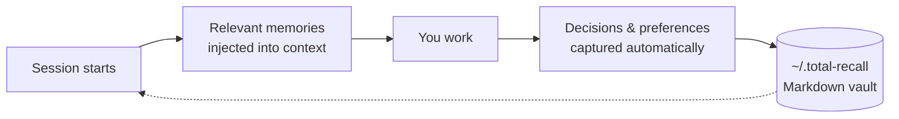
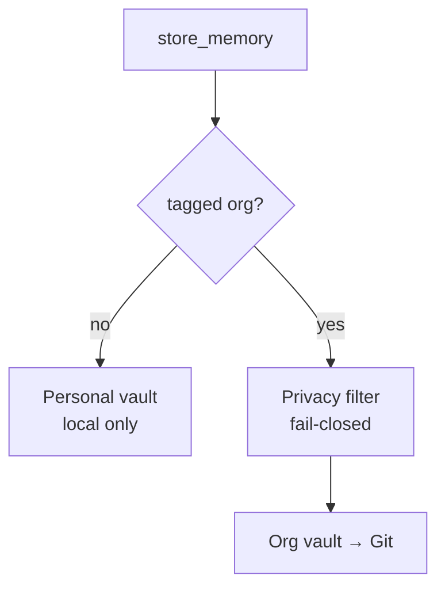

# 🧠 total-recall

**Your AI assistant forgets everything at the end of each session. This fixes that.**

A persistent, searchable memory for Claude Code and Gemini/Antigravity. Memories are plain Markdown files on your disk — greppable, git-versionable, [Obsidian](https://obsidian.md/)-readable. Nothing leaves your machine unless you tag it `org`.

🇬🇧 English · [🇷🇴 Română](README-ro.md)

## ⚡ TL;DR

- **What it is** — a persistent memory plugin for Claude Code and Gemini/Antigravity: memories are saved on your computer and survive across sessions, so you don't re-explain the same things every time. 22 MCP tools (17 for memory, 5 for spec-driven architecture work) over a vault of Markdown files in `~/.total-recall`.
- **What it does for you** — injects the relevant memories at the start of every session and captures decisions and preferences automatically as you work and before each context compaction.
- **How it searches** — hybrid: TF-IDF × Ebbinghaus forgetting curve, plus optional semantic search; falls back cleanly to text search when semantic search is off.
- **Privacy** — local-first. The personal vault never leaves your machine; only what you tag `org` goes, through a fail-closed filter, to a shared Git repo.
- **Install** — `/plugin marketplace add adrian-balaban/total-recall`, `/plugin install total-recall`, then `./install.sh` once. Node.js 18+, Linux · macOS · Windows (Git Bash).
- **Footprint** — ~1–2 MB, two production dependencies (the MCP SDK and Zod). The ~200 MB semantic model downloads only if you enable semantic search.
- **Status** — v1.2.0, stable: 861 tests pass, 93.5% statement coverage, ≈67% mutation score. See [Known issues](#️-known-issues) for the coverage thresholds CI still misses.



## 📡 Thoughtworks Technology Radar Vol. 34

Several techniques from the [Thoughtworks Technology Radar](https://www.thoughtworks.com/radar)
([Vol. 34, 2026 — PDF](https://www.thoughtworks.com/content/dam/thoughtworks/documents/radar/2026/04/tr_technology_radar_vol_34_en_1.pdf)) are already implemented here, as design decisions taken independently:

| Technique | Ring | How Total Recall does it |
|---|---|---|
| Progressive context disclosure + Context engineering | Trial + Adopt | SessionStart injects only the memory index; full content is read on demand |
| Mutation testing | Trial | Stryker gate in CI (see [Status](#-status)) |
| Claude Code plugin marketplace | Trial | git-based distribution, no version drift; the only channel, fed by a GitHub Actions CI-built on main branch |
| Structured output from LLMs | Adopt | the capture hook asks the model for JSON lines, not free text |
| MCP by default | Hold | system operations (git, indexing) stay in plain scripts, not MCP tools |

**Three future directions**, each tracked in [BACKLOG.md](BACKLOG.md) with a trigger:
a context graph over memories (the `supersededAt` chain already stores temporal edges);
source-grounded extraction for the capture hook; an evaluation set for `recall_memory`.

## ⚙️ How it works

| | |
|---|---|
| **22 MCP tools** | store, recall, hybrid search, semantic rerank, bulk export/import, and 5 architecture tools for ADL/CALM projects |
| **Hybrid search** | TF-IDF × Ebbinghaus forgetting curve, optionally fused with vector embeddings |
| **Lifecycle hooks** | context injected at session start, memories captured as you work |
| **Two vaults** | personal stays local; `org`-tagged syncs to a shared Git repo |

- **Headline feature:** at SessionStart only the memory index is injected; full memories are fetched on demand through `get_memories_by_keys`.
- **PreCompact capture:** 0–3 lessons are extracted from the conversation before context compaction and saved.
- **Live reload:** memories a teammate pushes to the org vault appear in your session without a restart.
- **Archive, not delete:** superseded versions of a memory are kept, not overwritten.



C4 diagrams (context → containers → components → code), module map, data model,
boot sequence, search pipeline and hook lifecycle are documented in
**[ARCHITECTURE.md](plugins/total-recall/ARCHITECTURE.md)**.

## 🛠️ The 22 tools

| Group | Tools |
|---|---|
| **Store** | `store_memory` |
| **Search** | `recall_memory`, `search_index` |
| **Read** | `list_memories`, `get_memories_by_keys`, `get_stats`, `get_timeline`, `get_related_memories` |
| **Modify** | `update_memory`, `delete_memory`, `confirm_memory`, `rebuild_index`, `prune_memories` |
| **Re-rank** | `rerank_memories` |
| **Bulk** | `export_memories`, `import_memories`, `delete_memories` |
| **Architecture** (spec-driven, can be switched off) | `index_architecture`, `get_architecture_context`, `trace`, `get_architecture_history`, `validate_architecture` |

### 📐 Spec-driven work with ADL and CALM

When a project keeps its architecture as code (ADL files and a CALM document), Total Recall remembers what the files do not: why each rule exists, what was rejected, which checks failed and how they were fixed. The files stay in your repository as the source of truth.

- `index_architecture` reads the project's `*.adl` and `*.calm.json` files into one summary memory per system, and links each ADL assertion to the tests that carry its ID.
- `get_architecture_context`, `trace` and `get_architecture_history` give back the rules, controls, decisions, failures and changes for one element, requirement or assertion.
- `validate_architecture` runs the CALM CLI and the ADL test-coverage check, and records each failure and its fix.
- Memories can carry `system`, `elements`, `requirements` and a few more optional fields. `recall_memory` and `search_index` filter on `elements`.
- Hooks add a short architecture summary at session start, and a prompt to record the change when an `.adl` or `.calm.json` file is edited.
- The `spec-driven-workflow` skill describes the whole loop and has starter templates.

Everything is configurable under `specDriven` in `~/.total-recall/config.json`, and `"specDriven": {"enabled": false}` gives back exactly the 17-tool behaviour. See the [plugin README](plugins/total-recall/README.md#-spec-driven-architecture-adl--calm) for the keys.

## 📐 Architecture as code: ADL and CALM

Total Recall describes its own architecture in two notations, ADL for the code level and CALM for the system level, and the build fails when the code drifts from either. The [spec-driven tools](#-spec-driven-work-with-adl-and-calm) work with the same two notations in your own projects.

### ADL: Architecture Definition Language

ADL is the notation used in the masterclass **"How to Teach Your Agents About Architecture"**, which Neal Ford taught as part of his *Architecture as Code* material at Codecamp Iași (27–28 October 2026).

- **What it is.** A light, pseudocode-like way to write an architecture down, with no formal grammar. `DEFINE` lines name the system, its domains and its components. `ASSERT(…)` lines state the rules the code must keep, in plain English where that is clearer.
- **Who reads it.** People read it as short documentation that is harder to let go stale than a diagram. AI agents read it as context when they write code, and as a specification to check the code against.
- **How it is enforced.** An ADL file is never executed. Each assertion is checked by a test written for it (a fitness function), for example with ArchUnitTS in this repository.

This example comes from this repository's own [structure.adl](plugins/total-recall/architecture/adl/structure.adl), not from the course:

```
DEFINE SYSTEM Total Recall AS tr
    DEFINE COMPONENT Pure Helpers AS helpers
    DEFINE COMPONENT Tools AS tools
ASSERT(Pure Helpers have no dependency on any other component) # [TR-S1]
```

The `# [TR-S1]` tag is a Total Recall convention, not part of ADL. The test that enforces the rule has the same tag in its name, and `adl-coverage.test.ts` fails when an assertion has no test.

> The course material is not published here: no slides, exercises, reference guide or solutions. This section describes the idea in our own words, and every example is from this repository.

### CALM: Common Architecture Language Model

[CALM](https://calm.finos.org/introduction/what-is-calm) is an open specification for describing a software architecture as code, in JSON that people and tools can both read. The [FINOS Architecture as Code community](https://github.com/finos/architecture-as-code) develops it, Morgan Stanley contributed it, and version 1.0 came out in August 2025.

- **Main concepts.** Nodes (the building blocks: services, databases, actors), the relationships between them, and the interfaces the nodes expose. Controls attach requirements to a node or a relationship. The specification also covers flows, timelines and decorators.
- **Tooling.** A CLI (`npm install -g @finos/calm-cli`) that validates documents against the schema, plus VS Code plugins, AI integrations and [CalmStudio](https://calm.finos.org/calm-studio/intro/), a visual editor that keeps the JSON as the source of truth.
- **Purpose.** Keep the architecture in version control, validate it in CI next to the code, and give agents a model to follow.

Total Recall's own model is [total-recall.calm.json](plugins/total-recall/architecture/calm/total-recall.calm.json). It covers the MCP server, the hooks, the two vaults and the local embedder, plus three controls (the fail-closed privacy filter, org author protection and the TF-IDF fallback), each linked to its ADL assertion. CI validates it with a pinned `@finos/calm-cli` (1.66.0, CALM 1.0 schema).

### How the two fit together

| | ADL | CALM |
|---|---|---|
| Level | Code: modules, dependencies, data rules | System: containers, connections, controls |
| Format | Pseudocode text (`.adl`) | JSON with a published schema (`.calm.json`) |
| Checked by | Tests tagged with the assertion ID | `calm validate`, plus `calm.test.ts` cross-checks against the ADL |
| Origin | Neal Ford's *Architecture as Code* masterclass | FINOS open standard |

Details: [ARCHITECTURE.md → Architecture as code](plugins/total-recall/ARCHITECTURE.md#-architecture-as-code).

## 💡 What gets saved automatically

Work observations (what worked, what didn't) · non-obvious project context
(motivations, constraints, non-trivial decisions) · an end-of-session
"anything worth remembering?" prompt.

Not saved: code snippets, file paths, git history — all derivable from the workspace. (The one exception is deliberate: a spec or architecture memory may record the repo-relative path and commit of the file it summarises, as a pointer in its frontmatter, never in the text.)

## 🥇 Using it as your only memory system

Claude Code ships its own file-based memory (a `memory/` directory with a `MEMORY.md`
index), and some setups add a `.remember/` history. If you want Total Recall to be the
single source of truth, say so in your **global** `~/.claude/CLAUDE.md`:

```markdown
## Memory
Use total-recall exclusively for all memories, in every project.
- Store via `store_memory` / `update_memory`; recall via `recall_memory` / `search_index`.
- NEVER use the harness file-based memory (`memory/`, `MEMORY.md`) or `.remember/`.
- If total-recall is unavailable, tell me and skip persisting — do not silently fall back.
```

**Why it works:** instruction priority is your `CLAUDE.md` > skills > harness defaults, so
your instruction beats the hook and default prompts that encourage the built-in memory.

**Retrieval order, cheapest first:** the injected index (already in context) →
`get_memories_by_keys` → `search_index` → `recall_memory`.

The `total-recall:memory-workflow` skill (retrieval order, dedup, `importanceScore`, org
tagging) is optional reference material, not a dependency.

## 🚀 Install

From inside a Claude Code session:

```
/plugin marketplace add adrian-balaban/total-recall
/plugin install total-recall
```

then `./install.sh` once, from the installed plugin directory, to create the
vaults and register the MCP server.

Linux · macOS · Windows (Git Bash) · Node.js 18+. Gemini/Antigravity, local clones, and the
minimal (no-vector) profile: **[INSTALL.md](plugins/total-recall/INSTALL.md)**

**The marketplace is the only distribution channel** — no zip, no npm package. It
installs the `release` branch, whose bundle is built by GitHub Actions after the CI
gate goes green; `dist/` is gitignored on `main`, so no hand-built artifact can ship.

### 🔗 Footprint

Two production dependencies — the MCP SDK and Zod. Three optional ones power
semantic search (`@huggingface/transformers`, `better-sqlite3`, `sqlite-vec`)
and are only pulled in if you enable it.

| | |
|---|---|
| **Plugin** | ~1–2 MB |
| **Optional model** | ~200 MB, downloaded on first use |

## 📦 What ships vs. what's for contributors

<details>
<summary>Runtime, org-vault-only and contributor-only files</summary>

- **Runtime (always):** manifests (`plugin.json`, `.mcp.json`, `package.json`), `dist/index.js`, `dist/frontmatter.mjs`, `hooks/hooks.json`, and the SessionStart index scripts.
- **Runtime for org-vault users only:** `sync-org-memory.*`, `pull-org-vault.sh`, `check-sync-errors.sh`, `dist/privacy-filter.mjs`, `atomic-write.mjs`.
- **Contributor-only:** `src/`, tests, vitest/stryker configs, `tsconfig.json`, `CLAUDE.md`, `ARCHITECTURE.md`.

Generated output (`node_modules/`, `coverage/`, `reports/`, `.remember/`) is gitignored and safe to delete. `dist/` is built by CI, not committed.

</details>

## 🧭 Design principles

- **Local-first** — memories live on your machine, not in the cloud.
- **Readable** — every memory is a Markdown file you can edit in any editor.
- **Versionable** — the team vault is git-backed; the personal vault stays local.
- **No infrastructure** — no external server or database. The Markdown files are
  the source of truth; the vector index is a local SQLite, regenerable anytime.
- **Fault-tolerant** — degrades to text search if the vector path is unavailable.

## 📊 Status

| | |
|---|---|
| **Version** | 1.2.0 — stable |
| **Tests** | 778 unit + 20 integration passing · 47 files · ~13k lines of test code |
| **Coverage** | 93.5% statements · 87.1% branches · 95.7% lines |
| **Mutation** | ≈67% (Stryker, 16 core modules) · drifts ~±1 pt run-to-run · gate fails below 65% |
| **CI** | [`mutation.yml`](.github/workflows/mutation.yml) — audit + typecheck + build + full unit & integration suites + Stryker on every push/PR to `main`. The only build pipeline; nothing is gated locally |
| **Releases** | [`release.yml`](.github/workflows/release.yml) — builds `dist/` and publishes the `release` branch the marketplace installs from; tags + notes when the version changes |
| **Audit** | 0 critical in production deps |

Mutation testing checks whether the tests are actually any good: Stryker deliberately changes small things in the code (`>` becomes `<`, `true` becomes `false`), and a test suite that doesn't fail when that happens isn't strict enough.

Reproduce: `npm test` · `npm run test:coverage` · `npm run test:integration` · `npm run mutation`
(from `plugins/total-recall/`)

### ⚠️ Known issues

- **Org-vault content is injected into every teammate's context unfiltered.** At
  SessionStart the org vault is `git pull`ed and its memory index goes straight into
  the model's context. Anyone with push access to the shared repo can therefore place
  text, including instruction-shaped text, in every colleague's session. The privacy
  filter guards the outbound push only; nothing fences inbound content. Until that
  lands, give org-vault push access only to people you trust, and protect its branch.
  See [SECURITY.md](SECURITY.md).
- **Coverage misses three of four thresholds** set in `vitest.config.ts`: statements
  93.5% (need 95), functions 93.1% (need 95), branches 87.1% (need 90). Lines pass at
  95.7%. `npm run test:coverage` therefore exits non-zero. Largest gaps are
  `vectorStore.ts` (72.5%) and `embeddings.ts` (88.6%).
- **Three modules reach code without checking it.** Per-module mutation score diverges
  sharply from coverage: `embeddings.ts` 49.4%, `vectorStore.ts` 53.7% and
  `persistence.ts` 55.0%. `persistence.ts` is the instructive case — 86.1% coverage but
  only 55.0% mutation, with 116 surviving mutants: the tests run the code but would not
  notice if it broke. Coverage alone would have missed this, which is why the gate
  looks at mutation.
- **The mutation score is not reproducible run-to-run.** Two CI runs with no
  change to any mutated source file reported 65.39% and 66.39% — about ±1 point
  of drift, most likely from mutants that time out under varying runner load. Do
  not read a single decimal figure as precise. Margin over the 65% break
  threshold was widened to roughly 3 points in v1.1.22 (five modules taken from
  0–75% up to 93–100%, +34 mutants killed), so ordinary drift no longer risks a
  red gate — which matters because a red gate silently withholds the `release`
  branch rather than shipping anything broken.

---

📖 **[Full documentation](plugins/total-recall/README.md)** ·
🏗️ **[Architecture](plugins/total-recall/ARCHITECTURE.md)** ·
📦 **[Install guide](plugins/total-recall/INSTALL.md)** ·
🎤 **[Talk: Claude vs Ollama & Total Recall](https://github.com/adrian-balaban/presentation-claude-vs-ollama-and-total-recall-plugin-21-07-2026)** (Romanian, Jul 2026)
