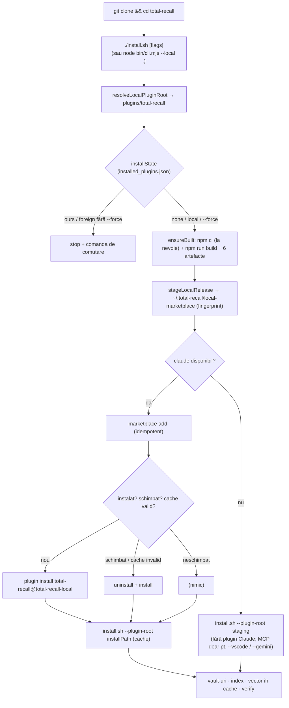

# PLAN FINAL — Instalare directă cu build local după `git clone`

**Status:** aprobat pentru implementare după review · **Revizia 2:** 2026-11-09, după review-ul extern (§11) · **Branch de lucru:** `feat/local-install` (din `main`)
**Surse unificate** (toate în `backlog-and-plans/`, lângă acest fișier): [PLAN-INSTALARE-LOCALA-GEMINI3.8.md](PLAN-INSTALARE-LOCALA-GEMINI3.8.md) · [PLAN-INSTALARE-LOCALA-DEEPSEEK.md](PLAN-INSTALARE-LOCALA-DEEPSEEK.md) · [PLAN-INSTALARE-LOCALA-Claude.md](PLAN-INSTALARE-LOCALA-Claude.md)
**Etichete de proveniență:** `[G]` Gemini · `[D]` DeepSeek · `[C]` Claude · `[R]` nou, apărut din review

> **Pentru agentul care implementează.** Faptele din §3 au fost verificate la 2026-11-09: codul a fost citit în repo, iar comportamentul `claude plugin` a fost observat printr-un spike real pe Claude Code 2.1.220, cu `HOME` temporar. Nu le re-deriva. Dacă o linie citată nu se mai potrivește sau versiunea `claude` e alta, re-verifică doar punctul respectiv. Codul, mesajele CLI și documentația repo-ului sunt în engleză. Nu modifica niciun `package-lock.json`.

---

## 1. Obiectiv și UX final

După clone, o singură comandă construiește pluginul local și îl instalează complet:

```bash
git clone https://github.com/adrian-balaban/total-recall.git
cd total-recall
./install.sh [-y] [--no-vector] [--gemini] [--vscode] [...]   # toate flag-urile install.sh existente
```

| Situație | Rezultat |
|---|---|
| `claude` disponibil | Plugin Claude Code `total-recall@total-recall-local`, cu hooks și MCP (din `.mcp.json` al pluginului), plus pașii `install.sh`: vault-uri, index, vector, verificare. |
| `claude` lipsă | Vault-uri + index. MCP-ul se înregistrează doar pentru hosturile cerute: `--vscode` scrie în `mcp.json` din VS Code o cale către staging, iar `--gemini` afișează comanda `agy`, care copiază arborele (F10). Fără niciun flag de host nu se înregistrează niciun MCP; pasul 3 din `install.sh` e sărit fără `claude`. |
| Re-rulare fără schimbări | Idempotentă: nu reinstalează și nu atinge memoriile. |
| `git pull` + re-rulare | Rebuild și livrarea codului nou în pluginul instalat. |

Variante echivalente: `node bin/cli.mjs --local [cale] [flags]`, `npm run install:local` și, după publicarea unei versiuni npm care include `--local`, `npx @adrian-balaban/total-recall --local <cale>`.

Marketplace-ul (`npx @adrian-balaban/total-recall` sau `/plugin install total-recall@my-claude-plugins`) **rămâne canalul recomandat**. Canalul local e pentru forkuri, cod de pe `main` înainte de release și power-users. `[D:D2]`

---

## 2. Review comparativ al celor trei planuri

### 2.1 Scor pe criterii

| Criteriu | Gemini 3.8 | DeepSeek | Claude |
|---|---|---|---|
| Fapte verificate în repo (linii, comportament) | slab: afirmații neverificate | **foarte bun**: linii corecte | **foarte bun** + spike CLI real |
| Mecanismul de instalare Claude Code funcționează | ✘ `plugin install <cale>` | ✘ `plugin install <cale>` | ✔ marketplace local de tip director |
| Dependențele vector ajung unde rulează serverul | ✘ | ✘ (rulează `install.sh` pe clone) | ✔ (rulează `install.sh` pe cache) |
| Evită copierea `node_modules` (1.9 GB) în cache | ✘ | ✘ | ✔ (staging curat) |
| `dist/` vechi după `git pull` | ✘ | parțial (`--rebuild` manual) | ✔ (build mereu, refresh pe fingerprint) |
| Politica de coliziune cu marketplace-ul | ✘ | ✔ (unidirecțională) | ✔ (simetrică) |
| Plan de teste offline | ✘ | **foarte bun** | ✔ (preia DeepSeek + teste noi) |
| Punct de intrare imediat după clone | **✔ `./install.sh` în root** | ~ (npx publicat) | ✔ (preia Gemini) |
| Integritatea lockfile-ului | ✘ (`npm ci \|\| npm install`) | ✔ | ✔ |
| Trust, docs, smoke | parțial | **foarte bun** | ✔ (preia DeepSeek) |

### 2.2 Verdicte

- **Gemini 3.8 — idei de UX bune, mecanism nefuncțional.** Am preluat `./install.sh` în root, verificarea tuturor artefactelor `dist/`, scripturile npm din root și diagrama de flux. Am respins:
  - `claude plugin install "$PLUGIN_ROOT"` (eșuează, F1);
  - fallback-ul `npm install` (modifică lockfile-ul);
  - afirmația că `--gemini` rulează `agy` automat (nu o face sub `-y`, F9);
  - flag-ul `--no-plugin`, nespecificat;
  - `chmod +x`, inutil.

  Statusul „Gata de implementare" era supraevaluat. Detalii în [PLAN-…-Claude.md, Anexa A](PLAN-INSTALARE-LOCALA-Claude.md#anexa-a--review-plan-instalare-locala-gemini38md).
- **DeepSeek — cel mai riguros ca proces, dar cu pasul critic greșit.** Am preluat aproape toată structura: decizii D2–D7, `resolveLocalPluginRoot`, parsarea indexată, `claude` opțional sub `--local`, `--rebuild`, planul de teste cu `deps` injectate, trust, docs, criteriul „fișiere neatinse". Defecte:
  - `claude plugin install <cale>` (F1) e tratat ca „neverificat", nu ca blocant;
  - `install.sh` rulează pe clone, așa că dependențele vector ajung în clone (F8);
  - copierea `node_modules` nu e luată în calcul (F3);
  - pe win32, `npm.cmd` fără `shell: true` eșuează;
  - bug-ul latent din `installState` (F5) nu e observat.

  Detalii în [Anexa B](PLAN-INSTALARE-LOCALA-Claude.md#anexa-b--review-backlog-and-plansplan-instalare-locala-deepseekmd).
- **Claude — auto-review.** Planul rezolvă blocantele prin fapte observate, nu presupuse. Puncte slabe, corectate în acest plan final:
  - nu verifica faptul că cache-ul poate exista fără `dist/index.js` după un install întrerupt `[R1]`;
  - nu testa păstrarea bitului de execuție pe `hooks/scripts/*.sh` în staging `[R2]`;
  - nu menționa efectul `sync:version` asupra arborelui `[R3]`;
  - nu recomanda restartul sesiunilor Claude Code după refresh `[R4]`;
  - dependența de comportamentul CLI pe o singură versiune trebuie fixată prin smoke `[R5]`.

---

## 3. Fapte verificate (baza deciziilor)

| # | Fapt | Sursă |
|---|---|---|
| F1 | `claude plugin install <cale>` → `not found in any configured marketplace`. `install` acceptă doar `plugin[@marketplace]`. Documentația actuală (`INSTALL.md` § Developing from a clone, `plugins/total-recall/CLAUDE.md` § Install) e greșită. | spike |
| F2 | `claude plugin marketplace add <dir>` cere `<dir>/.claude-plugin/marketplace.json`. Funcționează cu sursa `"./plugins/total-recall"`. ID-ul devine `total-recall@<nume-mkt>`. Re-adăugarea e idempotentă. | spike |
| F3 | Instalarea copiază directorul-sursă în `~/.claude/plugins/cache/<mkt>/total-recall/<ver>/`, **inclusiv** `dist/` și `node_modules/` (fără filtrare `.gitignore`). `node_modules` din plugin, într-un clone de dev, are 1.9 GB. | spike, `du` |
| F4 | La aceeași versiune, `install` e no-op („already installed") și `update` e no-op („already at latest"). Doar `uninstall` + `install` reîmprospătează. | spike |
| F5 | `uninstall` golește `installed_plugins.json`, dar lasă directorul în cache. `installState()` (`bin/cli.mjs:113-122`) se uită doar la cache, deci raportează `'ours'` după un uninstall (bug latent). `PLUGIN_MANAGED` (`plugins/total-recall/install.sh:332-338`) citește `installed_plugins.json` și e corect. | spike, cod |
| F6 | `.claude-plugin/marketplace.json` din rădăcină se numește `my-claude-plugins` și are sursa `git-subdir` GitHub `ref: release`. Rădăcina clone-ului nu poate fi marketplace local: ar intra în coliziune de nume și ar aduce codul din `release`. | cod |
| F7 | `claude --plugin-dir <cale>` încarcă pluginul doar pentru sesiunea curentă. Acesta e dev loop-ul corect. | `claude --help` |
| F8 | Pasul 7 din `install.sh` rulează `npm install --no-save <vector deps> && npm run build` în `PLUGIN_ROOT`. Fluxul npx de azi rulează `install.sh` din cache (`bin/cli.mjs:171-184`). | cod |
| F9 | `--gemini` sub `-y` sau fără tty nu rulează `agy` (din cauza promptului de trust). Afișează doar comanda (`install.sh:565-595`). | cod |
| F10 | `agy plugin install <dir>` copiază `<dir>` în `~/.gemini/extensions/total-recall/`. | cod (comentariu, `install.sh:47-51`) |
| F11 | `pack-guard` permite `package.json`, `README*`, `LICENSE*` și `bin/*.mjs`. Un fișier nou `bin/local.mjs` e permis. | `test/pack-guard.mjs:7` |
| F12 | `plugins/total-recall/install.sh` are mod `100755` în git. | `git ls-files -s` |
| F13 | `dist/index.js` e un bundle self-contained. Externe sunt doar `fsevents`, `@huggingface/transformers`, `sqlite-vec` și `better-sqlite3` (opționale). Un arbore fără `node_modules` rulează, la fel ca `release`. | `package.json` (plugin) |
| F14 | `npm run build` produce 6 artefacte: `index.js`, `frontmatter.mjs`, `build-index-cache.mjs`, `privacy-filter.mjs`, `spec-config.mjs`, `spec-fields.mjs`. Rulează întâi `sync:version`, care rescrie versiunea în `plugin.json`, `gemini-extension.json` și în manifestul npx din root. | `package.json` (plugin), `CLAUDE.md` |
| F15 | Gate-ul CI (`mutation.yml:70-72`) rulează `npm test` în root. | cod |

---

## 4. Decizii finale

| ID | Decizie | Proveniență |
|---|---|---|
| **DF1** | **Punct de intrare:** `./install.sh` în rădăcina repo-ului, ca wrapper bash minimal peste `node bin/cli.mjs --local "$ROOT" "$@"`. Toată logica stă în Node, testabilă. | `[G]` intrare + `[C]` delegare |
| **DF2** | **Logica `--local`** stă în modulul nou `bin/local.mjs`, importat de `bin/cli.mjs`. Flag-ul `--local [cale]` e un own-flag, nu o subcomandă. | `[D:D1]` + `[C]` |
| **DF3** | **„Release local" în `~/.total-recall/local-marketplace/`**: `.claude-plugin/marketplace.json` (`name: total-recall-local`, sursa `./plugins/total-recall`), `plugins/total-recall/` (arbore curat + `dist/`, fără `node_modules`) și `.local-build.json` (metadate). Instalarea Claude se face din acest marketplace, nu din clone (F1, F3, F6). | `[C]` |
| **DF4** | **Selecția fișierelor:** `git ls-files -co --exclude-standard` în directorul plugin (urmărite + noi neignorate, deci include modificările locale), plus `dist/`. **Fallback, fail-closed `[R6]`:** se folosește doar când nu există `.git` în niciun părinte (arhivă descărcată, fără fișiere de dev). Dacă există `.git`, dar `git` lipsește sau eșuează → stop cu instrucțiunea „install git, or copy the plugin without dev files”. Fallback-ul folosește un **allowlist** pentru intrările cu punct (`.claude-plugin/`, `.mcp.json`; restul intrărilor care încep cu `.` se sar, inclusiv `.remember/`, `.claude/`, `.git/`, `.stryker-tmp/`) și exclude `node_modules`, `dist`, `coverage`, `reports`, `tmp`, `*.tsbuildinfo`. Staging-ul se face într-un director temporar alăturat, apoi `rename` atomic. Bitul de execuție se păstrează `[R2]`. | `[C]` + `[R6]` |
| **DF5** | **Build:** `npm ci --no-audit --no-fund` doar dacă `node_modules/.package-lock.json` lipsește sau e mai vechi decât `package-lock.json`. `npm run build` rulează **mereu** sub `--local` (esbuild, secunde). Apoi se verifică toate cele 6 artefacte (F14). **Fără** fallback `npm install`. | `[C]` + `[G]` (6 artefacte) + `[D]` (lockfile) |
| **DF6** | **Build înaintea instalării:** build → staging → `marketplace add` → `install`. Copia în cache are deja `dist/`. | `[D:D3]` |
| **DF7** | **Cu `claude`:** `marketplace add <staging>` (idempotent). Apoi: dacă pluginul nu e instalat → `install`; dacă e instalat și (fingerprint schimbat **sau** `<installPath>/dist/index.js` lipsă `[R1]`) → `uninstall` + `install` (F4); altfel nimic. `installPath` se **re-citește** din `installed_plugins.json` **după** ce `install` sau `uninstall` + `install` s-a terminat; valoarea citită înainte nu se refolosește `[R7]`. Dacă după instalare nu există `installPath` sau `<installPath>/install.sh` → exit 1, cu comanda manuală `[R5]`. Apoi `bash <installPath>/install.sh --plugin-root <installPath> <forward>` (F8). | `[C]` + `[R1]` + `[R7]` |
| **DF8** | **Fără `claude`:** `bash <staging>/plugins/total-recall/install.sh --plugin-root <staging>/plugins/total-recall <forward>`. Sub `--local`, `claude` nu e cerință obligatorie. Staging-ul devine **locația de rulare** pentru intrarea din VS Code `mcp.json`, deci nu se șterge cât timp intrarea există. Re-rularea îl înlocuiește la aceeași cale. Dezinstalarea e documentată separat (Pasul 8) `[R8]`. | `[D]` + `[C]` (staging în loc de clone) + `[R8]` |
| **DF9** | **`installState`** se bazează pe `installed_plugins.json`, cu fallback pe cache doar dacă fișierul lipsește, și întoarce `'ours' \| 'local' \| 'foreign' \| 'none'`. Repară bug-ul F5 și în fluxul marketplace. | `[C]` + `[R]` |
| **DF10** | **Coliziuni (simetric):** `--local` + `ours` → stop cu `claude plugin uninstall total-recall@my-claude-plugins`. Marketplace + `local` → stop cu `claude plugin uninstall total-recall@total-recall-local`. `foreign` → mesajul existent. `--force` trece peste, cu warning despre hook-uri și MCP duplicate. Memoriile nu sunt afectate. | `[D:D4]` extins de `[C]` |
| **DF11** | **`plugins/total-recall/install.sh`** primește trei modificări: `--rebuild`; build declanșat dacă lipsește *oricare* din cele 6 artefacte; mesaj dedicat pentru `PLUGIN_ROOT` aflat în `cache/total-recall-local/`. Nimic altceva. | `[D:D5]` + `[G]` + `[C]` |
| **DF12** | **Fără `git clone` din bootstrap.** Nici cod de plugin în tarball-ul npm (`pack-guard` neatins). `bin/local.mjs` intră în tarball (permis de `bin/*.mjs`, F11), deci rămâne fără dependențe și importă doar `node:*` și `./cli.mjs`; nu importă nimic din `plugins/`. Invariantul e verificat de un test `[R9]`. | `[D:D7]` + `[R9]` |
| **DF13** | **Trust:** canalul local înseamnă „commit-ul clonat + toolchain-ul local + registry npm la build". Se documentează în `SECURITY.md`. | `[D:D6]` |
| **DF14** | **Dev loop separat:** `npm run build && claude --plugin-dir "$(pwd)"` (F7). Înlocuiește comanda greșită din documentație. | `[C]` |
| **DF15** | **Scripturi npm în root:** `build`, `install:local`, `test` → `node --test test/*.test.mjs`. `files: ["bin"]` rămâne neschimbat. | `[G]` (adaptat) |

### Respinse explicit

| Propunere | Motiv |
|---|---|
| `claude plugin install <cale>` `[G][D]` | Nu funcționează (F1). |
| `npm ci \|\| npm install` `[G]` | Rescrie `package-lock.json` și ascunde drift-ul pe care CI îl respinge. |
| Rularea `install.sh` pe clone după instalarea pluginului `[D]` | Dependențele vector ar ajunge în locul greșit (F8). |
| Înregistrarea clone-ului ca marketplace | Rădăcina e ocupată (F6), iar `node_modules` ar fi copiat (F3). |
| `npx … --local` ca primă comandă `[D]` | Aduce launcherul publicat, nu pe cel din clone. Rămâne doar alternativă. |
| Rularea automată `agy plugin install` `[G]` | Promptul de trust e o politică de securitate (F9). Rămâne comportamentul actual. |
| Flag-ul `--no-plugin` `[G]` | Nu există cerință. Lipsa `claude` acoperă deja cazul standalone. |
| Bump de versiune artificial (de ex. `-local.<sha>`) pentru `claude plugin update` | Ar falsifica versiunea raportată și ar acumula directoare în cache. `uninstall` + `install` e verificat și curat. |

---

## 5. Flux



---

## 6. Pași de implementare (commit-uri mici, în ordine)

### Pasul 0 — Bază
1. Node 20 (`mise`/`.nvmrc`), branch `feat/local-install`, `git status` curat.
2. `npm test` în root e verde. `HOME=$(mktemp -d) npm test` în `plugins/total-recall` e opțional.
3. `claude --version`. Dacă e ≠ 2.1.220, repetă rapid spike-ul F1/F2/F4 într-un `HOME` temporar și notează diferențele în PR `[R5]`.

### Pasul 1 — `bin/cli.mjs`: parsare și `installState`
- `parseArgs`: buclă indexată. `--local` consumă următorul token dacă acesta există și nu începe cu `-`. `own.local` ia valorile `false | true | string`. Restul argumentelor se transmit neschimbate, în ordine. Testul existent „removes its own flags and forwards the rest verbatim" rămâne verde. `[D]`
- `installState(home, fsImpl)` conform DF9. Constantă nouă: `LOCAL_MARKETPLACE_NAME = 'total-recall-local'`.
- Fluxul marketplace: starea `'local'` → stop conform DF10 (cu `--force` → continuă).
- `USAGE`: `--local [path]`, cu exemplul de după clone.
- Commit: `feat(cli): --local flag parsing and installed_plugins-based install state`.

### Pasul 2 — `bin/local.mjs` (nou)
Funcții exportate, toate cu `deps` injectate (`run`, `fsImpl`, `home`, `platform`, `out`, `err`):
- `resolveLocalPluginRoot({ given, cwd, fsImpl })` conform `[D]` Pasul 1: o cale directă către plugin, o cale către rădăcina repo-ului sau autodetect urcând din `cwd`. Marker: `.claude-plugin/plugin.json` + `package.json`. Rezultatul trece prin `path.resolve`.
- `npmCommand(platform)` → `{ cmd: 'npm.cmd', shell: true }` pe `win32`, altfel `{ cmd: 'npm' }`. Pe Windows e nevoie de shell (CVE-2024-27980).
- `ensureBuilt({ pluginDir, ... })` conform DF5. La eșec, mesajul spune: „local build needs Node ≥18 and npm registry access; run `npm ci && npm run build` in <dir> to see the error". Notă `[R3]`: `sync:version` poate modifica fișierele versionate dacă versiunile din clone nu sunt sincronizate. Se raportează cu `out()` și nu se blochează.
- `DIST_ARTIFACTS` — lista celor 6 (F14).
- `stageLocalRelease({ pluginDir, home, ... })` conform DF3 și DF4. Întoarce `{ stagingDir, pluginStageDir, fingerprint, changed }`. Fingerprint = sha256 peste căile sortate + conținut. `changed` se calculează față de `.local-build.json` anterior, care conține `{ source, gitSha, dirty, fingerprint, builtAt }`.
- `readInstalledPlugin(home, id, fsImpl)` → `{ installPath } | null`, din `installed_plugins.json`. Schema observată pe 2.1.220 `[R10]`: `{ "version": 2, "plugins": { "<name>@<mkt>": [ { "scope": "user", "installPath": "…", "version": "…", "installedAt": "…", "lastUpdated": "…", "gitCommitSha"?: "…" } ] } }`. Valoarea e un **array** de intrări, câte una pe scope. Se ia intrarea cu `scope: "user"`, altfel prima. Cheie absentă sau array gol ⇒ `null` (starea după `uninstall`, F5). `installState` (DF9) folosește **același** helper de parsare (`readInstalledPlugins`), ca să nu existe două interpretări ale fișierului. JSON corupt ⇒ tratat ca fișier lipsă (fallback pe cache) și raportat cu `err()`.
- `installLocal(argvForward, own, deps)` — orchestrarea completă conform DF7, DF8 și DF10. Codurile de ieșire: `1` pentru erori, `EX_UNAVAILABLE` (69) pentru Windows fără Git Bash, altfel exit code-ul `install.sh`. După un refresh afișează: „restart running Claude Code sessions to load the new build" `[R4]`.
- `run` implicit în `cli.mjs` acceptă `{ inherit, cwd, capture, shell }`. `capture` întoarce `stdout`, folosit de `git ls-files`.
- Commit: `feat(cli): local-release build, staging and install (--local)`.

### Pasul 3 — `bin/cli.mjs`: ramura `--local` în `main`
- Ramura vine după `--help`/`--version` și gate-ul Node ≥18, **înainte** de `resolveClaude` obligatoriu. Delegă la `installLocal`. Fluxul marketplace rămâne neschimbat, cu excepția DF9/DF10.
- Commit: `feat(cli): route --local before the marketplace flow`.

### Pasul 4 — `install.sh` în rădăcină (nou)
```bash
#!/usr/bin/env bash
# Build total-recall from this clone and install it (local release). See plugins/total-recall/INSTALL.md.
set -euo pipefail
ROOT="$(cd -- "$(dirname -- "${BASH_SOURCE[0]}")" && pwd -P)"
command -v node >/dev/null 2>&1 || { echo "install.sh: Node.js 18+ is required (https://nodejs.org)." >&2; exit 1; }
exec node "$ROOT/bin/cli.mjs" --local "$ROOT" "$@"
```
- Se commit-uiește cu `git update-index --chmod=+x install.sh`. `--help` ajunge la `cli.mjs`; help-ul `install.sh` din plugin rămâne accesibil prin flag-urile transmise.
- Commit: `feat: root ./install.sh entry point for local builds`.

### Pasul 5 — `plugins/total-recall/install.sh`
1. `REBUILD=0` lângă valorile implicite. `--rebuild) REBUILD=1; shift;;` în parsarea de la `:206-221`. Intrare nouă în blocul „Options:" din header.
2. La `:305`, condiția devine: lipsește oricare din cele 6 artefacte **sau** `REBUILD=1`. Mesaj `info` diferențiat. `npm ci && npm run build` rămân neschimbate.
3. La `:322-327`: pentru `*/.claude/plugins/cache/total-recall-local/*` afișează `info "Local build (total-recall-local) — after 'git pull', re-run ./install.sh in your clone."` în locul celor două `warn`.
4. `bash -n plugins/total-recall/install.sh` trebuie să treacă.
- Commit: `feat(install): --rebuild, full dist check, local-channel cache notice`.

### Pasul 6 — `package.json` din rădăcină
```json
"scripts": {
  "build": "npm --prefix plugins/total-recall run build",
  "install:local": "node bin/cli.mjs --local .",
  "test": "node --test test/*.test.mjs",
  "prepublishOnly": "node test/pack-guard.mjs"
}
```
- `node test/pack-guard.mjs` trebuie să treacă. Commit: `chore: root build/install:local scripts`.

### Pasul 7 — Teste (offline, rulate de `npm test` în root, F15)
**`test/cli.test.mjs`** (extins):
- parsarea `--local`: `/p` → `'/p'`; `--local --gemini` → `true`, iar `--gemini` e transmis; `--local` la final → `true`; ordinea argumentelor transmise e păstrată;
- `installState`: `ours`, `local`, `foreign`, `none`, plus F5 (director în cache, `installed_plugins.json` gol ⇒ `none`) și fallback pe cache când fișierul lipsește. Fixture-ul folosește schema exactă `[R10]`, inclusiv cheia cu array gol. `total-recall@total-recall-local` ⇒ `local`, nu `foreign` (triaj prin constanta `LOCAL_MARKETPLACE_NAME`). Precedența în fallback rămâne `ours` > `local` > `foreign`, deci testul existent cu `foreign` + `ours` în cache rămâne verde;
- marketplace + `local` ⇒ 1 fără `--force`, continuă cu `--force`. Mesajul pentru `foreign` rămâne textual neschimbat;
- testele existente rămân neschimbate și verzi.

**`test/local.test.mjs`** (nou; directoare temporare reale prin `fs.mkdtempSync`, `run` fals):
- `resolveLocalPluginRoot`: plugin direct, rădăcina repo-ului, `cwd` imbricat, `cwd` = plugin, nimic ⇒ `null`;
- `ensureBuilt`: `ci` doar fără `node_modules` sau cu lockfile mai nou; `build` mereu; `npm.cmd` + `shell` pe win32; artefact lipsă după build ⇒ eroare; `run` eșuat ⇒ eroare;
- `stageLocalRelease`:
  - fără `node_modules`; `dist/` prezent; `marketplace.json` corect;
  - bitul de execuție păstrat pe **toate** fișierele `100755` din git: `hooks/scripts/*.sh`, `install.sh`, `scripts/start-server.sh` `[R2]`. `statusline.sh` e `100644` în git, deci nu se asertează;
  - fingerprint stabil la re-run (`changed=false`) și schimbat după o modificare (`changed=true`);
  - fallback fără `.git`: un `.remember/x.md` și un `.claude/settings.local.json` false, plus `tmp/` și `x.tsbuildinfo`, **lipsesc** din staging, iar `.claude-plugin/` și `.mcp.json` sunt prezente `[R6]`;
  - `.git` prezent + `git` eșuat ⇒ eroare, fără staging parțial `[R6]`;
- `installInvariant` `[R9]`: `bin/local.mjs` nu conține `import`/`require` către altceva decât `node:*` sau `./cli.mjs`;
- `installLocal` cu `claude`:
  - ordinea exactă a apelurilor `run`: `npm…` → `marketplace add` → `install` → `bash <installPath>/install.sh --plugin-root <installPath> …`;
  - varianta `changed` ⇒ `uninstall` + `install`;
  - `unchanged` ⇒ fără `install`;
  - cache fără `dist/index.js` ⇒ refresh `[R1]`;
  - după `uninstall` + `install`, `installed_plugins.json` falsificat de `run` cu altă `installPath` ⇒ `install.sh` rulează din calea **nouă** `[R7]`; `installPath` lipsă după install ⇒ 1;
  - `--local` + `ours` ⇒ 1, iar cu `--force` continuă;
- `installLocal` fără `claude`: `install.sh --plugin-root <staging>/plugins/total-recall`;
- Windows fără Git Bash ⇒ 69;
- **consistență:** `DIST_ARTIFACTS` coincide cu `--outfile=dist/…` din `plugins/total-recall/package.json`.

Commit: `test(cli): --local coverage`.

### Pasul 8 — Documentație (engleză)
- **`plugins/total-recall/INSTALL.md`**:
  - secțiune nouă „Install from a local clone (build it yourself)", după „Install without Claude Code":
    - cerințe: Node ≥18 (build cu același Node pe care îl folosește hostul), npm cu acces la registry la build, git; Git Bash pe Windows (exit 69 fără el);
    - comanda `./install.sh [-y] [flags]` și ce face (build → release local → plugin `total-recall@total-recall-local` → `install.sh` în cache; fără `claude` → MCP standalone);
    - upgrade: `git pull && ./install.sh -y`, apoi restart sesiuni;
    - dezinstalare cu `claude`: `claude plugin uninstall total-recall@total-recall-local && claude plugin marketplace remove total-recall-local && rm -rf ~/.total-recall/local-marketplace` (memoriile rămân);
    - dezinstalare fără `claude` `[R8]`: întâi șterge intrarea `total-recall` din VS Code `mcp.json` (dacă ai folosit `--vscode`) și extensia Gemini (`agy`, dacă ai folosit `--gemini`); abia apoi `rm -rf ~/.total-recall/local-marketplace`. Avertisment explicit: ștergerea staging-ului înainte lasă în VS Code un MCP care nu mai pornește;
    - comutarea de canal în ambele direcții;
    - o propoziție despre trust, cu link la `SECURITY.md`;
  - **corectează** „Developing from a clone": `npm install && npm run build && claude --plugin-dir "$(pwd)"` pentru dev live, `./install.sh` pentru instalare. Elimină `claude plugin install "$(pwd)"`;
  - § „What you are installing": o notă despre canalul local.
- **`plugins/total-recall/CLAUDE.md`** § Install: înlocuiește „A manual clone gets the same behavior through `claude plugin install "$(pwd)"`" cu fluxul `./install.sh` din root și `--plugin-dir` pentru dev. Adaugă `--rebuild` la lista de flag-uri. Regula „Docs must track install.sh" se aplică: README, INSTALL și `install.sh` se verifică împreună.
- **`README.md` + `README-ro.md`**: paragraf scurt „From source / fork: `git clone … && cd total-recall && ./install.sh`", cu link la INSTALL.md.
- **`SECURITY.md`**: DF13 — canalul local și modelul de trust; marketplace rămâne build CI.
- **`RELEASE-SMOKE-TEST.md`**: scenariul de la Pasul 9.
- **`backlog-and-plans/BACKLOG.md`**: intrare cu link la acest plan, plus follow-up-ul din §10.
- Planurile `PLAN-INSTALARE-LOCALA-*.md` sunt deja în `backlog-and-plans/` (mutate pe 2026-11-09). Se adaugă în același commit.
- Commit: `docs: local clone install channel; fix plugin-install-from-path instructions`.

### Pasul 9 — Smoke end-to-end (sandbox, `HOME=$(mktemp -d)`; `claude plugin …` merge fără autentificare, confirmat în spike)
1. Clone curat de pe branch, fără `node_modules`/`dist` → `./install.sh -y --no-vector` → exit 0.
2. `claude plugin list` arată `total-recall@total-recall-local`, enabled.
3. `installPath` din `installed_plugins.json` conține cele 6 artefacte și **nu** conține `node_modules`.
4. `claude mcp list` (rulat dintr-un director gol) nu are `total-recall` user-scope.
5. `~/.total-recall/personal-vault/` există, iar `.index-cache.txt` a fost generat.
6. Re-run → mesaj „unchanged", fără `uninstall`.
7. O modificare trivială în `src/` → re-run → rebuild + refresh, iar `dist/index.js` din cache e cel nou.
8. Profil complet (fără `--no-vector`) → dependențele vector apar în `installPath/node_modules`, nu în staging și nu în clone. Confirmă și că pasul 7 din `install.sh` (`npm install --no-save <vector deps> && npm run build`) reușește pe arborele curat din cache: `npm install` aduce și devDependencies (`esbuild`). Comportamentul e identic cu fluxul marketplace de azi, dar aici se verifică explicit.
9. Instalare marketplace prezentă + `--local` → stop; cu `--force` → trece, cu warning. Invers: `npx …` cu local instalat → stop.
10. `PATH` fără `claude`, cu `--vscode` → intrarea din VS Code `mcp.json` indică `~/.total-recall/local-marketplace/plugins/total-recall/dist/index.js`, exit 0. Fără `--vscode` → exit 0, iar mesajul spune că Step 3 a fost sărit.
11. Dezinstalarea documentată, în ambele variante (cu și fără `claude`) → `claude plugin list` curat, nicio intrare `total-recall` orfană în VS Code `mcp.json`; memoriile sunt neatinse.

Dacă mașina agentului nu are `claude`, punctele 2–4 și 6–9 rămân la maintainer și se notează în PR.

---

## 7. Criterii de acceptanță

1. Pe un clone curat de `main`: `./install.sh -y` → exit 0 și `total-recall@total-recall-local` enabled, cu hooks + MCP din pluginul instalat.
2. Copia din cache conține toate cele 6 artefacte `dist/` și niciun `node_modules` provenit din clone. Dependențele vector (profil complet) se află în cache.
3. Re-rularea fără schimbări nu reinstalează. După `git pull` cu modificări, codul nou e livrat. `~/.total-recall/personal-vault/` nu e niciodată atins destructiv.
4. Fără `claude`: fără eroare. Vault-uri + index create; MCP înregistrat din staging doar pentru hosturile cerute (`--vscode`). Dezinstalarea fără `claude` e documentată.
4a. Staging-ul nu conține niciodată fișiere ignorate de git (`.remember/`, `.claude/settings.local.json`, `tmp/`). Fallback-ul e fail-closed `[R6]`.
5. Coliziunile DF10 sunt deterministe în ambele direcții. Bug-ul F5 e reparat (test dedicat).
6. `npm test` în root e verde și offline. `node test/pack-guard.mjs` trece. `bash -n` trece pe ambele `install.sh`. `node --check bin/*.mjs` trece.
7. `git diff main` nu atinge `.claude-plugin/marketplace.json`, `.github/workflows/*`, `plugins/total-recall/package.json` și niciun `package-lock.json`.
8. `grep -rn 'claude plugin install "\$(pwd)"'` nu mai găsește nimic în documentație.
9. Toate comenzile din `INSTALL.md`/`README*` sunt copy-paste-abile. Upgrade-ul, dezinstalarea și comutarea de canal sunt documentate.

---

## 8. Riscuri și mitigări

| Risc | Mitigare |
|---|---|
| Comportamentul `claude plugin` se schimbă (F1–F5 observate pe 2.1.220) | Pasul 0.3 + smoke-ul din `RELEASE-SMOKE-TEST.md`. Mesajele de eroare afișează comanda manuală echivalentă `[R5]`. |
| Refresh-ul (`uninstall` + `install`) șterge dependențele vector din cache, care se reinstalează (minute, rețea) | Se face doar la fingerprint schimbat sau cache invalid. Durata e documentată. |
| Sesiuni Claude Code deschise în timpul refresh-ului | Mesaj „restart running sessions" `[R4]`. Hook-urile și serverul vechi rulează până la restart. |
| `~/.total-recall/local-marketplace/` lângă vault-uri | `paths.ts` folosește doar subcăi explicite (`TOTAL_RECALL_DIR` + `personal-vault`/`org`/…). La implementare se rulează un grep care confirmă că nimic nu parcurge rădăcina. |
| `sync:version` modifică fișiere versionate într-un clone desincronizat `[R3]` | Se raportează, nu se blochează. E comportamentul normal al `npm run build`. |
| ABI `better-sqlite3` | `node_modules` nu se copiază din clone. Pasul 7 compilează în cache cu Node-ul care rulează `install.sh`. Self-heal-ul existent rămâne. |
| Registry npm indisponibil la build | Mesaj clar. Alternativa documentată rămâne clone-ul de `release` (dist prebuilt). |
| Launcherul crește | Modul separat `bin/local.mjs`, zero dependențe, fără cod de plugin. `pack-guard` rămâne valid (F11). |
| Windows | `npm.cmd` + `shell:true`, Git Bash prin `resolveBash`. Smoke-ul real pe Windows rămâne la maintainer. |
| Regresie pe canalul marketplace | Singura schimbare acolo e DF9/DF10, acoperită de teste. Restul e aditiv. |

---

## 9. Out of scope

Publicarea pluginului pe npm/zip/Homebrew (`PLAN-NPX-INSTALL-BOOTSTRAP.md` §10), modul symlink/watch (acoperit de `--plugin-dir`), semnarea commit-urilor și artefactelor (`PLAN-SIGNED-RELEASES.md`), orice modificare la `release.yml` sau la branch-ul `release`, automatizarea promptului de trust `agy`, demonstrația end-to-end pe Windows.

## 10. Follow-up-uri găsite la review (de trecut în BACKLOG)

- **Ordinea `install.sh` 5c → 7:** extensia Gemini (`agy plugin install`) e copiată înainte ca pasul 7 să instaleze dependențele vector, deci copia Gemini nu are vector search. Problema există în toate canalele.
- **Directoare orfane în cache** după `uninstall`/`update` (F4/F5): consum de disc. De evaluat dacă `claude plugin prune` sau o curățare documentată acoperă cazul.

## 11. Revizia 2 — triajul review-ului extern (2026-11-09)

Fiecare punct a fost verificat în repo înainte de aplicare.

| Punct din review | Verdict | Ce s-a schimbat |
|---|---|---|
| **B1** Fallback-ul fără git scapă `.remember/` și `.claude/settings.local.json` | **Corect.** Ambele există fizic în `plugins/total-recall/`. Singurele intrări cu punct urmărite de git sunt `.claude-plugin/`, `.gitignore` și `.mcp.json`. | DF4: fallback fail-closed + allowlist pentru intrările cu punct `[R6]`; teste în Pasul 7; criteriul 4a. |
| **B2** Pasul de mutare e depășit | **Corect.** Fișierele au fost mutate. | Pasul 8 doar adaugă fișierele în commit. |
| **B2** „Uniformizează link-urile la `backlog-and-plans/…`” | **Greșit, invers.** Link-urile relative se rezolvă față de directorul fișierului. Din `backlog-and-plans/`, `PLAN-…-GEMINI3.8.md` era corect; doar link-ul DeepSeek, cu prefixul `backlog-and-plans/`, era rupt. Recomandarea ar fi rupt toate link-urile. | Am scos prefixul de la DeepSeek. Am corectat și link-urile din `PLAN-…-GEMINI3.8.md`, rupte la mutare. |
| **S1** `installPath` re-citit după instalare | **Corect.** | DF7 + Pasul 7 `[R7]`. |
| **S2** Dezinstalarea fără `claude` | **Corect în fond, imprecis în detaliu.** Fără `claude`, `install.sh` sare Step 3, deci nu există MCP „standalone” implicit. Staging-ul e referit doar de VS Code `mcp.json` (`--vscode`); `agy` copiază arborele (F10). Formularea „MCP standalone” din §1, §5 și §7 era și ea supraevaluată. | §1, DF8, §5, Pasul 8, Pasul 9.10–11, criteriul 4 `[R8]`. |
| **S3** Schema `installed_plugins.json` | **Corect.** Valoarea e un array de intrări pe scope, nu un obiect. | Schema fixată în Pasul 2, un singur helper de parsare, fixture în teste `[R10]`. |
| N1 Bitul de execuție și pe `install.sh`, `statusline.sh` | **Parțial.** `install.sh` și `scripts/start-server.sh` sunt `100755`. `statusline.sh` e `100644`, deci o aserțiune pe el ar pica. | Testul asertează toate fișierele `100755` din git. |
| N2 `bin/local.mjs` în tarball | **Corect.** | DF12 + test de invariant `[R9]`. |
| N3 Triaj `local` vs `foreign` | **Corect** (era implicit în DF9). | Explicitat în Pasul 7. |
| N4 `npm run build` în cache, pe arborele curat | **Corect.** Comportament pre-existent. | Pasul 9.8. |
