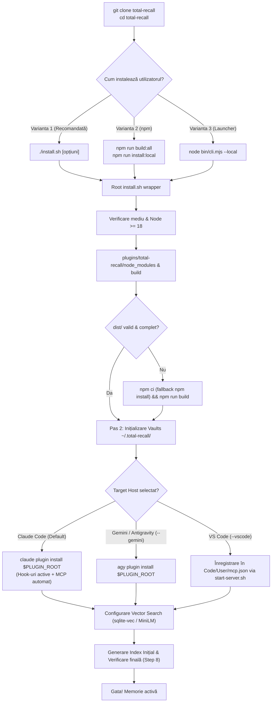

# PLAN — Instalare directă cu build local după `git clone`

**Status:** Propus / Gata de implementare  
**Data:** 2026-11-09  
**Model & Asistent:** Gemini 3.8 Flash (Antigravity)  
**Branch vizat:** `main`  
**Document țintă:** `PLAN-INSTALARE-LOCALA-GEMINI3.8.md`  
**Referințe înrudite:** [PLAN-NPX-INSTALL-BOOTSTRAP.md](PLAN-NPX-INSTALL-BOOTSTRAP.md), [INSTALL.md](../plugins/total-recall/INSTALL.md), [README.md](../README.md), [README-ro.md](../README-ro.md)

---

## 1. Rezumat Executiv & Obiectiv

### 1.1 Contextul actual
Astăzi, experiența de instalare a proiectului Total Recall este optimizată primar pentru două scenarii:
1. **Canalul de producție marketplace Claude Code / npx**: `npx @adrian-balaban/total-recall` sau instalarea din marketplace-ul GitHub, unde codul de producție este descărcat din branch-ul `release` (unde fișierele compilate din `dist/` sunt pre-generate de pipeline-ul de CI).
2. **Clonarea dedicată a branch-ului `release`**: `git clone --depth 1 -b release ...` urmat de rularea `install.sh` din subdirectorul `plugins/total-recall`.

### 1.2 Problema
Dacă un dezvoltator sau un utilizator clonează branch-ul standard (`main` sau o ramură de lucru/PR):
```bash
git clone https://github.com/adrian-balaban/total-recall.git
cd total-recall
```
aceștia întâmpină multiple puncte de fricțiune majore:
* **Nu există un punct de intrare în rădăcina proiectului**: Nu există niciun script `./install.sh` în directorul rădăcină (`total-recall/`). Rularea `./install.sh` returnează imediat `No such file or directory`.
* **Rădăcina conține doar launcherul npm**: `package.json` din root aparține pachetului `@adrian-balaban/total-recall` (launcherul npx); nu conține scripturi de `build` sau `install` care să controleze sub-proiectul din `plugins/total-recall`.
* **Directorul `dist/` lipsește cu desăvârșire**: `dist/` este inclus în `.gitignore`. Un clone proaspăt conține doar sursele TypeScript (`src/`). Fără rularea manuală a build-ului esbuild, pluginul este complet inoperabil.
* **Instalarea pe Claude Code din clone nu leagă automat hook-urile**: Dacă utilizatorul navighează manual în `plugins/total-recall` și rulează `./install.sh`, scriptul înregistrează doar un server MCP brut la nivel de utilizator (`claude mcp add-json ... --scope user`). Claude Code execută hook-urile (`SessionStart`, `PostToolUse`, `SessionEnd`, `PreCompact`) **doar dacă** pluginul este instalat prin `claude plugin install <path>`. Utilizatorul primește doar un mesaj informativ și trebuie să ghicească comanda manuală, riscând conflicte între serverul user-scope și cel plugin-scope.
* **Instalarea pentru Gemini/Antigravity (`--gemini`) eșuează silențios dacă `dist/` nu a fost compilat anterior**: `gemini-extension.json` indică direct către `${extensionPath}/dist/index.js`. Dacă `agy plugin install` se apelează înainte de compilare, extensia instalată nu va putea porni.

### 1.3 Obiectivul planului
Permiterea unei instalări "one-shot" directe, elegante și reziliente imediat după `git clone`, direct din directorul rădăcină al depozitului:
```bash
git clone https://github.com/adrian-balaban/total-recall.git
cd total-recall
./install.sh [opțiuni]
```
sau prin comenzi Node/npm intuitive:
```bash
npm run build && npm run install:local
```
Acest flux va asigura instalarea automată a dependințelor, compilarea completă locală a artefactelor (`dist/index.js`, `dist/frontmatter.mjs`, `dist/build-index-cache.mjs`, `dist/privacy-filter.mjs`, `dist/spec-*.mjs`), configurarea bazei de date/vault-ului și înregistrarea optimă pentru platformele țintă (Claude Code, Gemini/Antigravity CLI, VS Code).

---

## 2. Analiza Detaliată a Stării Curente (Friction Points)

| Fișier / Componentă | Situație curentă | Impact la `git clone` |
|---|---|---|
| **Root repo (`/`)** | Nu există `install.sh`, `Makefile` sau scripturi de instalare/build. | Utilizatorul nu știe ce să ruleze. Comenzile firești (`./install.sh`, `npm run build`) eșuează. |
| **Root `package.json`** | Are doar `"scripts": { "test": "...", "prepublishOnly": "..." }`. | Utilizatorii de Node care dau `npm run build` primesc `Missing script: "build"`. |
| **Pachetul `plugins/total-recall`** | Conține codul real TypeScript, dar este ascuns la al doilea nivel de directoare. | Utilizatorul trebuie să știe să facă `cd plugins/total-recall`. |
| **Directorul `dist/`** | Este exclus prin `.gitignore` și lipsește din ramura `main`. | Serverul MCP, scripturile de hook (`frontmatter.mjs`, `build-index-cache.mjs`, `privacy-filter.mjs`) nu pot rula fără build prealabil. |
| **`plugins/total-recall/install.sh` (Step 1)** | Încearcă să compileze `dist/index.js` apelând `npm ci && npm run build` doar dacă `dist/index.js` lipsește. | Dacă `package-lock.json` are discrepanțe locale, `npm ci` eșuează brusc. În plus, dacă `dist/index.js` există din întâmplare dar celelalte scripturi `dist/*.mjs` lipsesc, nu se recompilează. |
| **`plugins/total-recall/install.sh` (Step 3 & 5)** | Dacă nu detectează pluginul în `installed_plugins.json`, adaugă serverul MCP ca `user-scope`. Pentru hook-uri, doar afișează: `Manual clone: run 'claude plugin install "$(pwd)"'`. | Utilizatorul nu beneficiază de hook-urile automate fără comenzi adiționale. Dacă rulează comanda ulterior, ajunge să aibă 2 servere MCP înregistrate (dublă indexare). |
| **`bin/cli.mjs` (Launcher)** | Caută doar cache-ul Claude marketplace (`my-claude-plugins/total-recall`) și execută comenzile de descărcare git/marketplace. | Nu suportă un mod `--local` care să ruleze din codul sursă curent. |
| **Invariantul `test/pack-guard.mjs`** | Tarball-ul npm publicat pentru `@adrian-balaban/total-recall` trebuie să conțină strict `bin/`, `package.json`, `README*`, `LICENSE*`. | Orice modificare adusă rădăcinii nu trebuie să altereze fișierele incluse în tarball-ul npm. |

---

## 3. Principii de Design & Decizii Arhitecturale

### 3.1 Punct de intrare unificat în Root (`./install.sh`)
* **Decizie**: Crearea unui script executabil `install.sh` în rădăcina proiectului (`total-recall/install.sh`).
* **Comportament**: Scriptul va funcționa ca un wrapper inteligent și rezilient peste `plugins/total-recall/install.sh`:
  - Detectează automat dacă rulează din rădăcina depozitului.
  - Setează implicit `--plugin-root "$ROOT_DIR/plugins/total-recall"`.
  - Propagă transparent toate argumentele CLI primite (`"$@"`), permițând rularea:
    ```bash
    ./install.sh -y
    ./install.sh --gemini
    ./install.sh --vscode
    ./install.sh --no-vector
    ```
  - Asigură că pe Windows (Git Bash) căile sunt rezolvate compatibil.

### 3.2 Scripturi de delegare în Root `package.json`
* **Decizie**: Adăugarea de scripturi de convenție în `package.json`-ul din rădăcină:
  ```json
  "scripts": {
    "build": "npm --prefix plugins/total-recall run build",
    "build:all": "npm --prefix plugins/total-recall install && npm --prefix plugins/total-recall run build",
    "install:local": "./install.sh",
    "test": "node --test test/cli.test.mjs",
    "test:plugin": "npm --prefix plugins/total-recall test",
    "prepublishOnly": "node test/pack-guard.mjs"
  }
  ```
* **Compatibilitate npm pack**: Deoarece `package.json` are definit `"files": ["bin"]`, aceste scripturi noi nu vor adăuga niciun fișier în pachetul npm distribuit, respectând 100% testul `pack-guard.mjs`.

### 3.3 Build determinist și rezilient al pachetului plugin
* În `plugins/total-recall/install.sh` (și în scriptul root), etapa de build local trebuie să fie complet imună la probleme minore de mediu:
  1. Verifică dacă `plugins/total-recall/node_modules` există; dacă nu, rulează instalarea dependințelor.
  2. Încearcă `npm ci --no-audit --no-fund`; dacă acesta eșuează (de exemplu, lockfile desincronizat pe o ramură locală), face fallback automat la `npm install --no-audit --no-fund`.
  3. Rulează `npm run build`, care execută în lanț:
     - `sync:version`
     - `build:esbuild` -> `dist/index.js`
     - `build:frontmatter` -> `dist/frontmatter.mjs`
     - `build:index-cache` -> `dist/build-index-cache.mjs`
     - `build:privacy-filter` -> `dist/privacy-filter.mjs`
     - `build:spec-hooks` -> `dist/spec-config.mjs` & `dist/spec-fields.mjs`
  4. Verifică existența **tuturor** fișierelor din `dist/`, nu doar a `dist/index.js`.

### 3.4 Suport integrat complet pentru Claude Code Plugin (`claude plugin install`)
* În cazul unui build local dintr-un clone:
  - Dacă utilitarul `claude` este prezent în PATH:
    - În loc să înregistreze doar `claude mcp add-json total-recall ... --scope user` (care lasă hook-urile dezactivate), scriptul va putea înregistra pluginul direct prin:
      ```bash
      claude plugin install "$PLUGIN_ROOT"
      ```
    - Dacă utilizatorul dorește strict server MCP fără plugin (de ex. un mediu personalizat sau flag `--no-plugin`), scriptul păstrează fallback-ul pe `claude mcp add-json`.
    - Pentru a preveni conflictele și dubla indexare: scriptul verifică și curăță înregistrarea `user-scope` a lui `total-recall` dacă se instalează ca plugin.

### 3.5 Integrare fluidă pentru Gemini / Antigravity (`--gemini`)
* Când este furnizat flag-ul `--gemini`:
  1. Se asigură că `dist/` este deja compilat local în `$PLUGIN_ROOT`.
  2. Execută instalarea extensiei prin `agy plugin install "$PLUGIN_ROOT"` (sau oferă comanda exactă dacă CLI-ul cere confirmare interactivă de încredere a folderului).
  3. Deoarece `dist/` este compilat, extensia Gemini pornește instantaneu fără erori de fișiere lipsă.

### 3.6 Modul `--local` în `bin/cli.mjs` (Opțional / Suport npx direct din repo)
* Extinderea launcherului `bin/cli.mjs` pentru a recunoaște flag-ul `--local`:
  - Dacă utilizatorul se află în directorul clonat și rulează `node bin/cli.mjs --local` (sau `npx . --local`), launcherul:
    - Sare peste pașii de adăugare marketplace remote (`claude plugin marketplace add ...`).
    - Detectează direct `plugins/total-recall/`.
    - Lansează scriptul de build și instalare locală.

---

## 4. Arhitectura Tehnică & Fluxul de Execuție

### 4.1 Diagrama fluxului de instalare după `git clone`



---

## 5. Specificații Tehnice pentru Fișierele Noi și Modificate

### 5.1 Fișier nou: `install.sh` (în rădăcina depozitului)
Acest fișier va fi creat cu permisiuni de execuție (`chmod +x`).

```bash
#!/usr/bin/env bash
#
# install.sh — Root entrypoint for local build & installation of Total Recall
#
# Allows running directly after:
#   git clone https://github.com/adrian-balaban/total-recall.git
#   cd total-recall
#   ./install.sh [options]
#
set -euo pipefail

ROOT_DIR="$(cd -- "$(dirname -- "${BASH_SOURCE[0]}")" >/dev/null 2>&1 && pwd -P)"
PLUGIN_DIR="$ROOT_DIR/plugins/total-recall"

if [ ! -d "$PLUGIN_DIR" ] || [ ! -f "$PLUGIN_DIR/package.json" ]; then
  echo "Error: Could not locate plugin directory at '$PLUGIN_DIR'." >&2
  exit 1
fi

# Ensure executable permissions on plugin scripts
chmod +x "$PLUGIN_DIR/install.sh" "$PLUGIN_DIR/scripts/"*.sh "$PLUGIN_DIR/hooks/scripts/"*.sh 2>/dev/null || true

# Execute the main installer with --plugin-root pointing to the local clone
exec "$PLUGIN_DIR/install.sh" --plugin-root "$PLUGIN_DIR" "$@"
```

### 5.2 Modificare: `package.json` (rădăcină)
Actualizarea secțiunii `"scripts"` pentru a permite comenzile standard de build/instalare fără a modifica tarball-ul distribuit:

```json
{
  "name": "@adrian-balaban/total-recall",
  "version": "1.8.1",
  "description": "One-command install bootstrap for the total-recall memory plugin (Claude Code / Gemini / VS Code). The plugin code itself ships from the GitHub release branch.",
  "type": "module",
  "license": "MIT",
  "bin": { "total-recall": "bin/cli.mjs" },
  "files": ["bin"],
  "engines": { "node": ">=18" },
  "repository": { "type": "git", "url": "git+https://github.com/adrian-balaban/total-recall.git" },
  "scripts": {
    "build": "npm --prefix plugins/total-recall run build",
    "build:all": "npm --prefix plugins/total-recall install && npm --prefix plugins/total-recall run build",
    "install:local": "./install.sh",
    "test": "node --test test/cli.test.mjs",
    "test:plugin": "npm --prefix plugins/total-recall test",
    "prepublishOnly": "node test/pack-guard.mjs"
  }
}
```

### 5.3 Modificare: `plugins/total-recall/install.sh`
Îmbunătățiri aduse scriptului principal:
1. **Verificare completă a build-ului `dist/`**:
   În loc să verifice doar `[ -f "$PLUGIN_ROOT/dist/index.js" ]`, se verifică toate componentele necesare:
   - `dist/index.js`
   - `dist/frontmatter.mjs`
   - `dist/build-index-cache.mjs`
   - `dist/privacy-filter.mjs`
   - `dist/spec-config.mjs`
   - `dist/spec-fields.mjs`
   Dacă oricare dintre acestea lipsește, se declanșează automat `npm run build`.
2. **Instalare rezilientă a dependențelor**:
   Înlocuirea secvenței rigide `npm ci` cu un bloc sigur:
   ```bash
   if [ ! -d "$PLUGIN_ROOT/node_modules" ]; then
     info "Installing plugin dependencies in $PLUGIN_ROOT ..."
     ( cd "$PLUGIN_ROOT" && (npm ci --no-audit --no-fund || npm install --no-audit --no-fund) ) \
       || die "Failed to install dependencies in '$PLUGIN_ROOT'."
   fi
   ```
3. **Instalare automată Claude Code Plugin pentru instalările locale**:
   În Step 3 & Step 5:
   Dacă `PLUGIN_ROOT` nu este în cache-ul Claude (`~/.claude/plugins/cache/`), dar `claude` CLI este disponibil:
   - Se oferă opțiunea (sau se execută automat cu `-y`) instalarea locală ca plugin:
     ```bash
     claude plugin install "$PLUGIN_ROOT"
     ```
   - Acest pas asigură încărcarea instantanee a fișierului `hooks/hooks.json` în sesiunile Claude Code!
   - Dacă `claude plugin install` reușește, `PLUGIN_MANAGED` devine `1`, iar scriptul curăță orice înregistrare manuală duplicată din `claude mcp`, prevenind dublarea uneltelor.

### 5.4 Modificare: `bin/cli.mjs`
Adăugarea suportului pentru `--local`:
* În `parseArgs`: adăugarea flag-ului `local: false`.
* În `main()`:
  Dacă `own.local` este `true`:
  - Verifică dacă există un subdirector local `plugins/total-recall` sau dacă procesul curent se află într-un director de plugin.
  - Sare peste apelurile `claude plugin marketplace add` și `claude plugin install total-recall@my-claude-plugins`.
  - Execută direct `install.sh` cu `--plugin-root` setat la folderul local.

---

## 6. Plan de Implementare Pas cu Pas (Task Breakdown)

### Faza 1: Punctul de intrare root și scripturile npm
* [ ] **Task 1.1**: Crearea scriptului executabil `install.sh` în rădăcina proiectului.
* [ ] **Task 1.2**: Asigurarea permisiunilor `chmod +x install.sh` și validarea pe Linux / macOS.
* [ ] **Task 1.3**: Actualizarea fișierului `package.json` din rădăcină cu scripturile `build`, `build:all`, `install:local`, `test:plugin`.
* [ ] **Task 1.4**: Rularea testului `node test/pack-guard.mjs` pentru a garanta că `npm pack` nu conține fișiere nepermise.

### Faza 2: Robustizarea build-ului și a logicii din `plugins/total-recall/install.sh`
* [ ] **Task 2.1**: Rafinarea detectării integrității `dist/` (verificarea tuturor scripturilor `.mjs` și a `dist/index.js`).
* [ ] **Task 2.2**: Adăugarea mecanismului fallback `npm ci` -> `npm install` dacă lipsesc dependințele.
* [ ] **Task 2.3**: Îmbunătățirea pasului de înregistrare Claude Code pentru instalările locale (rularea automată `claude plugin install "$PLUGIN_ROOT"` și evitarea conflictelor cu `claude mcp`).
* [ ] **Task 2.4**: Validarea fluxului `--gemini` și `--vscode` când este apelat din rădăcină prin wrapper.

### Faza 3: Extinderea `bin/cli.mjs` cu opțiunea `--local`
* [ ] **Task 3.1**: Actualizarea parserului de argumente din `bin/cli.mjs` pentru a accepta `--local`.
* [ ] **Task 3.2**: Implementarea ramurii de execuție locală fără interogarea marketplace-ului remote.
* [ ] **Task 3.3**: Adăugarea testelor unitare corespunzătoare în `test/cli.test.mjs`.

### Faza 4: Testare, Verificare și Smoke Tests
* [ ] **Task 4.1**: Rularea testelor unitare din rădăcină: `npm test`.
* [ ] **Task 4.2**: Rularea testelor din plugin: `npm run test:plugin`.
* [ ] **Task 4.3**: Smoke test într-un sandbox/director temporar:
  - Clonare curată a depozitului într-un folder temporar.
  - Rulare `./install.sh -y --no-vector`.
  - Verificare creare `~/.total-recall/personal-vault/`.
  - Verificare generare fișiere `dist/`.
  - Verificare înregistrare unelte MCP.
* [ ] **Task 4.4**: Verificarea profilului complet (cu compilare locală de vector search).

### Faza 5: Documentație
* [ ] **Task 5.1**: Actualizarea `README.md` și `README-ro.md` cu noua secțiune: *"Instalare directă din surse (git clone)"*.
* [ ] **Task 5.2**: Actualizarea `plugins/total-recall/INSTALL.md` la secțiunea *"Developing from a clone"* cu noile instrucțiuni simplificate.

---

## 7. Matricea de Testare și Criterii de Acceptare

### 7.1 Criterii de Acceptare (Acceptance Criteria)
1. **Comandă unică**: Imediat după `git clone ... && cd total-recall`, comanda `./install.sh -y` trebuie să finalizeze instalarea cu cod de ieșire `0` fără intervenție manuală.
2. **Build automat complet**: Directorul `dist/` trebuie să conțină toate artefactele compilate funcționale (`index.js`, `frontmatter.mjs`, `build-index-cache.mjs`, `privacy-filter.mjs`, `spec-config.mjs`, `spec-fields.mjs`).
3. **Păstrarea datelor**: Re-rularea `./install.sh` nu trebuie să șteargă sau să corupă memoriile existente din `~/.total-recall/personal-vault/`.
4. **Hook-uri funcționale în Claude Code**: Dacă instalarea se face pe o mașină cu `claude` CLI, pluginul este înregistrat astfel încât hook-urile de la `SessionStart` și `PostToolUse` să se declanșeze.
5. **Garanția de pachet NPM (`pack-guard`)**: Comanda `npm run prepublishOnly` din rădăcină trebuie să treacă cu succes, confirmând că pachetul npm nu este poluat.
6. **Suport multi-platformă**: Scripturile trebuie să ruleze identic pe Linux, macOS și Windows (Git Bash).

---

## 8. Concluzie

Prin implementarea acestui plan, Total Recall va elimina bariera tehnică dintre dezvoltatorii care vor să instaleze pluginul rapid din surse și structura internă a depozitului. Oricine clonează proiectul va avea la dispoziție o experiență de clasă superioară: **un singur script (`./install.sh`) sau o singură comandă npm, build local automat și integrare directă cu asistentul preferat (Claude Code, Gemini/Antigravity, VS Code)**.
