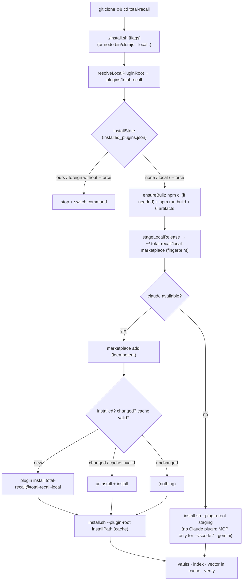

# FINAL PLAN — Direct install with a local build after `git clone`

**Status:** approved for implementation after review · **Revision 2:** 2026-11-09, after the external review (§11) · **Working branch:** `feat/local-install` (from `main`)
**Unified sources** (all in `backlog-and-plans/`, next to this file): [PLAN-INSTALARE-LOCALA-GEMINI3.8.md](PLAN-INSTALARE-LOCALA-GEMINI3.8.md) · [PLAN-INSTALARE-LOCALA-DEEPSEEK.md](PLAN-INSTALARE-LOCALA-DEEPSEEK.md) · [PLAN-INSTALARE-LOCALA-Claude.md](PLAN-INSTALARE-LOCALA-Claude.md)
**Provenance tags:** `[G]` Gemini · `[D]` DeepSeek · `[C]` Claude · `[R]` new, raised in review

> **For the implementing agent.** The facts in §3 were verified on 2026-11-09: the code was read in the repo, and `claude plugin` behaviour was observed in a real spike on Claude Code 2.1.220 with a temporary `HOME`. Do not re-derive them. If a quoted line no longer matches or the `claude` version differs, re-verify only that point. Code, CLI messages and repo documentation are in English. Do not modify any `package-lock.json`.

---

## 1. Goal and final UX

After cloning, one command builds the plugin locally and installs it completely:

```bash
git clone https://github.com/adrian-balaban/total-recall.git
cd total-recall
./install.sh [-y] [--no-vector] [--gemini] [--vscode] [...]   # every existing install.sh flag
```

| Situation | Result |
|---|---|
| `claude` available | Claude Code plugin `total-recall@total-recall-local`, with hooks and MCP (from the plugin's `.mcp.json`), plus the `install.sh` steps: vaults, index, vector, verification. |
| `claude` missing | Vaults + index. MCP is registered only for the requested hosts: `--vscode` writes a path to the staging tree into VS Code's `mcp.json`, and `--gemini` prints the `agy` command, which copies the tree (F10). With no host flag no MCP is registered; step 3 of `install.sh` is skipped without `claude`. |
| Re-run with no changes | Idempotent: no reinstall, memories untouched. |
| `git pull` + re-run | Rebuild, and the new code is delivered into the installed plugin. |

Equivalent variants: `node bin/cli.mjs --local [path] [flags]`, `npm run install:local` and, once an npm version that includes `--local` is published, `npx @adrian-balaban/total-recall --local <path>`.

The marketplace (`npx @adrian-balaban/total-recall` or `/plugin install total-recall@my-claude-plugins`) **remains the recommended channel**. The local channel is for forks, code from `main` before a release, and power users. `[D:D2]`

---

## 2. Comparative review of the three plans

### 2.1 Score by criterion

| Criterion | Gemini 3.8 | DeepSeek | Claude |
|---|---|---|---|
| Facts verified in the repo (lines, behaviour) | weak: unverified claims | **very good**: correct lines | **very good** + real CLI spike |
| The Claude Code install mechanism works | ✘ `plugin install <path>` | ✘ `plugin install <path>` | ✔ local directory marketplace |
| Vector dependencies land where the server runs | ✘ | ✘ (runs `install.sh` on the clone) | ✔ (runs `install.sh` on the cache) |
| Avoids copying `node_modules` (1.9 GB) into the cache | ✘ | ✘ | ✔ (clean staging) |
| Stale `dist/` after `git pull` | ✘ | partial (manual `--rebuild`) | ✔ (always builds, refresh on fingerprint) |
| Collision policy with the marketplace | ✘ | ✔ (one-directional) | ✔ (symmetric) |
| Offline test plan | ✘ | **very good** | ✔ (takes DeepSeek's + new tests) |
| Entry point right after the clone | **✔ `./install.sh` at the root** | ~ (published npx) | ✔ (takes Gemini's) |
| Lockfile integrity | ✘ (`npm ci \|\| npm install`) | ✔ | ✔ |
| Trust, docs, smoke | partial | **very good** | ✔ (takes DeepSeek's) |

### 2.2 Verdicts

- **Gemini 3.8 — good UX ideas, broken mechanism.** Kept: the root `./install.sh`, checking every `dist/` artifact, the root npm scripts and the flow diagram. Rejected:
  - `claude plugin install "$PLUGIN_ROOT"` (fails, F1);
  - the `npm install` fallback (modifies the lockfile);
  - the claim that `--gemini` runs `agy` automatically (it does not under `-y`, F9);
  - the unspecified `--no-plugin` flag;
  - `chmod +x`, which is unnecessary.

  Its "Ready to implement" status was overstated. Details in [PLAN-…-Claude.md, Annex A](PLAN-INSTALARE-LOCALA-Claude.md#anexa-a--review-plan-instalare-locala-gemini38md).
- **DeepSeek — the most rigorous process, but the critical step is wrong.** Almost all of its structure was kept: decisions D2–D7, `resolveLocalPluginRoot`, indexed parsing, optional `claude` under `--local`, `--rebuild`, the test plan with injected `deps`, trust, docs, the "untouched files" criterion. Defects:
  - `claude plugin install <path>` (F1) is treated as "unverified", not as a blocker;
  - `install.sh` runs on the clone, so the vector dependencies land in the clone (F8);
  - copying `node_modules` is not accounted for (F3);
  - on win32, `npm.cmd` without `shell: true` fails;
  - the latent `installState` bug (F5) goes unnoticed.

  Details in [Annex B](PLAN-INSTALARE-LOCALA-Claude.md#anexa-b--review-backlog-and-plansplan-instalare-locala-deepseekmd).
- **Claude — self-review.** The plan resolves the blockers through observed facts, not assumptions. Weak points, corrected in this final plan:
  - it did not check that the cache can exist without `dist/index.js` after an interrupted install `[R1]`;
  - it did not test that the executable bit on `hooks/scripts/*.sh` survives staging `[R2]`;
  - it did not mention the effect of `sync:version` on the tree `[R3]`;
  - it did not recommend restarting Claude Code sessions after a refresh `[R4]`;
  - the dependency on CLI behaviour observed on a single version must be pinned by a smoke test `[R5]`.

---

## 3. Verified facts (the basis for the decisions)

| # | Fact | Source |
|---|---|---|
| F1 | `claude plugin install <path>` → `not found in any configured marketplace`. `install` only accepts `plugin[@marketplace]`. The current docs (`INSTALL.md` § Developing from a clone, `plugins/total-recall/CLAUDE.md` § Install) are wrong. | spike |
| F2 | `claude plugin marketplace add <dir>` requires `<dir>/.claude-plugin/marketplace.json`. It works with the source `"./plugins/total-recall"`. The ID becomes `total-recall@<mkt-name>`. Re-adding is idempotent. | spike |
| F3 | Installing copies the source directory into `~/.claude/plugins/cache/<mkt>/total-recall/<ver>/`, **including** `dist/` and `node_modules/` (no `.gitignore` filtering). The plugin's `node_modules` in a dev clone is 1.9 GB. | spike, `du` |
| F4 | At the same version, `install` is a no-op ("already installed") and `update` is a no-op ("already at latest"). Only `uninstall` + `install` refreshes. | spike |
| F5 | `uninstall` empties `installed_plugins.json` but leaves the directory in the cache. `installState()` (`bin/cli.mjs:113-122`) only looks at the cache, so it reports `'ours'` after an uninstall (latent bug). `PLUGIN_MANAGED` (`plugins/total-recall/install.sh:332-338`) reads `installed_plugins.json` and is correct. | spike, code |
| F6 | The root `.claude-plugin/marketplace.json` is named `my-claude-plugins` and has a GitHub `git-subdir` source with `ref: release`. The clone's root cannot be a local marketplace: it would collide by name and would pull the code from `release`. | code |
| F7 | `claude --plugin-dir <path>` loads the plugin for the current session only. That is the correct dev loop. | `claude --help` |
| F8 | Step 7 of `install.sh` runs `npm install --no-save <vector deps> && npm run build` in `PLUGIN_ROOT`. Today's npx flow runs `install.sh` from the cache (`bin/cli.mjs:171-184`). | code |
| F9 | `--gemini` under `-y` or without a tty does not run `agy` (because of the trust prompt). It only prints the command (`install.sh:565-595`). | code |
| F10 | `agy plugin install <dir>` copies `<dir>` into `~/.gemini/extensions/total-recall/`. | code (comment, `install.sh:47-51`) |
| F11 | `pack-guard` allows `package.json`, `README*`, `LICENSE*` and `bin/*.mjs`. A new `bin/local.mjs` file is allowed. | `test/pack-guard.mjs:7` |
| F12 | `plugins/total-recall/install.sh` has mode `100755` in git. | `git ls-files -s` |
| F13 | `dist/index.js` is a self-contained bundle. The only externals are `fsevents`, `@huggingface/transformers`, `sqlite-vec` and `better-sqlite3` (optional). A tree without `node_modules` runs, just like `release`. | `package.json` (plugin) |
| F14 | `npm run build` produces 6 artifacts: `index.js`, `frontmatter.mjs`, `build-index-cache.mjs`, `privacy-filter.mjs`, `spec-config.mjs`, `spec-fields.mjs`. It first runs `sync:version`, which rewrites the version in `plugin.json`, `gemini-extension.json` and the root npx manifest. | `package.json` (plugin), `CLAUDE.md` |
| F15 | The CI gate (`mutation.yml:70-72`) runs `npm test` at the root. | code |

---

## 4. Final decisions

| ID | Decision | Provenance |
|---|---|---|
| **DF1** | **Entry point:** `./install.sh` at the repo root, as a minimal bash wrapper over `node bin/cli.mjs --local "$ROOT" "$@"`. All the logic lives in Node, where it is testable. | `[G]` entry + `[C]` delegation |
| **DF2** | **The `--local` logic** lives in the new module `bin/local.mjs`, imported by `bin/cli.mjs`. The `--local [path]` flag is an own-flag, not a subcommand. | `[D:D1]` + `[C]` |
| **DF3** | **"Local release" in `~/.total-recall/local-marketplace/`**: `.claude-plugin/marketplace.json` (`name: total-recall-local`, source `./plugins/total-recall`), `plugins/total-recall/` (clean tree + `dist/`, no `node_modules`) and `.local-build.json` (metadata). Claude installs from this marketplace, not from the clone (F1, F3, F6). | `[C]` |
| **DF4** | **File selection:** `git ls-files -co --exclude-standard` in the plugin directory (tracked + new non-ignored files, so local changes are included), plus `dist/`. **Fallback, fail-closed `[R6]`:** used only when there is no `.git` in any parent (a downloaded archive, no dev files). If `.git` exists but `git` is missing or fails → stop with the instruction "install git, or copy the plugin without dev files". The fallback uses an **allowlist** for dot entries (`.claude-plugin/`, `.mcp.json`; every other entry starting with `.` is skipped, including `.remember/`, `.claude/`, `.git/`, `.stryker-tmp/`) and excludes `node_modules`, `dist`, `coverage`, `reports`, `tmp`, `*.tsbuildinfo`. Staging happens in a temporary sibling directory, followed by an atomic `rename`. The executable bit is preserved `[R2]`. | `[C]` + `[R6]` |
| **DF5** | **Build:** `npm ci --no-audit --no-fund` only if `node_modules/.package-lock.json` is missing or older than `package-lock.json`. `npm run build` **always** runs under `--local` (esbuild, seconds). Then all 6 artifacts are checked (F14). **No** `npm install` fallback. | `[C]` + `[G]` (6 artifacts) + `[D]` (lockfile) |
| **DF6** | **Build before install:** build → staging → `marketplace add` → `install`. The cache copy already has `dist/`. | `[D:D3]` |
| **DF7** | **With `claude`:** `marketplace add <staging>` (idempotent). Then: if the plugin is not installed → `install`; if it is installed and (the fingerprint changed **or** `<installPath>/dist/index.js` is missing `[R1]`) → `uninstall` + `install` (F4); otherwise nothing. `installPath` is **re-read** from `installed_plugins.json` **after** `install` or `uninstall` + `install` has finished; the value read before is not reused `[R7]`. If after the install there is no `installPath` or no `<installPath>/install.sh` → exit 1, with the manual command `[R5]`. Then `bash <installPath>/install.sh --plugin-root <installPath> <forward>` (F8). | `[C]` + `[R1]` + `[R7]` |
| **DF8** | **Without `claude`:** `bash <staging>/plugins/total-recall/install.sh --plugin-root <staging>/plugins/total-recall <forward>`. Under `--local`, `claude` is not a hard requirement. The staging tree becomes the **runtime location** for the VS Code `mcp.json` entry, so it is not deleted while that entry exists. A re-run replaces it at the same path. Uninstalling is documented separately (Step 8) `[R8]`. | `[D]` + `[C]` (staging instead of the clone) + `[R8]` |
| **DF9** | **`installState`** relies on `installed_plugins.json`, falling back to the cache only if the file is missing, and returns `'ours' \| 'local' \| 'foreign' \| 'none'`. This also fixes bug F5 in the marketplace flow. | `[C]` + `[R]` |
| **DF10** | **Collisions (symmetric):** `--local` + `ours` → stop with `claude plugin uninstall total-recall@my-claude-plugins`. Marketplace + `local` → stop with `claude plugin uninstall total-recall@total-recall-local`. `foreign` → the existing message. `--force` overrides, with a warning about duplicate hooks and MCP. Memories are not affected. | `[D:D4]` extended by `[C]` |
| **DF11** | **`plugins/total-recall/install.sh`** gets three changes: `--rebuild`; a build triggered if *any* of the 6 artifacts is missing; a dedicated message when `PLUGIN_ROOT` lies in `cache/total-recall-local/`. Nothing else. | `[D:D5]` + `[G]` + `[C]` |
| **DF12** | **No `git clone` from the bootstrap.** No plugin code in the npm tarball either (`pack-guard` untouched). `bin/local.mjs` goes into the tarball (allowed by `bin/*.mjs`, F11), so it stays dependency-free and imports only `node:*` and `./cli.mjs`; it imports nothing from `plugins/`. A test enforces this invariant `[R9]`. | `[D:D7]` + `[R9]` |
| **DF13** | **Trust:** the local channel means "the cloned commit + the local toolchain + the npm registry at build time". This is documented in `SECURITY.md`. | `[D:D6]` |
| **DF14** | **Separate dev loop:** `npm run build && claude --plugin-dir "$(pwd)"` (F7). It replaces the wrong command in the docs. | `[C]` |
| **DF15** | **Root npm scripts:** `build`, `install:local`, `test` → `node --test test/*.test.mjs`. `files: ["bin"]` stays unchanged. | `[G]` (adapted) |

### Explicitly rejected

| Proposal | Reason |
|---|---|
| `claude plugin install <path>` `[G][D]` | Does not work (F1). |
| `npm ci \|\| npm install` `[G]` | Rewrites `package-lock.json` and hides the drift that CI rejects. |
| Running `install.sh` on the clone after installing the plugin `[D]` | The vector dependencies would land in the wrong place (F8). |
| Registering the clone as a marketplace | The root name is taken (F6), and `node_modules` would be copied (F3). |
| `npx … --local` as the first command `[D]` | Fetches the published launcher, not the one in the clone. It stays only as an alternative. |
| Running `agy plugin install` automatically `[G]` | The trust prompt is a security policy (F9). Current behaviour stays. |
| The `--no-plugin` flag `[G]` | No requirement for it. A missing `claude` already covers the standalone case. |
| An artificial version bump (e.g. `-local.<sha>`) for `claude plugin update` | It would falsify the reported version and pile up directories in the cache. `uninstall` + `install` is verified and clean. |

---

## 5. Flow



---

## 6. Implementation steps (small commits, in order)

### Step 0 — Baseline
1. Node 20 (`mise`/`.nvmrc`), branch `feat/local-install`, clean `git status`.
2. `npm test` at the root is green. `HOME=$(mktemp -d) npm test` in `plugins/total-recall` is optional.
3. `claude --version`. If it is not 2.1.220, quickly repeat the F1/F2/F4 spike in a temporary `HOME` and note the differences in the PR `[R5]`.

### Step 1 — `bin/cli.mjs`: parsing and `installState`
- `parseArgs`: indexed loop. `--local` consumes the next token if it exists and does not start with `-`. `own.local` takes the values `false | true | string`. The remaining arguments are forwarded unchanged, in order. The existing test "removes its own flags and forwards the rest verbatim" stays green. `[D]`
- `installState(home, fsImpl)` per DF9. New constant: `LOCAL_MARKETPLACE_NAME = 'total-recall-local'`.
- Marketplace flow: state `'local'` → stop per DF10 (with `--force` → continue).
- `USAGE`: `--local [path]`, with the after-clone example.
- Commit: `feat(cli): --local flag parsing and installed_plugins-based install state`.

### Step 2 — `bin/local.mjs` (new)
Exported functions, all with injected `deps` (`run`, `fsImpl`, `home`, `platform`, `out`, `err`):
- `resolveLocalPluginRoot({ given, cwd, fsImpl })` per `[D]` Step 1: a direct path to the plugin, a path to the repo root, or autodetection by walking up from `cwd`. Marker: `.claude-plugin/plugin.json` + `package.json`. The result goes through `path.resolve`.
- `npmCommand(platform)` → `{ cmd: 'npm.cmd', shell: true }` on `win32`, otherwise `{ cmd: 'npm' }`. Windows needs a shell (CVE-2024-27980).
- `ensureBuilt({ pluginDir, ... })` per DF5. On failure the message says: "local build needs Node ≥18 and npm registry access; run `npm ci && npm run build` in <dir> to see the error". Note `[R3]`: `sync:version` may modify tracked files if the versions in the clone are out of sync. Report this with `out()`; do not block.
- `DIST_ARTIFACTS` — the list of 6 (F14).
- `stageLocalRelease({ pluginDir, home, ... })` per DF3 and DF4. Returns `{ stagingDir, pluginStageDir, fingerprint, changed }`. Fingerprint = sha256 over the sorted paths + content. `changed` is computed against the previous `.local-build.json`, which holds `{ source, gitSha, dirty, fingerprint, builtAt }`.
- `readInstalledPlugin(home, id, fsImpl)` → `{ installPath } | null`, from `installed_plugins.json`. Schema observed on 2.1.220 `[R10]`: `{ "version": 2, "plugins": { "<name>@<mkt>": [ { "scope": "user", "installPath": "…", "version": "…", "installedAt": "…", "lastUpdated": "…", "gitCommitSha"?: "…" } ] } }`. The value is an **array** of entries, one per scope. Take the entry with `scope: "user"`, otherwise the first. A missing key or an empty array ⇒ `null` (the state after `uninstall`, F5). `installState` (DF9) uses the **same** parsing helper (`readInstalledPlugins`), so there are never two interpretations of the file. Corrupt JSON ⇒ treated as a missing file (cache fallback) and reported with `err()`.
- `installLocal(argvForward, own, deps)` — the full orchestration per DF7, DF8 and DF10. Exit codes: `1` for errors, `EX_UNAVAILABLE` (69) for Windows without Git Bash, otherwise the exit code of `install.sh`. After a refresh it prints: "restart running Claude Code sessions to load the new build" `[R4]`.
- The default `run` in `cli.mjs` accepts `{ inherit, cwd, capture, shell }`. `capture` returns `stdout`, used by `git ls-files`.
- Commit: `feat(cli): local-release build, staging and install (--local)`.

### Step 3 — `bin/cli.mjs`: the `--local` branch in `main`
- The branch comes after `--help`/`--version` and the Node ≥18 gate, **before** the mandatory `resolveClaude`. It delegates to `installLocal`. The marketplace flow stays unchanged, apart from DF9/DF10.
- Commit: `feat(cli): route --local before the marketplace flow`.

### Step 4 — `install.sh` at the root (new)
```bash
#!/usr/bin/env bash
# Build total-recall from this clone and install it (local release). See plugins/total-recall/INSTALL.md.
set -euo pipefail
ROOT="$(cd -- "$(dirname -- "${BASH_SOURCE[0]}")" && pwd -P)"
command -v node >/dev/null 2>&1 || { echo "install.sh: Node.js 18+ is required (https://nodejs.org)." >&2; exit 1; }
exec node "$ROOT/bin/cli.mjs" --local "$ROOT" "$@"
```
- Commit it with `git update-index --chmod=+x install.sh`. `--help` reaches `cli.mjs`; the plugin's `install.sh` help stays reachable through the forwarded flags.
- Commit: `feat: root ./install.sh entry point for local builds`.

### Step 5 — `plugins/total-recall/install.sh`
1. `REBUILD=0` next to the defaults. `--rebuild) REBUILD=1; shift;;` in the parsing at `:206-221`. A new entry in the header's "Options:" block.
2. At `:305`, the condition becomes: any of the 6 artifacts is missing **or** `REBUILD=1`. A distinct `info` message. `npm ci && npm run build` stay unchanged.
3. At `:322-327`: for `*/.claude/plugins/cache/total-recall-local/*`, print `info "Local build (total-recall-local) — after 'git pull', re-run ./install.sh in your clone."` instead of the two `warn` lines.
4. `bash -n plugins/total-recall/install.sh` must pass.
- Commit: `feat(install): --rebuild, full dist check, local-channel cache notice`.

### Step 6 — Root `package.json`
```json
"scripts": {
  "build": "npm --prefix plugins/total-recall run build",
  "install:local": "node bin/cli.mjs --local .",
  "test": "node --test test/*.test.mjs",
  "prepublishOnly": "node test/pack-guard.mjs"
}
```
- `node test/pack-guard.mjs` must pass. Commit: `chore: root build/install:local scripts`.

### Step 7 — Tests (offline, run by `npm test` at the root, F15)
**`test/cli.test.mjs`** (extended):
- `--local` parsing: `/p` → `'/p'`; `--local --gemini` → `true`, and `--gemini` is forwarded; `--local` at the end → `true`; the order of forwarded arguments is preserved;
- `installState`: `ours`, `local`, `foreign`, `none`, plus F5 (directory in the cache, empty `installed_plugins.json` ⇒ `none`) and the cache fallback when the file is missing. The fixture uses the exact schema `[R10]`, including the key with an empty array. `total-recall@total-recall-local` ⇒ `local`, not `foreign` (triaged through the `LOCAL_MARKETPLACE_NAME` constant). Precedence in the fallback stays `ours` > `local` > `foreign`, so the existing test with `foreign` + `ours` in the cache stays green;
- marketplace + `local` ⇒ 1 without `--force`, continues with `--force`. The `foreign` message stays textually unchanged;
- the existing tests stay unchanged and green.

**`test/local.test.mjs`** (new; real temp directories via `fs.mkdtempSync`, fake `run`):
- `resolveLocalPluginRoot`: plugin directly, repo root, nested `cwd`, `cwd` = plugin, nothing ⇒ `null`;
- `ensureBuilt`: `ci` only without `node_modules` or with a newer lockfile; `build` always; `npm.cmd` + `shell` on win32; an artifact missing after the build ⇒ error; a failed `run` ⇒ error;
- `stageLocalRelease`:
  - no `node_modules`; `dist/` present; correct `marketplace.json`;
  - the executable bit preserved on **every** `100755` file in git: `hooks/scripts/*.sh`, `install.sh`, `scripts/start-server.sh` `[R2]`. `statusline.sh` is `100644` in git, so it is not asserted;
  - fingerprint stable on re-run (`changed=false`) and changed after an edit (`changed=true`);
  - fallback without `.git`: a fake `.remember/x.md` and `.claude/settings.local.json`, plus `tmp/` and `x.tsbuildinfo`, are **absent** from staging, while `.claude-plugin/` and `.mcp.json` are present `[R6]`;
  - `.git` present + `git` failing ⇒ error, with no partial staging `[R6]`;
- `installInvariant` `[R9]`: `bin/local.mjs` contains no `import`/`require` of anything other than `node:*` or `./cli.mjs`;
- `installLocal` with `claude`:
  - the exact order of `run` calls: `npm…` → `marketplace add` → `install` → `bash <installPath>/install.sh --plugin-root <installPath> …`;
  - the `changed` variant ⇒ `uninstall` + `install`;
  - `unchanged` ⇒ no `install`;
  - cache without `dist/index.js` ⇒ refresh `[R1]`;
  - after `uninstall` + `install`, with `installed_plugins.json` faked by `run` to a different `installPath` ⇒ `install.sh` runs from the **new** path `[R7]`; `installPath` missing after install ⇒ 1;
  - `--local` + `ours` ⇒ 1, and with `--force` it continues;
- `installLocal` without `claude`: `install.sh --plugin-root <staging>/plugins/total-recall`;
- Windows without Git Bash ⇒ 69;
- **consistency:** `DIST_ARTIFACTS` matches the `--outfile=dist/…` entries in `plugins/total-recall/package.json`.

Commit: `test(cli): --local coverage`.

### Step 8 — Documentation (English)
- **`plugins/total-recall/INSTALL.md`**:
  - a new section "Install from a local clone (build it yourself)", after "Install without Claude Code":
    - requirements: Node ≥18 (build with the same Node the host uses), npm with registry access at build time, git; Git Bash on Windows (exit 69 without it);
    - the command `./install.sh [-y] [flags]` and what it does (build → local release → plugin `total-recall@total-recall-local` → `install.sh` in the cache; without `claude` → standalone MCP);
    - upgrade: `git pull && ./install.sh -y`, then restart sessions;
    - uninstall with `claude`: `claude plugin uninstall total-recall@total-recall-local && claude plugin marketplace remove total-recall-local && rm -rf ~/.total-recall/local-marketplace` (memories remain);
    - uninstall without `claude` `[R8]`: first remove the `total-recall` entry from VS Code's `mcp.json` (if you used `--vscode`) and the Gemini extension (`agy`, if you used `--gemini`); only then `rm -rf ~/.total-recall/local-marketplace`. An explicit warning: deleting the staging tree first leaves VS Code with an MCP that no longer starts;
    - switching channels in both directions;
    - one sentence about trust, linking to `SECURITY.md`;
  - **fix** "Developing from a clone": `npm install && npm run build && claude --plugin-dir "$(pwd)"` for live dev, `./install.sh` to install. Remove `claude plugin install "$(pwd)"`;
  - § "What you are installing": a note about the local channel.
- **`plugins/total-recall/CLAUDE.md`** § Install: replace "A manual clone gets the same behavior through `claude plugin install "$(pwd)"`" with the root `./install.sh` flow and `--plugin-dir` for dev. Add `--rebuild` to the flag list. The "Docs must track install.sh" rule applies: README, INSTALL and `install.sh` are checked together.
- **`README.md` + `README-ro.md`**: a short paragraph "From source / fork: `git clone … && cd total-recall && ./install.sh`", linking to INSTALL.md.
- **`SECURITY.md`**: DF13 — the local channel and its trust model; the marketplace remains a CI build.
- **`RELEASE-SMOKE-TEST.md`**: the scenario from Step 9.
- **`backlog-and-plans/BACKLOG.md`**: an entry linking to this plan, plus the follow-up from §10.
- The `PLAN-INSTALARE-LOCALA-*.md` plans are already in `backlog-and-plans/` (moved on 2026-11-09). Add them in the same commit.
- Commit: `docs: local clone install channel; fix plugin-install-from-path instructions`.

### Step 9 — End-to-end smoke

Run in a sandbox (`HOME=$(mktemp -d)`). `claude plugin …` works without authentication, as confirmed in the spike.

1. A clean clone of the branch, with no `node_modules`/`dist` → `./install.sh -y --no-vector` → exit 0.
2. `claude plugin list` shows `total-recall@total-recall-local`, enabled.
3. The `installPath` from `installed_plugins.json` contains the 6 artifacts and does **not** contain `node_modules`.
4. `claude mcp list` (run from an empty directory) has no user-scope `total-recall`.
5. `~/.total-recall/personal-vault/` exists, and `.index-cache.txt` was generated.
6. Re-run → "unchanged" message, no `uninstall`.
7. A trivial change in `src/` → re-run → rebuild + refresh, and the cache's `dist/index.js` is the new one.
8. Full profile (no `--no-vector`) → the vector dependencies appear in `installPath/node_modules`, not in staging and not in the clone. Also confirm that step 7 of `install.sh` (`npm install --no-save <vector deps> && npm run build`) succeeds on the clean cache tree: `npm install` also brings in devDependencies (`esbuild`). The behaviour is identical to today's marketplace flow, but here it is checked explicitly.
9. Marketplace install present + `--local` → stop; with `--force` → passes, with a warning. Conversely: `npx …` with local installed → stop.
10. `PATH` without `claude`, with `--vscode` → the VS Code `mcp.json` entry runs `bash` with the argument `~/.total-recall/local-marketplace/plugins/total-recall/scripts/start-server.sh` (verified on 1.9.1; not `dist/index.js`), exit 0. Without `--vscode` → exit 0, and the message says Step 3 was skipped.
11. The documented uninstall, in both variants (with and without `claude`) → `claude plugin list` is clean, with no orphan `total-recall` entry in VS Code's `mcp.json`; memories are untouched.

If the agent's machine has no `claude`, items 2–4 and 6–9 stay with the maintainer and are noted in the PR.

---

## 7. Acceptance criteria

1. On a clean clone of `main`: `./install.sh -y` → exit 0 and `total-recall@total-recall-local` enabled, with hooks + MCP from the installed plugin.
2. The cache copy contains all 6 `dist/` artifacts and no `node_modules` from the clone. The vector dependencies (full profile) are in the cache.
3. A re-run with no changes does not reinstall. After a `git pull` with changes, the new code is delivered. `~/.total-recall/personal-vault/` is never touched destructively.
4. Without `claude`: no error. Vaults + index created; MCP registered from staging only for the requested hosts (`--vscode`). The uninstall without `claude` is documented.
4a. Staging never contains files ignored by git (`.remember/`, `.claude/settings.local.json`, `tmp/`). The fallback is fail-closed `[R6]`.
5. The DF10 collisions are deterministic in both directions. Bug F5 is fixed (dedicated test).
6. `npm test` at the root is green and offline. `node test/pack-guard.mjs` passes. `bash -n` passes on both `install.sh` files. `node --check bin/*.mjs` passes.
7. `git diff main` touches neither `.claude-plugin/marketplace.json`, `.github/workflows/*`, `plugins/total-recall/package.json` nor any `package-lock.json`.
8. `grep -rn 'claude plugin install "\$(pwd)"'` finds nothing in the docs any more.
9. Every command in `INSTALL.md`/`README*` is copy-pasteable. Upgrade, uninstall and channel switching are documented.

---

## 8. Risks and mitigations

| Risk | Mitigation |
|---|---|
| `claude plugin` behaviour changes (F1–F5 observed on 2.1.220) | Step 0.3 + the smoke in `RELEASE-SMOKE-TEST.md`. Error messages print the equivalent manual command `[R5]`. |
| A refresh (`uninstall` + `install`) deletes the vector dependencies from the cache, which then reinstall (minutes, network) | Only done on a changed fingerprint or an invalid cache. The duration is documented. |
| Claude Code sessions open during a refresh | A "restart running sessions" message `[R4]`. The old hooks and server keep running until the restart. |
| `~/.total-recall/local-marketplace/` next to the vaults | `paths.ts` only uses explicit subpaths (`TOTAL_RECALL_DIR` + `personal-vault`/`org`/…). During implementation, a grep confirms that nothing walks the root. |
| `sync:version` modifies tracked files in an out-of-sync clone `[R3]` | Reported, not blocked. This is the normal behaviour of `npm run build`. |
| `better-sqlite3` ABI | `node_modules` is not copied from the clone. Step 7 compiles in the cache with the Node that runs `install.sh`. The existing self-heal stays. |
| npm registry unavailable at build time | A clear message. The documented alternative remains the `release` clone (prebuilt dist). |
| The launcher grows | A separate module `bin/local.mjs`, zero dependencies, no plugin code. `pack-guard` stays valid (F11). |
| Windows | `npm.cmd` + `shell:true`, Git Bash through `resolveBash`. The real Windows smoke stays with the maintainer. |
| Regression in the marketplace channel | The only change there is DF9/DF10, covered by tests. Everything else is additive. |

---

## 9. Out of scope

Publishing the plugin to npm/zip/Homebrew (`PLAN-NPX-INSTALL-BOOTSTRAP.md` §10), a symlink/watch mode (covered by `--plugin-dir`), signing commits and artifacts (`PLAN-SIGNED-RELEASES.md`), any change to `release.yml` or to the `release` branch, automating the `agy` trust prompt, an end-to-end demonstration on Windows.

## 10. Follow-ups found in review (to move to BACKLOG)

- **`install.sh` order 5c → 7:** the Gemini extension (`agy plugin install`) is copied before step 7 installs the vector dependencies, so the Gemini copy has no vector search. The problem exists in every channel.
- **Orphan directories in the cache** after `uninstall`/`update` (F4/F5): disk usage. To be assessed whether `claude plugin prune` or a documented cleanup covers the case.

## 11. Revision 2 — triage of the external review (2026-11-09)

Each point was verified in the repo before being applied.

| Review point | Verdict | What changed |
|---|---|---|
| **B1** The git-less fallback leaks `.remember/` and `.claude/settings.local.json` | **Correct.** Both physically exist in `plugins/total-recall/`. The only dot entries tracked by git are `.claude-plugin/`, `.gitignore` and `.mcp.json`. | DF4: fail-closed fallback + allowlist for dot entries `[R6]`; tests in Step 7; criterion 4a. |
| **B2** The move step is outdated | **Correct.** The files were moved. | Step 8 only adds the files to the commit. |
| **B2** "Make the links uniform as `backlog-and-plans/…`" | **Wrong, the reverse.** Relative links resolve against the file's directory. From `backlog-and-plans/`, `PLAN-…-GEMINI3.8.md` was correct; only the DeepSeek link, with the `backlog-and-plans/` prefix, was broken. The recommendation would have broken every link. | Removed the prefix from the DeepSeek link. Also fixed the links in `PLAN-…-GEMINI3.8.md`, broken by the move. |
| **S1** `installPath` re-read after install | **Correct.** | DF7 + Step 7 `[R7]`. |
| **S2** Uninstalling without `claude` | **Correct in substance, imprecise in detail.** Without `claude`, `install.sh` skips Step 3, so there is no default "standalone" MCP. Only VS Code's `mcp.json` (`--vscode`) refers to the staging tree; `agy` copies the tree (F10). The "standalone MCP" wording in §1, §5 and §7 was overstated too. | §1, DF8, §5, Step 8, Step 9.10–11, criterion 4 `[R8]`. |
| **S3** The `installed_plugins.json` schema | **Correct.** The value is an array of per-scope entries, not an object. | Schema pinned in Step 2, a single parsing helper, a fixture in the tests `[R10]`. |
| N1 The executable bit on `install.sh` and `statusline.sh` too | **Partial.** `install.sh` and `scripts/start-server.sh` are `100755`. `statusline.sh` is `100644`, so an assertion on it would fail. | The test asserts every `100755` file in git. |
| N2 `bin/local.mjs` in the tarball | **Correct.** | DF12 + invariant test `[R9]`. |
| N3 Triage of `local` vs `foreign` | **Correct** (it was implicit in DF9). | Made explicit in Step 7. |
| N4 `npm run build` in the cache, on the clean tree | **Correct.** Pre-existing behaviour. | Step 9.8. |
