# 🏗️ Total-Recall — Architecture

An MCP stdio server (`dist/index.js`, TypeScript in `src/`) plus lifecycle hooks that give Claude Code and Gemini CLI persistent, searchable memory.

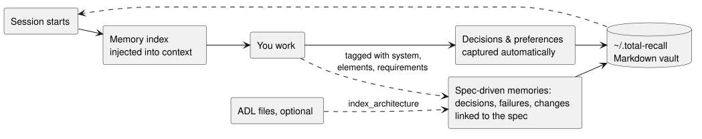

---

## 🧭 C4 Model

### C1 — System context

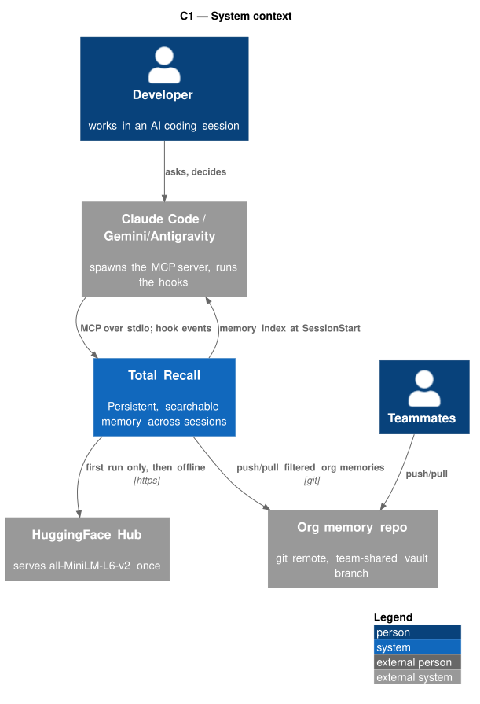

### C2 — Containers

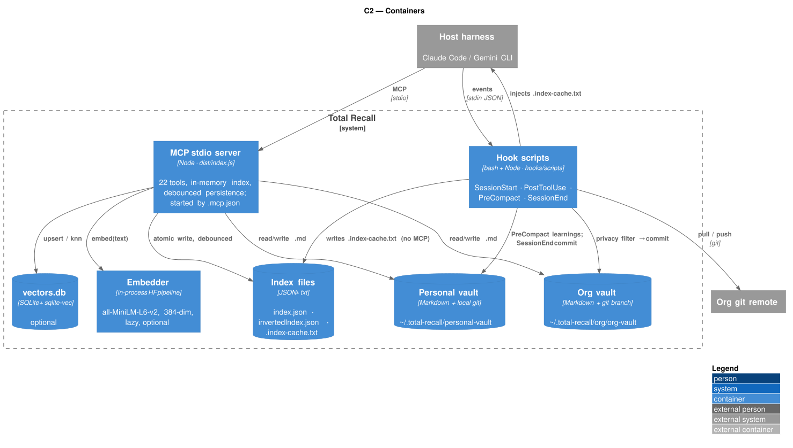

### C3 — Components (MCP server)

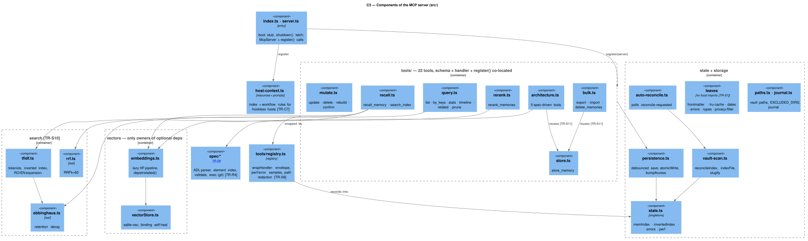

### C4 — Code: `recall_memory`

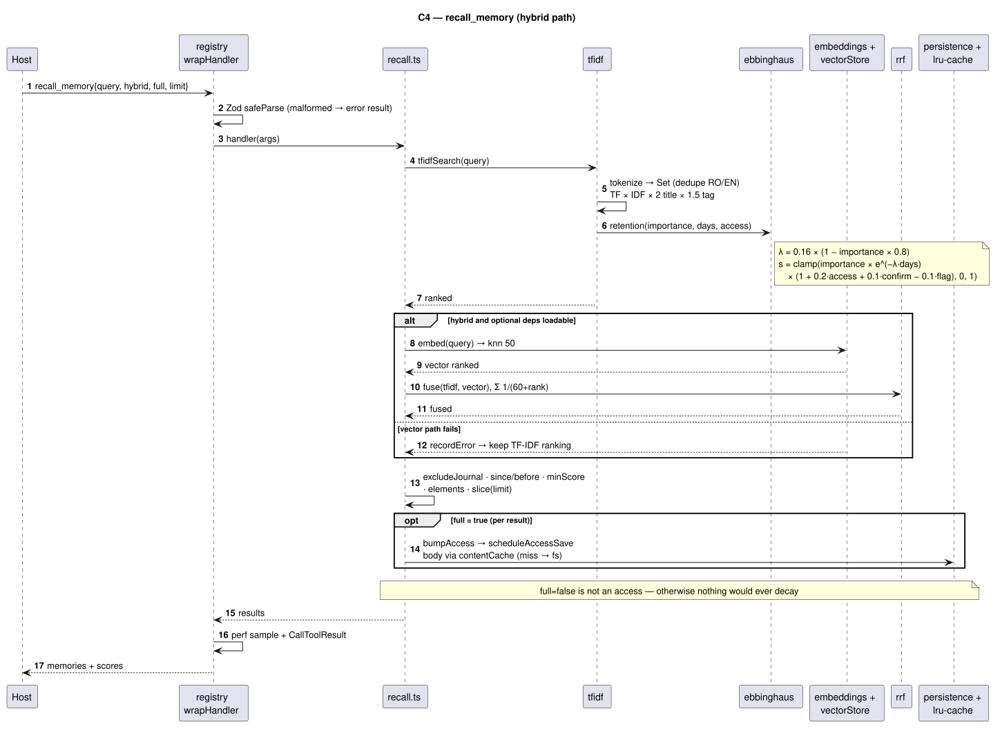

---

## 🛠️ The 22 MCP tools

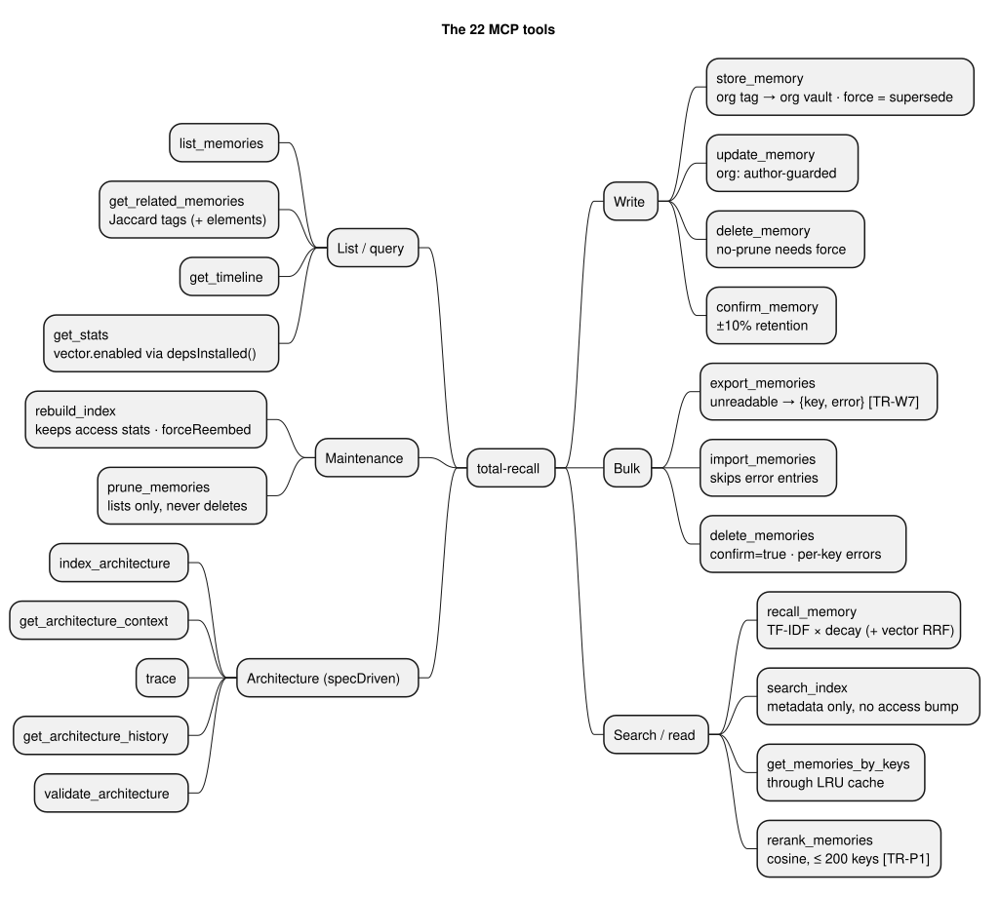

With `specDriven.enabled: false` the 5 architecture tools and the spec fields are not registered: `tools/list` is the 17-tool golden (`schema-parity.integration.test.ts`).

---

## 🧬 Data model

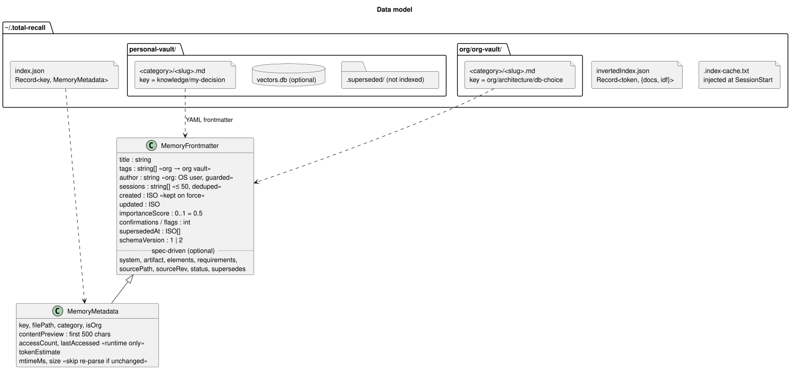

---

## 🔀 Write path

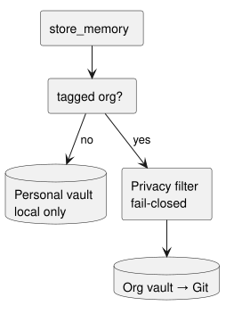

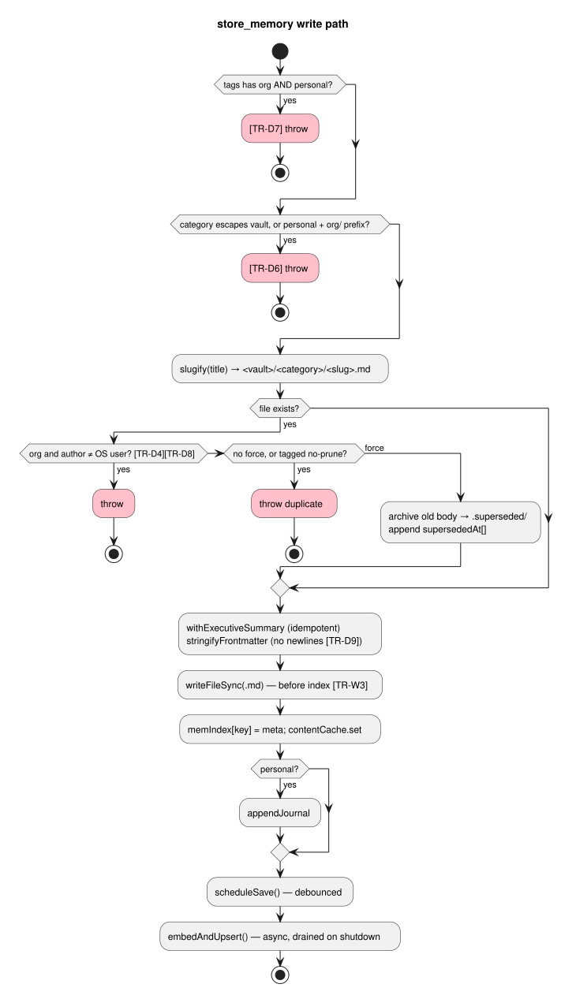

---

## 🚀 Lifecycle and persistence

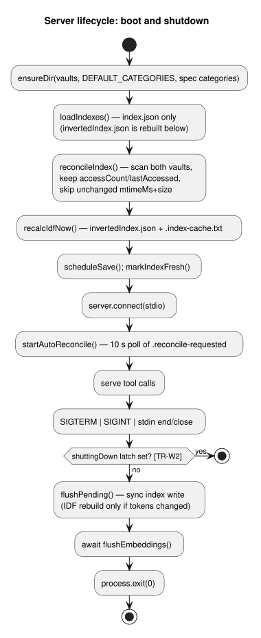

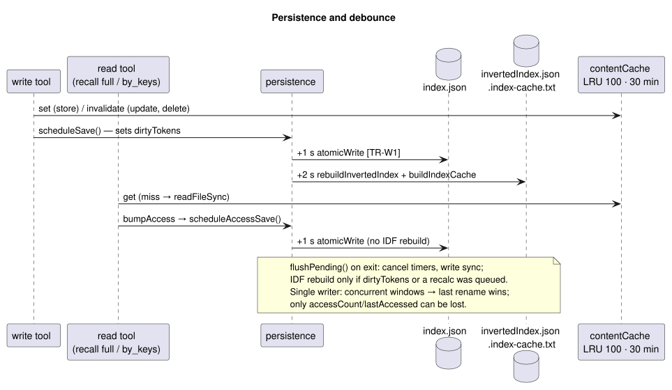

---

## 🪝 Hooks

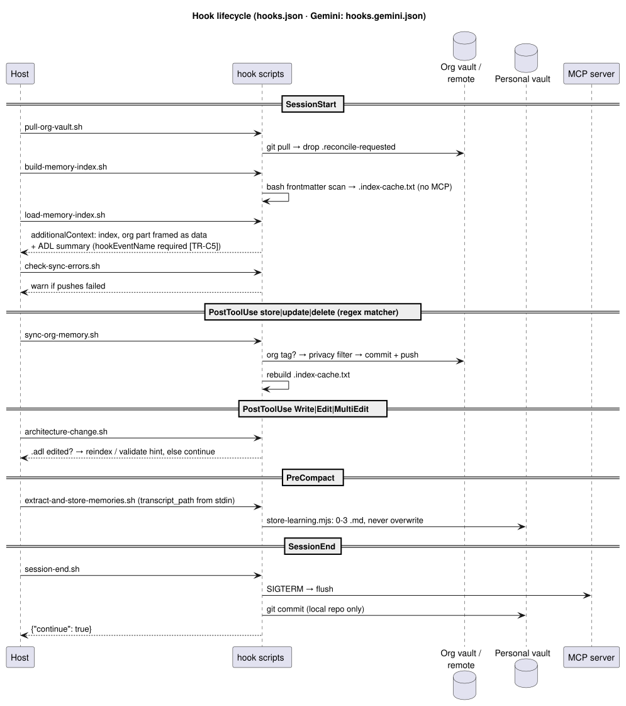

---

## 🔐 Org sync

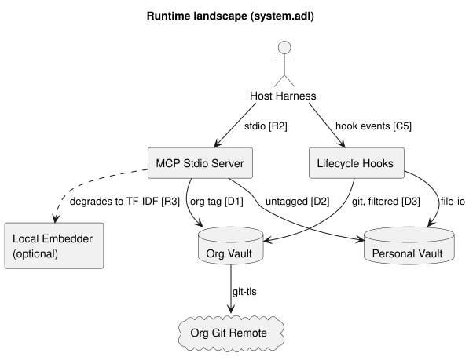

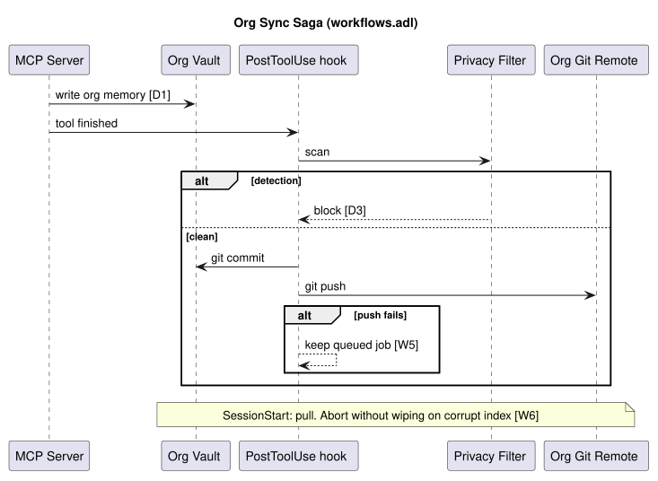

The fail-closed filter blocks secret tokens, emails (except `allowedEmailDomains`), Luhn-valid cards, mod-97 IBANs and formatted phone numbers. The "don't sync" guard is the `personal`/`org` tag exclusion.

---

## 📐 Architecture as code

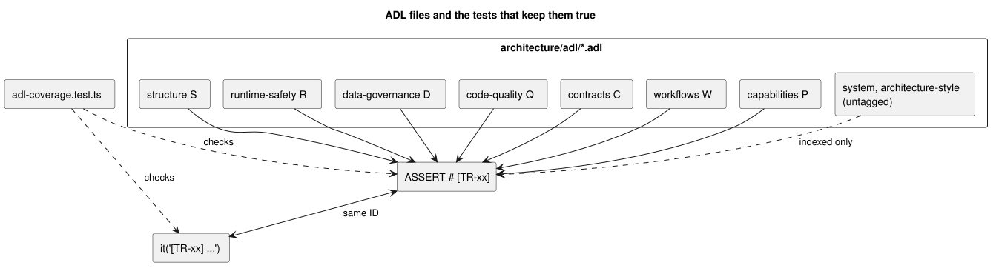

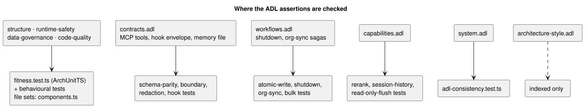

Each `ASSERT` ends with a tag such as `# [TR-S2]`; the test that checks it carries the same tag. `adl-coverage.test.ts` fails on an untested assertion or an unknown ID.

Sources: `architecture/diagrams/*.puml` and `../../docs/diagrams/*.puml`. Re-render: `java -jar plantuml.jar -tsvg architecture/diagrams/*.puml` (add `!pragma layout smetana` when `dot` is absent).

---

## ⚖️ Key invariants

| Invariant | Enforced in |
|---|---|
| One `memIndex` per process | `state.ts` |
| `.md` written before the index `[TR-W3]` | `store.ts` |
| Index files written atomically `[TR-W1]` | `persistence.ts` `atomicWrite()` |
| `accessCount`/`lastAccessed` survive `rebuild_index` `[TR-W4]` | `vault-scan.ts` |
| `shutdown()` runs once `[TR-W2]` | `index.ts` `shuttingDown` latch |
| `org` + `personal` exclusive `[TR-D7]` | `store.ts` |
| Org writes author-protected, caller `author` ignored `[TR-D4]` `[TR-D8]` | `store.ts` |
| `category` cannot escape the vault `[TR-D6]` | `store.ts`, before `ensureDir` |
| Frontmatter values reject newlines `[TR-D9]`; keys escaped before `RegExp` | `frontmatter.ts` |
| Journal only on personal `store_memory` | `store.ts` |
| `sessions` ≤ 50, deduped `[TR-P2]` | `mutate.ts` |
| `rerank_memories` ≤ 200 keys `[TR-P1]` | `rerank.ts` |
| Unreadable export → `{key, error}`, skipped on import `[TR-W7]` | `bulk.ts` |
| Optional deps never bundled | esbuild `--external` |
| SessionStart output carries `hookEventName` `[TR-C5]` | `load-memory-index.sh` |
| PostToolUse matcher stays a regex | `hooks-matcher.test.ts` |
| PreCompact reads `transcript_path` from stdin JSON | `extract-and-store-memories.sh` |
